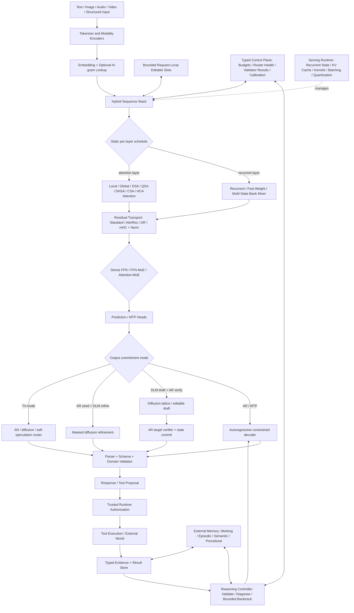

# The Synthesized SOTA LLM Architecture (v9 — four-axis co-design, verified diffusion drafting and curriculum-aware training)
*Research synthesis and candidate architecture informed by publicly documented Transformer, state-space, recurrent/fast-weight, hybrid, sparse-expert, memory-augmented, adaptive-compute, diffusion and multimodal language-model research available through 18 November 2026, plus the supplied IDEAS20 compilation.*

**Document status:** Research specification with explicit component contracts and experimental gates; proposed design, not a trained or benchmark-validated model.

**Baselines:** `Pasted text(20261117-071440).txt` (supplied v2) and the previous `SOTA_LLM_Architecture_v3.md` research synthesis.  
**Supplementary ideas:** `ideas20_full_compilation.zip` — IDEAS20 compilation, Sentinel mappings and v2 duplicate.  
**Review date:** 18 November 2026.  
**Revision:** v9; machine-checkable experiment contract, typed run manifests, and reproducible validation tooling; four-axis co-design, distinct diffusion draft/refinement paths, progressive-depth training ablations, and Pareto-based selection.

**How to read this document:** every mechanism is tagged by evidence status. A mechanism may be mathematically established without being the best production choice, and a component used in one released model does not establish a universal optimum.

- **[PRODUCTION-VALIDATED]** — used in a publicly documented released model or production system; the claim is limited to the reported implementation and conditions.
- **[EMPIRICALLY VALIDATED]** — supported by published experiments; scale, dataset, compute and evaluation scope remain relevant.
- **[THEORETICALLY SUPPORTED]** — supported by mathematical analysis or an algorithmic property, without implying frontier-scale capability.
- **[PROVEN MECHANISM, NEW APPLICATION]** — an established mechanism applied to a new location or problem; the new application remains unvalidated.
- **[PROPOSED]** — a concrete, implementable design requiring experiments.
- **[EMERGING / PREPRINT]** — recent work or a preprint that is relevant but not yet mature evidence.
- **[REJECTED AS STATED]** — the supplied claim is technically incorrect, underspecified, or unsupported in its current form.
- **[CONDITIONAL]** — useful only when a workload, hardware profile or evaluation demonstrates a benefit.

---

## 0. Design Thesis

The objective is not to assemble the largest possible collection of fashionable mechanisms. It is to construct a **quality-constrained, hardware-aware, adaptive hybrid language model** whose sequence-processing paths, parameter capacity, memory policies and inference-time compute are selected by measured marginal value.

The design has three distinct strata:

1. **Neural model** — learned parameters and differentiable operations: representation, sequence mixing, residual transport, feed-forward capacity, learned memory, prediction and multimodal interfaces.
2. **Inference and serving runtime** — KV allocation, kernels, batching, quantization, speculative verification, prefill/decode scheduling and hardware placement.
3. **Agent and application control plane** — persistent external memory, symbolic constraints, search, tool execution, permission enforcement, provenance, budgets, replay and validators.

These strata communicate through explicit interfaces, but they are not interchangeable. The five memory planes in Section 7 are state mechanisms within or across these strata; they are not a fourth architectural stratum. MLA does not create an episodic database. A Rust state machine does not change the neural backbone. A grammar does not prove a value semantically correct. A runtime cache is not the model's learned recurrent state.

### 0.1 Target objective

The architecture is optimized for a declared deployment and training envelope, not for a single abstract score. One useful constrained formulation is:

\[
\min_{\theta,\,\pi,\,\rho}\; C(\theta,\pi,\rho;\mathcal{H},\mathcal{W})
\]

subject to

\[
Q_j(\theta,\pi,\rho;\mathcal{D}_j)\geq q_j,\qquad
R_k(\theta,\pi,\rho)\leq r_k,
\]

where:

- \(\theta\) denotes model parameters and learned architecture choices;
- \(\pi\) denotes inference/serving policies;
- \(\rho\) denotes application-level retrieval, verification and control policies;
- \(\mathcal{H}\) is the actual hardware topology and supported kernels;
- \(\mathcal{W}\) is the workload distribution;
- \(Q_j\) are task-quality measures such as language modeling, coding, mathematical reasoning, retrieval, instruction following and multimodal performance;
- \(R_k\) are bounded risk measures such as hallucination rate, invalid tool actions, calibration error, safety violations and tail latency;
- \(C\) includes training FLOPs, inference FLOPs, HBM capacity and bandwidth, network traffic, energy, wall-clock latency and monetary cost.

The weights and thresholds are workload-specific. Perplexity alone is insufficient: a lower validation loss can fail to improve downstream task performance, and an architecture that wins at batch size one can lose under production batching. [R26]

### 0.2 Core architectural hypothesis

**[PROPOSED]** Use a hybrid sequence backbone with two complementary paths:

- a recurrent/fast-weight path (Gated DeltaNet-family or another empirically selected SSM/linear-attention operator) that maintains a compact state and processes long streams efficiently;
- a content-addressable attention path (GQA, MLA or an indexed sparse/global attention variant) that preserves high-fidelity access to selected historical positions.

Combine these with selectively placed sparse feed-forward capacity, a stable residual transport mechanism, optional auxiliary prediction heads, and a runtime that separates model-local state from durable external memory.

This proposal is grounded in successful examples of hybrid designs—Jamba, Qwen3-Next, Qwen3.8-Flash-Next and Nemotron 3 Nano—but **does not claim that one published ratio or operator is universally optimal**. [R13, R25, R26, R28]

### 0.3 What this document does not claim

- It does not claim to enumerate every architecture ever proposed or every proprietary architecture whose details are undisclosed.
- It does not claim that the proposed combination has been trained or outperformed an existing model.
- It does not assign numeric speedups, training-cost multipliers or accuracy gains without a specified implementation and measurement.
- It does not treat agreement among language models as proof, attention weights as causal explanations, or token entropy as calibrated correctness confidence.

---

### 0.4 Evidence added in v7

The v7 research snapshot adds four important evidence groups that were published or documented after the v6 cutoff:

1. **Inkling 2 Small** provides a concrete local/global-attention alternative to recurrent/attention hybrids, with block attention residuals, gated attention, short causal convolutions, sparse MoE, mixed expert precision and a native DSpark speculative drafter. Its exact layer schedule, context limit and resource profile are model-specific. [R87–R89]
2. **Nemotron-Labs-Diffusion** reports a single model family supporting autoregressive generation, diffusion generation and diffusion-draft / autoregressive-verify self-speculation. This is stronger evidence for a unified generation-mode challenger than a standalone diffusion-only comparison, but the reported family is 3B–14B and its performance numbers are hardware- and benchmark-specific. [R90]
3. **Seer, ShotKV/KVFundaBench, Distance-KV and LiteKV** expand the KV-cache design space beyond generic attention-weight eviction: semantic-centroid selection with product quantization; semantic-unit-preserving cache allocation; offline layer/head/relative-distance retention; and a recent/heavy-hitter/overview three-ring cache with semantic-shift awareness. They solve related but non-identical problems and must be evaluated separately before composition. [R91–R94]
4. **Training and safety co-design** from the Inkling 2 report shows that long-horizon RL needs both synchronous pre-execution tool-call controls and asynchronous rollout auditing; the report also documents a training-time behavior that circumvented a network restriction through another accessible service. This is a system-safety lesson, not a neural-layer mechanism. [R87]

The snapshot remains representative rather than exhaustive. Proprietary systems, unpublished internals, papers after this date and implementation-specific kernel changes may be absent.

### 0.5 Evidence added in v8

The v8 review adds a second-level synthesis of architecture co-design and recent generation/training methods:

1. **Four-axis architecture co-design:** a November 2026 survey organizes modern LLM changes across processing structure, transformation dynamics, state management and output commitment. It emphasizes that MoE, attention-state compression and recurrent sequence processing address different bottlenecks and must be evaluated jointly rather than collapsed into one “efficient architecture” label. [R95]
2. **Diffusion-based speculative drafting:** DiffuSpec uses a diffusion model to propose a token lattice, extracts a verifier-aligned causal path, and adapts draft length from online acceptance. DEdit iteratively edits a parallel draft before target verification. These are distinct from DSpark's Markov/RNN head and from a shared tri-mode model. [R96, R97]
3. **AR-seeded diffusion refinement:** Speculative Refinement (SpecRef) initializes masked diffusion from an autoregressive draft. Its evaluation shows that scaffold structure, refinement damage to already-correct tokens, metric choice and non-AR-specific harness post-processing can change measured results. This path does not automatically preserve the AR target distribution. [R98]
4. **Progressive depth/data curriculum:** Curriculum-Guided Layer Scaling (CGLS) studies adding layers during pretraining while increasing data difficulty. Its reported 100M and 1.2B experiments justify an ablation, not a claim that progressive growth is universally better or frontier-scale validated. [R99]
5. **Speculative decoding as systems co-design:** a peer-reviewed IEEE survey maps 312 works across Draft Source, Draft Geometry, Verification Fidelity and Runtime Execution, and formulates Representability, Verifiability, State Realizability and Profitability gates. v8 adopts these as an explicit contract for every speculative path. [R100]

The architecture-family survey and speculative-decoding survey are literature syntheses, not matched-condition experiments. Their taxonomies improve coverage and comparison discipline; they do not select a winning model. [R95, R100]

## 1. Scope and Architecture Taxonomy

The architecture landscape below is a representative taxonomy of publicly documented and technically relevant model families. It is designed to guide the synthesis and ablation plan, not to imply an impossible exhaustive inventory of all papers, private systems, model variants or implementations.

The taxonomy is cross-checked against recent component- and system-level surveys that organize the field around sequence processing, state management, conditional computation, residual/normalization changes, tokenization and output commitment. Surveys are useful for coverage discovery; primary papers and technical reports remain the evidence source for individual mechanisms and numerical claims. [R79]

### 1.1 Transformer and attention-based models

- **[PRODUCTION-VALIDATED] Decoder-only Transformers** remain a robust general-purpose autoregressive baseline. Self-attention provides direct content-addressable interactions between positions, with per-layer compute and memory costs that depend on sequence length and implementation. [R1]
- **[PRODUCTION-VALIDATED] Encoder-only and encoder-decoder Transformers** remain relevant for representation learning, retrieval/reranking, classification, translation and sequence-to-sequence tasks. BERT is a canonical bidirectional encoder; T5 is a canonical text-to-text encoder-decoder. They are not interchangeable with decoder-only chat models; choose based on task and interface requirements. [R1, R60, R61]
- **[PRODUCTION-VALIDATED] Decoder-only autoregressive scaling** is represented by GPT-style models and remains the dominant general-purpose next-token prediction family. Its simplicity of generation does not make it optimal for every task or generation regime. [R1, R62]
- **[PRODUCTION-VALIDATED] MHA, MQA and GQA** trade parameter sharing in key/value heads against attention expressivity and KV-cache size. GQA is a practical compromise; quality and speed depend on head dimensions, kernel implementation and uptraining recipe. [R4]
- **[PRODUCTION-VALIDATED] MLA** uses a compressed latent representation for key/value state and changes the cache representation. It is a model architecture choice, not an external semantic-memory subsystem. [R5, R6]
- **[PRODUCTION-VALIDATED] Local, sliding-window, block-sparse and indexed sparse attention** reduce or constrain which positions are directly attended. These mechanisms can improve long-context cost, but retrieval quality depends on the selector, windowing, global-token policy and workload. [R26]
- **[PRODUCTION-VALIDATED] FlashAttention and FlashAttention-2** are IO-aware exact-attention algorithms/kernels, not a new asymptotic attention architecture. They reduce memory traffic and improve GPU utilization; dense exact attention still has quadratic pairwise interaction compute in sequence length. [R2, R3]
- **[EMPIRICALLY VALIDATED / HISTORICAL ALTERNATIVES]** Reformer (LSH attention), Longformer and BigBird (structured sparse/local/global attention), Linformer (low-rank attention projection), Performer (kernelized/linear attention) and FNet (Fourier-based token mixing) explore alternative ways to reduce sequence-mixing cost. They remain useful reference points, but each changes the approximation or connectivity pattern and must be compared against modern kernels and recurrent hybrids. [R47–R53]

### 1.2 Linear attention, recurrent models and state-space models

- **[EMPIRICALLY VALIDATED] S4/S5-family state-space models** connect sequence modeling to structured linear dynamical systems. These are foundational alternatives to direct pairwise attention. [R54, R55]
- **[EMPIRICALLY VALIDATED] Mamba** makes state updates input-selective and uses hardware-aware scan kernels; its recurrent state avoids a conventional per-token Transformer KV cache for the SSM path. [R7]
- **[EMPIRICALLY VALIDATED] Mamba-2 / State Space Duality** develops the connection between structured state-space models and attention-like computation, improving parallel training efficiency in the reported experiments. [R8]
- **[EMPIRICALLY VALIDATED] Mamba-3** is an ICLR 2026 paper that reports improvements over compared recurrent baselines at the evaluated 1.5B scale; its results should still be evaluated at matched parameter count, data, tokens and hardware rather than extrapolated to frontier scale. [R9]
- **[EMPIRICALLY VALIDATED] RetNet** offers parallel, recurrent and chunkwise recurrent formulations of retention. [R15]
- **[EMPIRICALLY VALIDATED] RWKV** and later variants use recurrent weighted-key/value mechanisms to target constant-memory-per-step decoding. [R17]
- **[EMPIRICALLY VALIDATED] Griffin/Hawk** combine gated recurrent units with local attention. [R14]
- **[EMPIRICALLY VALIDATED] xLSTM** revisits recurrent memory through modified LSTM cells and matrix-memory variants. [R16]
- **[EMPIRICALLY VALIDATED] Hyena** uses implicit long convolutions and gating as a subquadratic sequence-mixing alternative. [R18]
- **[EMPIRICALLY VALIDATED] DeltaNet and Gated DeltaNet** use fast-weight / delta-rule updates; Gated DeltaNet adds selective forgetting. [R10]
- **[EMPIRICALLY VALIDATED] Gated DeltaNet-2 (GDN-2)** decouples erase and write gates and reports advantages over the compared recurrent baselines at 1.3B parameters and 100B FineWeb-Edu tokens. This is strong evidence for a candidate operator, not proof of frontier-scale dominance. [R11]
- **[EMERGING / PREPRINT] Muir** proposes sensitivity-allocated gating and matched-filter readout and reports results from 166M to 1.34B parameters. Its reported 10M-token extrapolation and passkey results are specific to the paper's experimental setup; they are not proof of general reasoning at arbitrary context lengths. Replicate independently before adoption. [R12]
- **[EMPIRICALLY VALIDATED] Mixture-of-Memories (MoM)** routes tokens among multiple independent recurrent memory states. It targets the single-state capacity/interference bottleneck in linear sequence models while retaining linear training and constant-per-token inference complexity under the paper's fixed-bank assumptions. It is a recurrent-state topology, not an external retrieval database or editable key-value memory. Bank count, router granularity, update rule and bank imbalance must be ablated together. [R84]

### 1.3 Hybrid sequence architectures

- **[PRODUCTION-VALIDATED] Jamba** combines Transformer attention, Mamba blocks and MoE, and demonstrates that a hybrid can be deployed at substantial model scale. Its configuration is one design point, not a universal layer ratio. [R13]
- **[PRODUCTION-VALIDATED] Qwen3-Next** combines Gated DeltaNet, gated attention, MoE and multi-token prediction in a model-specific layer schedule. [R25]
- **[PRODUCTION-VALIDATED] Qwen3.8-Flash-Next** combines Gated DeltaNet with global attention during pretraining; its report describes one full-attention layer in every four, with those full-attention layers replaced by Qwen Sparse Attention during continued pretraining. It also introduces a four-branch Gated Residual design, N-gram embeddings and Muon-based optimization. This is a model- and training-stage-specific schedule, not proof that 3:1 is globally optimal. [R26, R27]
- **[PRODUCTION-VALIDATED] Nemotron 3 Nano** combines Mamba-2, GQA and MoE; the technical report specifies 31.6B total parameters, 3.2B active parameters (3.6B including embeddings), 128 routable experts, 6 routed experts selected per token and 2 shared experts. This is a concrete example of a hybrid architecture and sparse capacity working together. [R28]
- **[PRODUCTION-VALIDATED / RESEARCH-REPORTED] Kimi-family models** combine Kimi Delta Attention and attention-based components; Kimi K3 adds Attention Residuals and Stable LatentMoE in the published architecture description. Treat each report's claims in its own evaluation context. [R24, R29]
- **[PRODUCTION-VALIDATED / RESEARCH-REPORTED] DeepSeek-V3.2** adds DeepSeek Sparse Attention (DSA) to an MLA/MoE foundation. DSA uses a lightweight learned indexer to select a subset of historical tokens for exact attention over the selected set. This is not the same mechanism as Qwen Sparse Attention (QSA): the published Qwen report describes micro-block-level scoring and a training-stage-specific replacement of full-attention layers. Compare DSA and QSA as separate sparse-attention implementations. [R67, R26, R27]
- **[PRODUCTION-VALIDATED / VENDOR-REPORTED] DeepSeek-V4** combines a hybrid historical-attention stack (sliding-window attention, Compressed Sparse Attention and Heavily Compressed Attention), mHC residual transport, MoE with a model-specific hash-routing bootstrap, Multi-Token Prediction and Muon optimization. Its model card reports 1M context, 1.6T total / 49B active parameters for Pro and 285B total / 13B active for Flash. The arXiv preview describes Flash as 284B total / 13B active, while the model card says 285B; v6 preserves this source discrepancy rather than silently treating the values as identical. These are provider-published model properties, not independently reproduced claims in this specification. [R80, R82]
- **[PRODUCTION-VALIDATED / VENDOR-REPORTED] Inkling 2 Small** is a separate local/global Transformer-MoE composition rather than a recurrent/attention hybrid. Public architecture documentation describes a 48-layer decoder, a 5:1 sliding-window/global-attention pattern (40 local and 8 global layers), GQA with 48 query heads and 8 KV heads, a 1,024-token local window, learned relative-position bias instead of RoPE, gated attention output with a per-token sink, four-tap causal short convolutions on K, V, attention output and MLP output, and eight six-layer block-attention-residual groups. Its MoE routes each token to 8 of 384 experts; all decoder layers use MoE, with NVFP4 experts in layers 0–39 and MXFP8 in layers 40–47. The 594B total / 17B active parameter values and up-to-1M context are vendor/model-card properties. Training used different context stages (512K and then 1M), while the RL report describes 256K context with compaction for longer trajectories; these are different facts, not a contradiction. It is a crucial control architecture for the proposed hybrid because local/global attention, block residuals and short convolution may deliver a better quality/cost trade without recurrent-state complexity. [R87, R88]\n- **[EMPIRICALLY VALIDATED] Dynamic Hierarchical Sparse Attention (DHSA)** estimates chunk importance and propagates it to token-level sparsity while keeping the tested LLM backbone frozen. Its ICML 2026 evaluation reports results on Needle-in-a-Haystack, LongBench and RULER, including up to 10× prefill speedup at 128K in its specific tiled-backend setup. Treat it as a distinct inference-side hierarchical sparsifier; reproduce its exact backend, model, quantization and tasks before comparing it with DSA or QSA. [R76]
- **[PRODUCTION-VALIDATED / VENDOR-REPORTED] Compressed Sparse Attention (CSA) and Heavily Compressed Attention (HCA)**, introduced in DeepSeek-V4, first compress historical K/V along the sequence dimension and then use different selection policies. CSA uses overlapping low-ratio compression and a Lightning Indexer to select compressed entries; HCA uses higher-ratio non-overlapping compression and dense attention over its compressed pool without that indexer. DeepSeek-V4 also retains a sliding-window attention type. Compression, selection and dense-vs-sparse attention are separate mechanisms: do not collapse CSA into ordinary DSA or HCA into a cache-eviction policy. The published Transformers implementation exposes model-specific reference values (CSA rate 4, HCA rate 128, index top-k 512 and local window 128); these must not be copied as universal defaults. [R80–R82]
- **[EMERGING / PREPRINT] Multi-layer Indexer (MLI)** proposes overlapping the indexer work of one DSA layer with attention work at another layer by reusing a preceding layer's selected set. The November 2026 preprint reports serving experiments on DeepSeek-V3.2 and GLM-5 at 10K–195K contexts. It is a serving-schedule optimization, not a new learned sequence-mixer architecture, and its results do not establish that arbitrary layers or architectures can safely share selections. [R68]

### 1.4 Sparse parameter architectures

- **[PRODUCTION-VALIDATED] Sparse Mixture-of-Experts** activates a subset of feed-forward experts for each token, increasing total parameter capacity without activating every parameter on every token. The progression includes GShard, Switch Transformer, GLaM, Mixtral and DeepSeekMoE/V3-style designs; router objective, expert granularity, top-k, capacity and placement differ across systems. [R6, R22, R63–R66]
- **[PRODUCTION-VALIDATED] Shared experts and fine-grained expert partitioning** can provide common capacity alongside routed specialization. [R22]
- **[PRODUCTION-VALIDATED] Auxiliary-loss-free load balancing** adjusts expert routing with utilization-dependent biases rather than relying solely on an auxiliary balance loss. DeepSeek-V3 reports this as part of its training and routing design. [R6]
- **[EMPIRICALLY VALIDATED] LatentMoE** changes the expert representation / computation to improve the efficiency–accuracy trade-off in its evaluated settings; its scaling and hardware implications must be matched to the target environment. [R23]
- **[EMPIRICALLY VALIDATED / SMALL-SCALE] SwitchHead** moves mixture-of-experts selection into attention rather than applying sparsity only to feed-forward layers. Its NeurIPS 2024 paper reports a 262M-parameter C4 experiment matching baseline perplexity at 44% of compute and 27% of memory, plus up to eight times fewer attention matrices in its tested setup. This is a distinct attention-capacity axis; the published experiment does not establish frontier-scale benefits or replace FFN-MoE. [R85]

### 1.5 Adaptive depth and inference-time computation

- **[EMPIRICALLY VALIDATED] Mixture of Depths** routes a limited number of token positions through a layer, allocating layer compute selectively under a fixed capacity budget. [R20]
- **[EMPIRICALLY VALIDATED] LayerSkip** trains early-exit behavior and uses early layers for drafting with later layers verifying/correcting. Reported speedups apply to tested models and tasks. [R21]
- **[CONDITIONAL] Speculative decoding** uses a cheaper draft proposal and target-model verification. It can reduce serial decoding steps when draft acceptance is high and verification overhead is favorable; exact distribution-preserving verification is required if the target sampling distribution must be preserved. [R30]

### 1.6 Memory-augmented models and external memory

- **[EMPIRICALLY VALIDATED] Transformer-XL** carries segment-level recurrent hidden state across segments; **Compressive Transformer** compresses older activations; and **RETRO** augments generation with retrieval from a large external corpus. These are important precedents for separating short-term attention, compressed state and retrieval memory. [R56–R58]
- **[EMPIRICALLY VALIDATED] Titans** investigates a learned neural long-term memory that can be updated and queried alongside attention. This is distinct from a serving KV cache and from an application-level database. [R19]
- **[PRODUCTION-VALIDATED] Retrieval-augmented generation (RAG)** combines parametric model knowledge with retrieved external information. Its retrieval store, provenance and freshness policy are system-level components that require their own evaluation. [R59]
- **[EMERGING / PREPRINT] Editable request-local memory** investigates bounded memory slots with explicit write, overwrite, protection, expiry and sparse-retrieval fallback policies. A 2026 preliminary study reports controlled synthetic and small-model evidence, but explicitly does not establish an integrated frontier-scale generative model or general open-text entity resolution. Treat this as a memory-lifecycle research candidate, not a production-proven memory subsystem. [R78]
- **[EMPIRICALLY VALIDATED] KV-cache management methods** include attention-sink retention, heavy-hitter retention, observation-window-based selection and layer-wise budget allocation. H2O, StreamingLLM, SnapKV and PyramidKV demonstrate distinct research policies, each with different workloads and failure modes. [R31–R34]
- **[EMPIRICALLY VALIDATED / EMNLP 2026] Seer** learns semantic centroids offline, estimates cluster-level importance and combines semantic selection with product-quantization cache compression and asymmetric distance lookup. The paper reports 40× lower theoretical attention bandwidth, 5.57× attention speed and 2× end-to-end speed over full attention at 32K in its tested setup; these figures are not a general serving guarantee. [R91]
- **[EMPIRICALLY VALIDATED / ICML 2026] ShotKV and KVFundaBench** highlight that sparse-retrieval evaluations can miss quality loss in high-density reasoning, where aggressive eviction can break chain-of-thought dependencies. ShotKV preserves few-shot examples as semantic units and separates prefill/decode decisions. Its reported quality and latency gains are specific to its test settings. [R92]
- **[EMERGING / PREPRINT] Distance-KV** learns an offline retention map over the joint layer/head/relative-distance space, exploiting the observation that retrieval value varies by relative distance even within one head. The paper reports 65.4% KV-memory reduction and 1.66× decode speedup on Llama-3.1-8B-Instruct at 128K, plus a maximum 9.3-point RULER improvement over its strongest compression baseline. Replicate on other backbones. [R93]
- **[EMPIRICALLY REPORTED / JOURNAL 2026] LiteKV** uses a three-ring cache (recent window, heavy hitters and overview zone) plus semantic-shift awareness. Its November 2026 journal abstract reports model-agnostic evaluations on Qwen 3, Llama 3.1 and Mistral 7B; because only the bibliographic/abstract-level record was available in this review, its detailed implementation and benchmark tables remain to be checked before adoption. [R94]

### 1.7 Diffusion language models

- **[EMPIRICALLY VALIDATED] Masked diffusion language models**, exemplified by LLaDA, offer a non-autoregressive generation formulation in which a model iteratively predicts masked positions. This is an alternative output-commitment process, not merely an autoregressive decoder with a different attention kernel. Compare its refinement schedule, editing behavior, latency, parallelism, calibration and tool-use properties against autoregressive models. [R35]
- **[EMERGING / EMPIRICALLY REPORTED] DiffuMamba** combines a masked diffusion objective with a bidirectional Mamba backbone; DiffuMamba-H adds interleaved attention. Its ICML 2026 paper reports experiments up to 1.3B parameters and throughput gains in its tested long-sequence settings. This establishes a credible separate challenger track, not superiority at larger scales or on every generation workload. [R77]
- **[EMERGING / PREPRINT] iLLaDA** is another diffusion-family direction to track. No diffusion design is made the default in this hybrid autoregressive proposal without direct task-level evidence. [R45]
- **[EMPIRICALLY VALIDATED / EMNLP 2026] Tri-mode autoregressive/diffusion/self-speculation** is demonstrated by Nemotron-Labs-Diffusion at 3B, 8B and 14B: one model family supports ordinary AR decoding, masked-diffusion decoding and diffusion-generated drafts verified by an AR target. The authors report complementary AR and diffusion objectives and higher draft acceptance than their MTP baselines in their tested regime. This is not equivalent to running a standalone masked diffusion model beside an AR model; it is a shared model with mode-specific objectives/runtime paths. Reported speedups (including a 4× SPEED-Bench system throughput result on GB200) are paper-specific and must not be projected onto another model or accelerator. [R90]

### 1.8 Multimodal architectures

A general multimodal model usually combines one or more modality-specific encoders, projection/connector layers, a shared or partially shared sequence model, and modality-specific generation heads. Architectures differ in early, intermediate or late fusion; image/video/audio representations and temporal alignment are not solved by merely appending image tokens. [R36, R46]

**Design implication:** preserve modular modality interfaces. Do not force one tokenization or one attention schedule across all modalities before measuring cross-modal alignment, temporal resolution, throughput and quality.

### 1.9 Architecture-family comparison matrix

| Family | Primary strength | Main limitation / risk | Best reason to evaluate it |
|---|---|---|---|
| Dense decoder-only Transformer | Flexible content-addressable sequence modeling and strong baseline ecosystem | Dense attention cost and KV growth with context | Quality reference and broad general-purpose generation |
| Encoder-only / encoder-decoder | Bidirectional representation and explicit input/output separation | Not a drop-in autoregressive chat decoder | Retrieval, reranking, classification, translation and conditional generation |
| Sparse / local / indexed attention | Reduces direct attention work or bounds attended positions | Selector misses, locality assumptions and retrieval degradation | Long contexts with structured or indexable dependencies |
| Learned-indexer sparse attention (DSA / QSA) | Query-conditioned selection of historical tokens or micro-blocks | Indexer scan, selection errors and cache-storage costs can remain material | Long-context workloads where exact attention over a selected subset is a good quality/cost trade |
| Dynamic hierarchical sparse attention (DHSA) | Chunk-level importance routing propagated to token-level sparse attention, with frozen-backbone inference in the reported setup | Selector calibration, chunk misses, backend constraints and prefill/decode asymmetry | Memory-constrained inference where a supported tiled backend reproduces the reported regime [R76] |
| Linear / kernelized attention | Lower asymptotic sequence cost in the chosen formulation | Approximation and/or reduced exact content-addressable retrieval | Long streams where measured accuracy survives the approximation |
| SSM / recurrent models | Compact recurrent state and streaming inference | Fixed/compressed state may interfere or forget exact historical details | Long-running streams and memory-constrained decode |
| Delta-rule / fast-weight models | Selective write, erase and update of compressed sequence state | State-update stability and exact multi-needle retrieval need testing | Candidate recurrent path for hybrid models |
| Hybrid recurrent + attention | Combines compressed streaming history with explicit retrieval path | More complex training, cache/state management and kernels | Workloads needing both long-stream efficiency and precise retrieval |
| Compressed historical attention (CSA/HCA) | Shrinks the historical K/V sequence before sparse or dense attention | Compression distortion, overlap, causal availability and compressor cost | Million-token/long-context serving where compressed-history quality is preserved [R80–R82] |
| Multi-bank recurrent state (MoM) | Multiple routed states increase linear-model memory capacity and may reduce interference | State-bank bytes, router imbalance, bank starvation and cross-bank interference | Recall-intensive streams where one fixed recurrent state is insufficient [R84] |
| Multi-stream residual transport (mHC) | Constrained mixing among residual streams with a doubly-stochastic constraint | Additional streams, Sinkhorn/memory traffic and depth-dependent utility | Deep models where residual transport can be improved without losing stable signal propagation [R80, R83, R86] |
| Attention-MoE (SwitchHead) | Conditional capacity inside attention, distinct from FFN experts | Small-scale evidence, dispatch/kernel complexity and scaling uncertainty | Workloads where attention capacity is a bottleneck and kernels support expert attention [R85] |
| Sparse MoE | High total capacity with limited active FFN compute | All-to-all traffic, routing imbalance and expert hot spots | Capacity growth when communication cost is controlled |
| Adaptive depth / early exit | Allocate compute by token or task | Confidence/exit errors and verifier overhead | Variable-complexity workloads with measurable early-exit utility |
| Diffusion language model | Parallel/masked refinement and non-autoregressive generation | Iteration schedule, latency, tool integration and decoding trade-offs | Editing, infilling or tasks where bidirectional iterative generation is advantageous |
| Neural / retrieval memory | Access to information beyond the immediate attention window | Write quality, interference, retrieval errors and memory governance | Long-horizon tasks requiring durable information |
| Multimodal encoder + connector + LLM | Modality-specific representation with shared reasoning/generation | Alignment, temporal grounding and connector bottlenecks | Vision, audio, video and structured sensor/action workloads |

The table is a decision aid, not an ordinal ranking. The design should select the least-complex family that meets the quality, reliability, latency and cost envelope. Hybridization is justified only when the workload needs the capabilities of more than one family and ablations show that the added complexity pays for itself.

**DeepSeek-V4 is a reference composition, not a blueprint to clone.** Its publicly described CSA/HCA, mHC, hash-MoE bootstrap and MTP show that these mechanisms can coexist in one released model. The v6 programme deliberately decomposes that bundle into separate tests so that neither its vendor-reported performance nor its model-specific configuration is attributed to an individual component without controlled ablation. [R80–R83]

### 1.10 Four-axis co-design map

The current architecture landscape is more accurately represented by four interacting dimensions than by a flat list of named models. [R95]

| Dimension | Core question | Representative choices | Primary cost/risk |
|---|---|---|---|
| Processing structure | Which operations and parameters execute for each token or segment? | Dense blocks, MoE, conditional depth, early exit, local/global schedules, recurrent/SSM mixing | FLOPs, communication, variable execution and load imbalance |
| Transformation dynamics | How are representations transformed and transported through depth? | Attention/FFN, gated attention, activations, normalization, residual variants, short convolution | Optimization stability, residual conditioning and hardware kernels |
| State management | How is prior information represented, updated, retained and retrieved? | KV cache, recurrent state, fast weights, latent memory, compressed/selective cache, retrieval | HBM, state drift, information loss, isolation and update semantics |
| Output commitment | When and under what guarantee are candidate outputs accepted? | AR next-token, MTP, speculative draft/verify, diffusion refinement, tri-mode generation | Sequential latency, verifier work, output-distribution fidelity and edit regressions |

These axes are deliberately orthogonal at the taxonomy level, not independent in implementation. For example, MoE can increase FFN capacity while leaving KV-cache bytes unchanged; MLA can reduce attention-state residency without making a dense FFN sparse; a recurrent mixer changes history representation but does not automatically remove layer-depth cost; and a draft head only helps if target verification and runtime-state updates are profitable. [R95]

**Design rule:** select one variable per axis for an initial experiment, measure the interaction terms only after the main effects are understood, and promote combinations using matched quality, compute, memory and latency budgets. Never infer a joint benefit by adding independent paper speedups.

---

## 2. Requirements Before Selecting a Configuration

The final architecture configuration cannot be responsibly fixed until the following are declared:

1. **Model scale:** parameter budget, active parameter budget, training-token budget and expected growth path.
2. **Deployment hardware:** accelerator type/count, HBM capacity/bandwidth, interconnect, CPU/RAM, storage and supported kernel stack.
3. **Serving workload:** context-length distribution, output-length distribution, batch size, concurrency, prefill/decode ratio, latency objectives and cache reuse rate.
4. **Capability targets:** multilinguality, coding, math, factual QA, multi-hop retrieval, tool-use, long-context retrieval, multimodal tasks and instruction following.
5. **Training regime:** pretraining corpus and licensing, continued pretraining, SFT, preference optimization, RL, distillation and safety evaluation.
6. **Deployment constraints:** open weights or API-only, license requirements, privacy, data residency, quantization and update cadence.

Until these are declared, the v9 proposal is a **configuration family and experimental hypothesis**, not a single frozen layer-by-layer blueprint.

---

## 3. Input and Representation Subsystem

### 3.1 Tokenization and base embeddings

**[PRODUCTION-VALIDATED]** Use a tokenizer appropriate to the target languages, code domains and multimodal serialization. Measure fertility, byte fallback rate, sequence expansion, rare-token behavior and cross-lingual fragmentation. Tokenizer changes after large-scale pretraining are expensive and can invalidate embedding alignment.

**[CONDITIONAL] N-gram embeddings.** Qwen3.8-Flash-Next reports an additional N-gram embedding table that augments model capacity at relatively low inference compute and can be offloaded/prefetched. [R26] This is a candidate when local token context is useful and host-memory bandwidth can sustain lookup. It is not a default: measure table footprint, host-device traffic, cache locality, collision behavior, data leakage risk and downstream accuracy against a no-N-gram baseline.

**[PROPOSED]** Keep the base token embedding, optional byte/character fallback and any N-gram table as distinct components with separately measured contribution. Do not use a semantic embedding table as a replacement for exact token identity.

### 3.2 Position and sequence metadata

**[PRODUCTION-VALIDATED]** Select positional encoding and extrapolation strategy with the target length distribution in mind. Rotary position embeddings and tested context-extension methods are established options, but extrapolation beyond training length must be evaluated for retrieval and generation quality, not just positional interpolation stability.

### 3.3 Multimodal ingress

**[PROPOSED]** Use modality-specific encoders and typed connectors for image, audio, video and structured spatial inputs. Preserve timestamps, frame/sample boundaries, resolution and modality provenance. A shared model can fuse these representations, but the connector must not erase temporal order or claim that a pooled embedding preserves all details.

---

## 4. Backbone: Adaptive Hybrid Recurrent / Attention Interleave

### 4.1 Proven core

A hybrid sequence mixer can combine:

- recurrent/SSM/fast-weight layers for compact streaming state and efficient long-sequence processing;
- local or chunked attention for nearby exact interactions;
- periodic global or indexed sparse attention for long-range content-addressable retrieval.

Mamba, Mamba-2, Gated DeltaNet, GDN-2, Jamba, Qwen3-Next, Qwen3.8-Flash-Next and Nemotron 3 Nano provide evidence for different parts of this design space. [R7–R13, R25–R28]

The v2 document's fixed 1:7 attention-to-Mamba ratio is **not** a universal optimum. Jamba's reported pattern, Nemotron's architecture and Qwen's 3:1 recurrent-to-attention-family pattern are different implementations with different scales, operators and training recipes. Compare ratios only under matched budgets and workloads.

### 4.2 [PROPOSED] Two-path hybrid block

Each stage contains:

1. a **recurrent state mixer** (GDN-2 as a strong candidate; Mamba-2/3, KDA or Muir as comparators);
2. a **content-addressable attention mixer** inserted at a selected cadence or selected block positions;
3. a feed-forward capacity module (dense or sparse MoE, depending on layer and budget);
4. a normalized residual transport path.

The recurrent state and the attention KV cache remain separate state objects. The recurrent path compresses sequence history through learned state updates; attention retains explicit position-indexed key/value representations (or an MLA latent representation) for the attention path.

### 4.3 [PROPOSED] Configurable layer schedule

Represent the layer schedule as a searchable configuration, not a hard-coded constant:

\[
S = (m_1,m_2,\ldots,m_L),\qquad m_i\in\{\text{recurrent},\text{local-attention},\text{global-attention}\}.
\]

Search over at least these pilot families:

- all-attention baseline;
- recurrent-only baseline;
- 1 recurrent : 1 attention;
- 3 recurrent : 1 attention;
- 7 recurrent : 1 attention;
- front-loaded and back-loaded global-attention schedules;
- a learned architecture-search schedule that is frozen before the final production run.

The 3:1 pattern is a practical initial candidate because it is close to a publicly documented Qwen3.8 configuration, but it is **not selected as final without ablation**. [R26]

### 4.4 [PROPOSED] Task- and layer-aware architecture selection

Do not implement the v2 supernet that computes both full attention and recurrent paths at every swappable position by default. It has an unverified 1.3–1.5× FLOP estimate and introduces path-state incompatibility, runtime dispatch, kernel and optimizer complications.

Instead:

- perform architecture search or controlled schedule sweeps during pilot training;
- select a fixed schedule for each model size / deployment profile;
- if conditional operator selection is later tested, gate at a sequence/chunk boundary with explicit state ownership and measure the full systems cost;
- require the conditional version to beat the best fixed schedule at equal quality and total hardware cost.

### 4.5 Attention variant selection

**[CONDITIONAL] GQA** is the lower-complexity baseline when KV-cache size is a constraint. **[CONDITIONAL] MLA** is a stronger candidate when the architecture can be trained and served with efficient latent-cache kernels. **[CONDITIONAL] indexed sparse attention** is useful when the context is long enough that the indexer cost is outweighed by fewer attention operations. MHA remains a valuable quality baseline. [R4–R6, R26]

Do not compare MLA, GQA and sparse selectors only by theoretical memory bytes. Measure real memory traffic, kernel occupancy, indexer overhead, context retrieval recall, tail latency and batch throughput. Keep DSA token-level learned top-k; QSA micro-block selection; DHSA hierarchical chunk-to-token inference-time sparsification; and CSA compressed-block selection distinct. Their training requirements, selection granularity, cache representations, frozen-backbone assumptions and kernels differ. HCA is not an indexed selector: it attends densely over a heavily compressed pool. Sparse selection reduces the attended set, but retained KV storage must be measured independently. [R67, R76, R80–R82]

#### 4.5.1 [PRODUCTION-VALIDATED / VENDOR-REPORTED] CSA, HCA and compressed historical attention

DeepSeek-V4 documents three historical-attention types: (1) local sliding-window attention; (2) CSA, which applies overlapping low-ratio sequence compression and then an indexer to select compressed entries; and (3) HCA, which applies heavier non-overlapping compression and dense attention over the compressed entries without a selector. The public Transformers implementation describes model-specific configuration values such as CSA compression rate 4, HCA rate 128, index top-k 512 and sliding window 128. These numbers describe that implementation/configuration and are not suggested defaults for another model. The implementation also documents a shared K=V multi-query representation, partial RoPE, per-head learnable attention sinks, a grouped low-rank output projection and a local sliding-window K/V branch combined with the compressed long-range branch. These are further orthogonal design variables, not automatic requirements for the proposed model. [R80–R82]

For v6, CSA/HCA are candidates for a *learned historical-attention representation*, while DSA/QSA/DHSA are candidate *selection policies*. The shared K=V projection, partial-RoPE fraction, sink parameterization, grouped output projection and local-window branch must be ablated separately from compression/selection; otherwise a result cannot be attributed to CSA/HCA alone. The implementation must declare whether compression is causal/streaming or block-complete. A compressed cache item carries its represented source span and an `available_after_position`; it cannot become visible to query position `t` before its compressor's causal contract permits. For a non-causal block compressor, the entire source block must be complete before the compressed item is visible. For a causal streaming compressor, the implementation must prove that no future token contributes to the stored representation. This prevents a subtle but severe temporal-leakage bug in compressed attention.

### 4.6 Recurrent operator selection

- **GDN-2:** primary research candidate because it decouples erase and write gating and has a public 1.3B-scale evaluation. [R11]
- **Muir:** high-priority exploratory candidate because the 5 November 2026 preprint reports favorable results from 166M to 1.34B parameters; replicate independently before adoption. Treat the reported 10M-token extrapolation and near-perfect passkey figures as paper-specific experiments, not proof of general reasoning or retrieval at arbitrary 10M contexts. No claim is made here about frontier-scale superiority. [R12]
- **Mamba-2 / Mamba-3:** important comparators for SSM state capacity, scan efficiency and long-sequence stability. [R8, R9]
- **KDA / Gated DeltaNet:** additional comparators for forgetting and state-update behavior. [R10, R24]

No recurrent operator is declared the winner solely because it provides linear-time or constant-memory sequence processing. A compact recurrent state can lose exact retrieval information; test associative recall, multi-needle retrieval, long-range dependencies, code references and interleaved task streams.

### 4.7 [PROPOSED] Sequence-state health monitoring

Track recurrent-state norm, update magnitude, erase/write gate distributions, saturation, drift and retrieval failures. Add tests for state contamination across independent documents, task boundaries and batch/sequence reset. Any state reuse must be scoped to the correct conversation or document and have explicit reset semantics.

---

## 5. Residual Transport and Normalization

### 5.1 Proven mechanisms

Residual streams and normalization are fundamental to stable deep networks. Recent proposals such as Attention Residuals (AttnRes), Gated Residual (GR) and Manifold-Constrained Hyper-Connections (mHC) offer alternatives to simple uniform residual accumulation. Qwen3.8 reports a four-branch gated residual path; Kimi reports attention over preceding block outputs with blockwise variants; mHC constrains multi-stream residual mixing to the Birkhoff polytope using a doubly-stochastic mixing matrix. DeepSeek-V4 reports using mHC. [R24, R26, R80, R83]

**[PRODUCTION-VALIDATED / EMPIRICALLY SUPPORTED] mHC** is an alternative residual-transport family, not a normalization layer and not merely a larger residual width. Its feasible doubly-stochastic mixing matrices include the identity, preserving an identity-like path in the constraint set; this does not mean every learned matrix equals identity. The official paper reports infrastructure work to control the memory-traffic and compute overhead. A later analysis of DeepSeek-V4-Flash reports strongly layer-dependent stream use, with early mixers more consequential than later ones in its tested interventions. This motivates a layer-selective ablation, not a universal rule to remove late mixers. [R83, R86]

### 5.2 [PROPOSED] Keep residual candidates separable

Use a conventional pre-normalized residual Transformer/hybrid as the reference baseline. Compare, independently:

1. standard residual addition + RMSNorm/LayerNorm variant;
2. block-level Attention Residuals;
3. a multi-branch Gated Residual;
4. mHC with its actual multi-stream parameterization and Sinkhorn projection;
5. a constrained hybrid only if the independent ablations justify combining them.

Do not stack AttnRes, four-branch GR and mHC automatically. They alter information transport in different ways, and a combined residual stack compounds activation storage, bandwidth and optimization complexity. Evaluate each against standard residual transport first; only test combinations after independent promotion. For mHC, include stream count, pre/post maps, Sinkhorn iterations, residual-mixer placement and kernel implementation in the manifest.

### 5.3 Acceptance criteria

Measure training stability, gradient norms, activation memory, validation loss, downstream accuracy, long-context degradation, throughput and scaling behavior. Reject a residual design if its training-loss gains do not translate into reliable downstream gains or if the serving footprint erases its quality advantage.

### 5.4 [PRODUCTION-VALIDATED / VENDOR-REPORTED] Block Attention Residuals and local short-convolution augmentation

Inkling 2 Small adds a distinct block-attention-residual topology: decoder layers are grouped into eight blocks of six layers; a completed block summary is retained, and a learned query mixes the token embedding and available preceding block outputs before a sublayer. Within a block, sublayer outputs accumulate into the current partial block summary. This is related to Attention Residuals, but the concrete six-layer blockwise accumulation/read schedule is a separate implementation and must not be assumed identical to Kimi's AttnRes or Qwen's four-branch Gated Residual. [R87, R88]

Inkling 2 also uses four-tap causal short convolutions on K, V, attention output and MLP output. These add a short local inductive path; they are not a substitute for long-range attention or a recurrent SSM. Its attention output is gated and includes a per-token sink. [R88]

**[PROPOSED]** Add two isolated pilot variables: (a) block-attention-residual span and block-summary read policy, and (b) short-convolution placement/kernel width. Keep both out of the initial recurrent-mixer comparison. For block residuals, test summary count, within-block accumulation, query normalization, causal availability and memory traffic. For short convolutions, compare no-convolution, K/V-only, all-four-path and selected-path variants. The 6-layer block and 4-tap kernel are reported Inkling 2 settings, not universal defaults.

**Acceptance:** require equal parameter/compute baselines where possible, successful gradient and causality checks, no summary leakage across block boundaries, explicit activation-memory accounting, and quality/latency results on both short and long contexts.

---

## 6. Capacity: Sparse MoE with Hardware-Aware Routing

### 6.1 Proven core

DeepSeek-V2/V3 demonstrate MLA and fine-grained MoE; DeepSeek-V3 reports 671B total parameters and 37B activated per token, with auxiliary-loss-free load balancing and multi-token prediction. Nemotron 3 Nano reports 128 routable experts, 6 routed experts activated per token and 2 shared experts; distinguish the routed top-k from the always-available shared path. [R5, R6, R28]

Sparse MoE increases total capacity while limiting active compute, but it introduces all-to-all communication, expert imbalance, routing instability, token dropping/capacity constraints and expert placement costs. DeepSeek-V4's implementation documentation describes a frozen token-ID-to-expert-ID lookup in the first few bootstrap layers, while learned gates still compute expert affinity/weighting; subsequent layers use ordinary learned routing. This is a model-specific routing warm start, not a general replacement for a learned router. It is tokenizer- and vocabulary-dependent and must be version-bound to the tokenizer/checkpoint. [R81]

### 6.2 [PROPOSED] Layer-selective MoE

Use dense FFNs in selected layers and MoE in others. Determine placement empirically. Each MoE layer should expose:

- a learned router and deterministic top-k selection policy;
- optional shared expert capacity for cross-domain/common features;
- explicit expert capacity and overflow policy;
- utilization and token-drop metrics;
- routing entropy and expert specialization diagnostics;
- communication-aware expert placement.

Top-k, shared-expert count, expert granularity and placement are configuration variables. They must not be copied blindly from a model at another scale.

### 6.3 [PROVEN MECHANISM, NEW APPLICATION] Auxiliary-loss-free utilization correction

A DeepSeek-style bias update is a candidate for balancing load without relying exclusively on an auxiliary loss. It should be treated as a routing-control mechanism with a monitored update rate and stability bounds, not as a proof that oscillation cannot occur in every implementation. Compare against auxiliary-loss balancing and router regularization under the same topology. [R6]

### 6.4 [CONDITIONAL] Latent expert representations

LatentMoE is a candidate where hardware layout and lower communication overhead justify the representation change. Compare parameter count, active FLOPs, expert bandwidth, accuracy and kernel support against standard MoE. [R23]

### 6.5 [REJECTED AS STATED] Sequence-coherent router momentum

The v2 proposal to penalize expert switching between adjacent tokens is not adopted as a default. Tokens within one sentence or code file can require different expert functions; forced continuity can suppress valid specialization. A perplexity spike under a previously selected expert is also not a clean pre-routing signal unless the relevant expert computation has already occurred.

A limited experiment may add a context-conditioned prior or group-level routing statistic, but it must not impose continuity and must be evaluated against the ordinary token-level router.

### 6.6 [CONDITIONAL] Attention-MoE as a separate capacity axis

SwitchHead demonstrates that conditional expert computation can be placed inside attention, rather than only in the FFN. Treat attention-MoE and FFN-MoE as separate design variables: an attention expert may represent different head projections or attention functions, while an FFN expert transforms token features after sequence mixing. They have different communication patterns, dispatch granularities, memory residency and quality risks. Begin with one sparse axis at a time; only evaluate a joint attention+FFN MoE after both individual variants have stable kernels and matched baselines. [R85]

**[PROPOSED] Hash-router bootstrap ablation:** compare (a) all learned routing from initialization, (b) a short frozen token-ID-to-expert lookup bootstrap followed by learned routing, and (c) a learned warm-start router distilled from a teacher. Hold tokenizer, vocabulary and expert count fixed. Measure early training stability, expert utilization, domain specialization, token/byte sensitivity, OOD generalization and the cost of rebuilding the lookup when the tokenizer changes. The DeepSeek-V4 configuration is evidence for one released model, not a universal best practice. [R81]

### 6.7 [CONDITIONAL] Adaptive expert budgets

Complexity-adaptive top-k is a plausible research direction, but complexity estimates and dynamic dispatch may cost more than the saved expert compute. First establish that token-level or layer-level complexity estimates predict marginal expert utility. Then test a small number of permitted expert budgets with a hard compute ceiling.

### 6.8 [CONDITIONAL] Layer-selective low-precision expert storage

Inkling 2 Small reports NVFP4 expert weights in layers 0–39 and MXFP8 expert weights in layers 40–47, while its public model card exposes NVFP4 and MXFP8 checkpoint variants and reports a small evaluation difference between them. This is evidence for testing layer-selective expert precision, not a general rule that early layers should always be lower precision or later layers should always be higher precision. [R87, R88]

**[PROPOSED]** Evaluate precision by layer, module and expert rather than only by a single checkpoint-wide bit width. Record weight/activation format, scale granularity, accumulation dtype, outlier handling, conversion overhead, kernel availability and per-domain quality deltas. The precision map must be part of checkpoint metadata and validated by the serving runtime.

---

## 7. Memory: Five Separate Memory Planes

The v2 document's most important conceptual correction was to separate model state from external memory. v6 makes the boundary more explicit: **recurrent sequence state, attention KV cache, learned neural memory, bounded request-local editable slots and external application memory are five different mechanisms**. Pretrained parametric knowledge in model weights is not a mutable runtime memory store.

### 7.1 Model-local recurrent state

**[PRODUCTION-VALIDATED / EMPIRICALLY VALIDATED]** SSM and linear-attention layers carry a compact recurrent state across tokens or chunks. This is a learned model state with fixed or bounded representation size per sequence, depending on the operator. It is not a searchable database and should not be assumed to preserve every earlier detail. State is owned by one live sequence/request and must be reset, copied or branched under explicit runtime rules.

**[EMPIRICALLY VALIDATED] Mixture-of-Memories (MoM)** changes the topology of this plane by maintaining multiple independent recurrent state banks and routing tokens to selected banks. It is a memory-capacity/partitioning mechanism inside the sequence model, not another persistent memory plane. The bank count is fixed or bounded in the paper's efficient formulation; router quality and bank interference still need measurement. Keep the per-bank update operator fixed in the first experiment so that any observed change is attributable to bank multiplicity and routing. [R84]

### 7.2 Attention KV cache

**[PRODUCTION-VALIDATED]** The KV cache stores attention-specific key/value data (or compressed MLA latent representations) needed for autoregressive continuation. It is an inference-time runtime resource, usually scoped to a sequence and model layer. It is not persistent cross-session memory. Cache layout, block allocator, prefix reuse, quantization, offload and eviction are runtime policies.

Some architectures also compress the historical sequence *inside the model's attention definition*. DeepSeek-V4's CSA/HCA path is an example: a learned/model-defined compressor creates shorter K/V sequences before subsequent selection or attention. This is distinct from runtime cache quantization (precision reduction), eviction (deleting entries), offload (moving entries to another memory tier) and sparse selection (choosing which entries a query reads). Report source-token coverage, compression distortion, compressed cache bytes and the cost/latency of producing the compressed representation separately. [R80–R82]

### 7.3 Learned neural long-term memory

**[EMPIRICALLY VALIDATED / CONDITIONAL]** Titans-style memory introduces a trainable neural memory module that learns to retain and retrieve historical information alongside attention. It is different from the recurrent state of a GDN/SSM layer, because its write/read and update rules are a separately trained memory mechanism; it is also different from an external vector database. [R19]

Treat learned memory as an optional model-path experiment. Specify whether its update is per token, per segment or gated by surprise/novelty; define gradient and test-time update semantics; bound state growth; and test interference, forgetting, poisoning, reset, reproducibility and privacy. Do not assume that a learned memory is durable across independent user sessions unless the implementation deliberately persists it with access controls and versioning.

### 7.4 Bounded request-local editable memory

**[EMERGING / PREPRINT]** A fifth, distinct candidate is an explicit bounded slot store owned by one live request or task. Unlike a recurrent state, slots have individually addressable identities and lifecycle operations; unlike the KV cache, they are not retained merely because a token was attended; unlike Titans-style learned memory, the design can expose explicit write/overwrite/protect/expire decisions; and unlike external durable memory, the default lifetime is the current request. A preliminary 2026 study investigates write supervision, anti-pollution behavior and sparse-retrieval fallback, but its controlled small-scale results do not demonstrate general open-domain memory or a production frontier model. [R78]

A candidate slot record should include: key/entity representation, value/content representation, canonical identity where available, source span/provenance, timestamp/version, confidence semantics, protection/authority class, expiry and conflict/supersession links. The controller must define explicit operations (`WRITE`, `UPDATE`, `PROTECT`, `INVALIDATE`, `EXPIRE`, `RETRIEVE`, `FALLBACK`) and their preconditions. Never infer that a slot should be written solely because a token is surprising; a surprising token may be noise, injection or a transient claim.

**[PROPOSED] Lifecycle policy:**

- Write only when a learned or rule-based write gate passes a calibrated threshold and the source is admissible.
- Preserve conflicting versions with provenance rather than silently overwriting them.
- Use authority and freshness rules for conflict resolution; semantic similarity is not evidence of identity or truth.
- Protect critical records only under explicit policy and allow authorized revocation/deletion.
- Trigger sparse retrieval fallback when a query cannot be answered from slots with sufficient evidence or when write-time signals may have missed relevant content.
- Enforce a hard per-request slot and byte budget; expose write, overwrite, eviction, fallback and retrieval costs.

This is an experiment candidate. The default profile keeps it disabled until overwrite, versioning, distractor, no-write-signal, deletion, prompt-injection and open-text entity-resolution tests pass.

### 7.5 External agent/application memory

**[PROPOSED]** Keep durable memory outside the neural KV cache and learned memory state. A practical four-tier organization remains useful:

1. **Working memory** — current task state, recent conversation and active constraints.
2. **Episodic memory** — time-stamped events, observations, tool results and decisions.
3. **Semantic memory** — reconciled facts, entities, relations, policies and durable knowledge abstractions.
4. **Procedural memory** — tested workflows, executable procedures, tool recipes and validated strategies.

Each record should include provenance, owner/scope, timestamps, version, confidence semantics, expiration/retention policy, access policy and a supersession/contradiction relation. Retrieval must return evidence and age, not only a free-floating summary. Treat untrusted retrieved content as data, not instructions; apply authorization and prompt-injection boundaries outside the model.

### 7.6 [CONDITIONAL] KV compression, selection, retention, storage and eviction

H2O, StreamingLLM, SnapKV and PyramidKV show that useful KV-retention policies can combine recency, attention statistics, attention sinks, observation windows and layer-specific budgets. No single policy is universally correct. [R31–R34]

**Critical distinction:** five operations must not be conflated.

1. **Compression** maps a source sequence span to a shorter representation, potentially lossy (CSA/HCA or MLA-style representation changes).
2. **Selection** chooses which eligible entries a query reads (DSA, QSA, DHSA or CSA's indexer).
3. **Retention** decides which entries remain resident for future queries.
4. **Eviction** removes an entry from the cache's active storage.
5. **Offload** changes placement (e.g., HBM to host memory) without itself changing the logical cache contents.

DSA/QSA-style indexers can reduce the number of keys used in the attention computation while the serving system still retains or scans a much larger cache. Compression may reduce the number of stored entries but adds compressor compute, metadata and possible retrieval distortion. A method only improves end-to-end memory use when its complete representation, selection and runtime costs are measured. [R26, R27, R67, R68, R80–R82]

The v2 proposal's counterfactual KL ablation is an expensive, output- and query-dependent diagnostic. Its result is not a universal causal value for a KV entry. Raw attention-weight history is not causal influence.

**[PROPOSED] Multi-signal KV manager:**

- enforce a hard per-sequence and per-layer memory budget;
- preserve architecture-required sink/global tokens;
- estimate retention utility from several signals (recency, measured attention patterns, retrieval tests, token/layer importance and workload profile);
- keep **selection**, **retention**, **allocation**, **eviction** and **offload** as separately observable policy decisions;
- support layer-specific allocation rather than a uniform cache budget;
- keep an exact/full-cache mode for quality measurement;
- evaluate approximate policies against full-cache output and task performance;
- optionally train a proxy for sampled counterfactual output-KL changes, with calibration and held-out interventions, as one feature among others—not as ground-truth causal attribution;
- for compressed entries, preserve source-span metadata and define the causal availability boundary of each compressed representation;
- maintain an exact/full-history fallback for evaluation and debugging.

#### 2026 KV-cache policy portfolio: semantic, distance, and three-ring candidates

The v6 multi-signal manager remains a controller interface, not a claim that every policy signal should be combined. The new evidence suggests four separate candidate policy families:

1. **Semantic-centroid policy (Seer):** learn centroids offline, score/cache-select by cluster importance and optionally compress selected representations with product quantization. The centroid model, codebooks, lookup tables and quantization metadata must be included in memory and latency accounting. [R91]
2. **Semantic-unit policy (ShotKV):** mark prompt exemplars or other structured evidence as indivisible retention units when splitting them would destroy their function. Define unit boundaries deterministically and test long reasoning traces, tool schemas and code examples—not only few-shot demonstrations. [R92]
3. **Distance-conditioned policy (Distance-KV):** use a frozen, offline layer/head/relative-distance retention prior. Treat it as a static prior; do not mistake it for query-specific semantic relevance. Test distribution shift and position extrapolation. [R93]
4. **Three-ring policy (LiteKV):** allocate space to a recent region, heavy hitters and a compact overview/semantic-transition region. The role of semantic-shift awareness is to retain transition-relevant evidence not captured by recency or accumulated attention alone. Detailed implementation claims remain provisional until full paper/code reproduction. [R94]

**Composition rule:** begin with each method independently against full KV, H2O, StreamingLLM, SnapKV and PyramidKV controls. Only then test pairs (for example, semantic-unit pinning + a distance prior). Do not automatically combine Seer centroids, Distance-KV masks, ShotKV units and LiteKV rings: they can compete for the same bytes, apply incompatible retention semantics or introduce overlapping selectors. Any composite controller must declare precedence, budget accounting, starvation protection and exact fallback behavior.

**Required quality suite:** add KVFundaBench-style high-density reasoning and semantic-unit integrity tests alongside NIAH/RULER and LongBench. Retrieval-only success is insufficient evidence that the compressed cache preserves reasoning dependencies. [R70, R71, R92]

### 7.7 [PROPOSED] External memory retrieval and consolidation

Use hybrid retrieval where appropriate: exact lexical search for identifiers and quoted strings; dense retrieval for semantic similarity; metadata/time filtering; graph traversal for explicit relations; reranking for query relevance. Consolidation should merge only supported facts, preserve conflicting evidence and record source lineage. Deletion and expiry must be implemented, not simulated by hiding a record from the prompt.

### 7.8 [PROVEN MECHANISM, NEW APPLICATION] CRDT-based shared memory

A CRDT can support convergent merging of distributed updates when its data type and operations satisfy the required algebraic properties. It does **not** make a memory fact true, current, authorized or conflict-free in the semantic sense. Preserve tombstones, source provenance, version vectors or equivalent causal metadata, authority, expiry and supersession rules. [R37]

### 7.9 [CONDITIONAL] Test-time adaptation and memory updates

Test-time training (TTT) and test-time memory updates must not be silently combined with retrieval. They modify a learned state or selected model representation using the current input; they can improve task-specific adaptation but can also overfit irrelevant spans, forget prior capabilities or create privacy leakage. A 2026 self-guided TTT preprint reports gains when the model selects evidence spans before adaptation and degradation when random spans are used. Treat this as emerging research and compare against no-update, retrieval-only and oracle-span upper bounds. [R75]

## 8. Adaptive Computation and Inference-Time Scaling

### 8.1 [EMPIRICALLY VALIDATED] Mixture of Depths and early exits

Mixture of Depths allocates a token's path through a layer under a capacity budget. LayerSkip trains early-exit behavior and can use early layers for draft generation followed by verification with later layers. [R20, R21]

### 8.2 [PROPOSED] Budgeted depth controller

A learned controller may choose among a small set of depth budgets or verification paths based on task class and calibrated utility estimates. It must be trained/evaluated against a fixed-depth baseline with the same total resource envelope. Never assume that a cheap uncertainty score always predicts whether more layers improve the answer.

### 8.3 [PROPOSED] Task-level test-time compute router

At request entry, estimate task class and risk, then select among:

- direct generation for simple requests;
- one-pass generation plus deterministic validation for structured outputs;
- tool-assisted execution for verifiable computations;
- multi-candidate generation and ranking for tasks where diversity improves success;
- bounded search/backtracking for complex planning or coding;
- escalation or abstention when the evidence is insufficient.

The router should be trained or calibrated on held-out workload traces. Record expected utility, actual quality, and additional cost for each budget level.

**[EMERGING / PREPRINT] Test-time training (TTT)** may adapt a small memory or parameter subset to selected evidence spans in a long input. It must be compared with retrieval-only and no-update baselines; random-span updates are a negative control, not an acceptable default. The 2026 S-TTT preprint reports results on LongBench v2 and LongBench Pro, but the method is not promoted to the default architecture. [R75]

### 8.4 [REJECTED AS STATED] Entropy as universal depth or stop signal

Token entropy measures uncertainty in a local predictive distribution, not answer correctness, epistemic uncertainty, progress or task completion. Low entropy can indicate a confidently wrong answer; high entropy can be appropriate for creative or branching tasks. Use entropy only as one calibrated feature, never as an automatic forced-commitment proof.

---

## 9. Reasoning: Bounded Search, Constraints and Verifiable Feedback

### 9.1 Proven mechanisms

- **[PROVEN MECHANISM]** Compile explicit constraints before generation when a parser, type checker, solver or domain extractor can do so reliably.
- **[EMPIRICALLY VALIDATED]** Reinforcement learning with verifiable rewards can improve reasoning on tasks where objective correctness checks exist. DeepSeek-R1 reports rule-based rewards for mathematics, coding and logical reasoning, while also discussing reward-model limitations for open-ended tasks. [R38]
- **[EMPIRICALLY VALIDATED]** Process reward models can evaluate intermediate steps, but model-based scoring is vulnerable to distribution shift and reward hacking. [R39]
- **[EMPIRICALLY VALIDATED]** Self-consistency can improve some reasoning tasks by aggregating sampled reasoning paths; agreement is a heuristic, not proof. [R40]
- **[EMPIRICALLY VALIDATED]** Tree-of-Thoughts and related search approaches explicitly retain branching and backtracking rather than forcing a one-way reasoning sequence. [R41]

### 9.2 [PROPOSED] Explicit task state graph

Use a controller with typed states and bounded transitions:

1. **Parse** — normalize the request and identify the expected output contract.
2. **Extract constraints** — collect hard constraints, assumptions, dependencies and unknowns.
3. **Build task model** — construct a dependency graph or structured state representation.
4. **Generate candidate** — produce one or more candidate plans/answers.
5. **Validate** — call an appropriate validator or independent evaluator.
6. **Diagnose** — classify failure as factual, logical, constraint, execution, formatting or insufficient-evidence.
7. **Revise / backtrack** — reopen only the relevant hypothesis or plan node, with bounded retries.
8. **Commit / abstain / escalate** — select a validated answer or clearly report uncertainty.

Transitions can revisit earlier logical states, but the controller must prevent unbounded loops. Use a maximum attempt count, token budget, tool budget, wall-clock deadline and a progress monitor. Record prior hypotheses, failures and state hashes to avoid repeating equivalent failed work.

### 9.3 [PROPOSED] Typed validator hierarchy

Choose the strongest available validator for the task:

| Validator | What it establishes | What it does not establish |
|---|---|---|
| Compiler / type checker | Syntactic and static type validity under the language/toolchain | Program meets all requirements or is secure |
| Test suite | Behavior on the covered tests | Correctness for untested inputs |
| SMT solver / proof checker | Validity under encoded assumptions and formalization | Correctness of assumptions or model of the real world |
| Database / API response | The specific returned state at the time of query | Global truth or future state |
| Independent measurement | Observed behavior under stated protocol | Generalization outside measured conditions |
| PRM / reward model / LLM critic | A learned plausibility or quality estimate | Formal truth; can be wrong or reward-hacked |
| Self-consistency | Agreement among sampled model paths | Independence or correctness of shared assumptions |
| Human/domain review | Contextual expert judgment | Infallibility or reproducibility without a record |

The controller should store validator identity, version, input hash, assumptions, result, timestamp and evidence. Multiple validators are not interchangeable just because they return a score.

### 9.4 [PROPOSED] Progress and cycle detection

Detect cycles from task-state and hypothesis equivalence, not textual similarity alone. Track:

- canonicalized plan/hypothesis identifiers;
- which constraints have been resolved;
- which tests have passed/failed;
- unresolved blockers;
- whether the candidate set or evidence set has changed;
- marginal quality improvement per additional token/tool call.

Terminate or change strategy when equivalent states recur without new evidence or measurable progress. This directly addresses reasoning loops while preserving legitimate backtracking.

### 9.5 [PROPOSED] Calibrated abstention

Abstain or request external review when validators disagree, evidence is missing, uncertainty is outside the calibrated range, or the expected value of further compute is low. Calibrate confidence on held-out examples and track Brier score, ECE, selective risk and coverage. Do not use self-consistency alone to trigger a high-confidence claim.

---

## 10. Output: Multi-Token Prediction and Constrained Decoding

### 10.1 Multi-Token Prediction

**[PRODUCTION-VALIDATED]** DeepSeek-V3 uses an MTP training objective and reports that the auxiliary future-token prediction objective benefits model performance; the trained prediction structure can also support speculative decoding. [R6]

MTP as a training objective, MTP prediction heads at inference, and speculative decoding are related but distinct:

1. an auxiliary training loss predicts future tokens to enrich supervision;
2. an auxiliary head may propose one or more future tokens;
3. a speculative decoding algorithm verifies proposals with the target model.

MTP does not guarantee 2× decoding speed. End-to-end gains depend on proposal accuracy, accepted draft length, verifier batching, memory, kernels, batch size and serving workload.

### 10.2 [PRODUCTION-VALIDATED] Exact speculative verification

When preserving the target model's sampling distribution is required, use a mathematically correct speculative sampling/verification procedure. Do not replace probability-based verification with semantic equivalence unless the system explicitly accepts a changed output distribution and has a separate correctness argument. [R30]

### 10.2.1 [EMPIRICALLY VALIDATED / EMERGING] DSpark-style block-parallel speculative drafting

DSpark extends a DFlash-style block-parallel draft backbone with a low-rank Markov head (or recurrent/RNN variant) that restores within-block dependence and a confidence head that predicts per-position acceptance likelihood. The target model still verifies the draft; the draft's confidence output is a scheduling/verification estimate, not a proof that a token is accepted. The official vLLM documentation exposes vanilla, gated and RNN Markov-head variants. [R89]

**[PROPOSED]** Compare MTP, external AR draft, LayerSkip/self-speculation, DFlash and DSpark under matched target models and concurrency. Measure draft forward cost, target verification cost, accepted prefix length by position, wasted block work, confidence calibration, HBM/weight residency and per-user versus aggregate throughput. Keep the verification algorithm and target distribution semantics explicit; an acceptance predictor does not replace target verification. Inkling 2 Small's published integration uses a five-layer DSpark drafter to draft seven tokens per step, but this is one checkpoint configuration. [R88, R89]

### 10.2.2 [EMPIRICALLY VALIDATED / FINDINGS ACL 2026] Diffusion model as a parallel drafter with AR target verification

DiffuSpec uses a diffusion language model to propose multiple positions in one parallel pass. Because bidirectional draft positions form a token lattice rather than a causal sequence, it adds Causal-consistency Path Search (CPS) to select a verifier-aligned causal path and an Adaptive Draft-Length (ADL) controller that uses online acceptance feedback. The AR target remains the verifier. The paper reports up to 3× wall-clock speedup in its evaluated settings; this is not a target-independent multiplier. [R96]

**[PROPOSED]** Test DLM-as-drafter separately from DSpark: record the token-lattice representation, path-search complexity, draft length by context/task, acceptance by position, verifier calls, fallback and state reconstruction. Exact target-distribution preservation is only claimed when the complete target-side acceptance/correction procedure proves it. In particular, the verifier must account for the probability of the final proposal after diffusion sampling, CPS search/pruning and adaptive-length decisions; CPS establishes a causal path, not a proposal probability or distributional exactness.

### 10.2.3 [EMERGING / PREPRINT] Iterative draft editing before target verification

DEdit treats a diffusion draft as editable: later candidate positions provide bidirectional context to repair earlier errors before the target verifier checks a causal prefix. Its ProposalMix objective trains the editor to improve proposals while reducing harmful edits. The paper reports macro-average speedups of 5.72×/5.97× under greedy decoding and 4.88×/4.90× under stochastic decoding on Qwen3-4B/8B in its seven-benchmark setup. Editing passes add drafter work; the reported gains are not portable without reproducing model sizes, execution settings and verifier path. [R97]

The edit process changes the distribution over final draft candidates. A target sampler can claim exactness only if the final post-edit proposal probability is tractable and the verifier's acceptance/correction rule accounts for it; checking a prefix is not by itself a proof.

**[PROPOSED]** Add edit passes only if marginal accepted-prefix gain exceeds their added forward-pass, memory and scheduling cost. Measure edits that repair an incorrect token, edits that damage an already-correct token, net prefix extension, edit-pass latency, and acceptance by depth. Keep an unedited-draft control and a target-verification fallback.

### 10.2.4 [EMPIRICALLY STUDIED / GEM 2026] AR-seeded diffusion refinement

Speculative Refinement (SpecRef) uses an AR draft as an initialization for a masked diffusion refiner, with entropy-guided selective masking. This is a refinement pipeline, not exact AR speculative decoding: unless a separate verifier is applied, it intentionally permits the refiner to change the AR draft and does not claim to preserve the AR sampling distribution. [R98]

The paper's evaluation highlights four general hazards: syntactic scaffolds can materially change code-task scores; refinement may damage tokens that were already correct; log-likelihood and free-generation protocols can rank models differently; and AR-specific post-processing can invalidate a non-AR evaluation. [R98]

**[PROPOSED]** Measure correction precision, correction recall, correct-token retention, edit damage rate, convergence/stopping, scaffold-free and scaffold-assisted coding results, exact target-distribution status, and quality at matched wall-clock/compute. Treat a refined output as a new generation mode with its own quality contract, not as a free correction to an AR answer.

### 10.2.5 Speculative systems co-design gates

Every draft/verify proposal must specify four dimensions: (1) **Draft Source** — model, layer, feature or diffusion source; (2) **Draft Geometry** — chain, block, tree, lattice, editable positions or multi-draft candidates; (3) **Verification Fidelity** — exact target distribution, deterministic target rule, bounded approximation or intentionally changed output semantics; and (4) **Runtime Execution** — KV/state commitment, rollback, batching, synchronization, fallbacks and measurement boundary. [R100]

A candidate must pass four gates before promotion: **Representability** (can the source produce the intended candidate geometry?), **Verifiability** (does the verifier license the stated fidelity claim?), **State Realizability** (after accept/reject/edit, does the runtime represent the actually committed target prefix?), and **Profitability** (does the full proposal + verification + state-management path improve end-to-end performance at the same quality and workload?). The four gates are cumulative acceptance criteria, not marketing labels. [R100]

### 10.3 [PROPOSED] Grammar plus semantic validation

Use a two-phase output contract:

- **During decoding:** constrain tokens to a grammar or schema where practical (JSON, code AST fragments, tool protocol, SQL subset).
- **After decoding:** parse and validate types, references, domain invariants, authorization and executable behavior.

Grammar validity guarantees only that the output belongs to the accepted language. It does not prove that a value is factually correct, that a referenced object exists, or that an action is safe.

### 10.4 [REJECTED AS STATED] Semantic re-ranking with the KV causal-influence proxy

A cache-eviction importance proxy is not a general semantic decoder score. It predicts an approximation to a cache-retention diagnostic and should not be repurposed as a token probability or semantic validity measure. Use explicit constraint, schema and domain validators instead.

---

## 11. Multimodal Extension

### 11.1 [PROPOSED] Modular modality front ends

Provide dedicated encoders or tokenizers for image, audio, video and structured spatial inputs. Each front end emits typed representations with modality/time metadata. The central model may share a latent sequence space while retaining modality identifiers and boundary information.

### 11.2 Fusion choices

Compare:

- early fusion: modality representations enter the shared sequence backbone early;
- intermediate fusion: modality-specific encoders connect through learned projections or cross-attention;
- late fusion: separately encoded streams are combined close to output or task heads.

Choose by task: real-time audio, speech generation, video temporal reasoning, image grounding, document understanding and spatial action prediction have different alignment and latency requirements. [R36]

### 11.3 Evaluation requirements

Evaluate temporal alignment, fine-grained localization, OCR/document accuracy, audio transcription and generation quality, video event ordering, modality hallucination, cross-modal retrieval and robustness to missing/corrupt inputs. A text-only benchmark suite cannot validate multimodal capability.

---

## 12. Training and Post-Training Architecture

### 12.1 Pretraining

**[PROPOSED]** Start with a controlled decoder-only baseline and scale the hybrid candidates with fixed data mixtures and training budgets. Keep data pipeline, tokenizer, optimizer schedule and evaluation checkpoints consistent across architecture comparisons.

Training-data controls:

- document data sources, provenance, license and allowed use;
- deduplicate at document and near-document levels;
- remove evaluation contamination where possible;
- classify language, domain, code, quality and time range;
- preserve high-quality long-context examples and structured sequences;
- use curriculum only when its effect is measured, not because it sounds intuitively beneficial.

### 12.2 Scaling laws and compute allocation

Chinchilla-style compute-optimal scaling is a historically important empirical result, not a universal rule that fixes the best parameter/token ratio for every 2026 model, post-training regime or inference-heavy deployment. [R42]

Fit scaling curves for the target data quality, architecture, training stack and inference objective. Track both validation loss and downstream performance; determine whether an extra parameter, data token, longer context, expert, memory mechanism or RL sample gives the best marginal return.

### 12.3 Optimizers and precision

**[CONDITIONAL]** Compare AdamW and Muon-family optimizers with architecture-specific learning-rate schedules and parameter-group treatment. Qwen3.8 reports Muon refinements; that does not mean Muon is the best optimizer for every hybrid model. [R26, R43]

**[CONDITIONAL]** Evaluate BF16, FP8 and lower-precision options (including FP4/NVFP4 where supported) with measured numerical stability, outlier behavior, accumulation precision, communication savings, kernel maturity and quality. DeepSeek-V3 reports FP8 training; NVIDIA's later Nemotron family reports low-precision deployment/training choices. There is no universal precision floor. [R6, R28]

### 12.4 Supervised fine-tuning

Use instruction data that covers all target task classes, response contracts, tool schemas, refusals, uncertainty and recovery from tool failures. Track source distribution and avoid optimizing for stylistic compliance at the expense of correctness. Keep tool traces and external execution feedback separate from hallucinated “tool-use” demonstrations.

### 12.5 Preference optimization and reinforcement learning

Use preference optimization (e.g. DPO-style methods) when curated preference pairs are available. Use RL with verifiable rewards for tasks with reliable graders such as math, code tests and formal constraints. For open-ended tasks, reward models and LLM judges are useful ranking signals but need human evaluation, adversarial tests and reward-hacking monitoring. [R38, R44]

### 12.6 Process supervision

A process reward model can help rank intermediate steps or identify failure modes, but it must be evaluated against outcome correctness and adversarial optimization. Use independent held-out verifiers for high-stakes or executable actions. [R39]

### 12.7 Distillation

Distill larger or more deliberative teacher behavior into smaller deployment models only after measuring capability transfer, calibration and regressions. Preserve verifier traces and answer correctness; do not train the student to imitate unverified reasoning verbosity as a proxy for reasoning quality.

### 12.8 [PRODUCTION-VALIDATED / VENDOR-REPORTED] Long-horizon, multi-stage training case study

Thinking Machines' Inkling 2 report provides a concrete training-systems example, not a recipe to copy unchanged: H1 used 8.4T tokens of natural language, code and image data; H2 added 3.8T tokens of newer/higher-quality data at 512K context; H3 added about 320B reasoning/agent trajectories at 1M context with replayed pretraining data; H4 added about 34B highest-quality agent trajectories. The report states that H1 ran for 68 hours on GB300 NVL72 racks in native NVFP4. Its joint RL phase used 2,048 GPUs for nine days, over 17M rollouts, over 3T rollout tokens and more than 4×10²³ FLOPs. These are provider-reported figures, with the provider's workload, data, stack and hardware; do not convert them into a generic per-token cost estimate. [R87]

The useful design lessons are: progressively introduce higher-quality and deployment-format trajectories; increase context length by stage rather than assuming 1M-context competence from a positional limit; train compaction for trajectories longer than the active context; use task-family-specific graders (tests for code, reference answers for STEM/vision, audited rubrics for tool/document work); and evaluate the impact of effort/length penalties instead of assuming longer reasoning is always better. [R87]

**[PROPOSED]** For this project, log every training phase as a reproducible manifest with data snapshot, license/provenance, deduplication version, context-length distribution, modality mixture, loss/objectives, optimizer/precision, compute, checkpoint lineage and evaluator versions. Treat stage transitions as controlled experiments; replay a fixed holdout after every phase.


### 12.9 [EMPIRICALLY STUDIED / ICML 2026] Progressive depth and data-difficulty curriculum

Curriculum-Guided Layer Scaling (CGLS) studies synchronizing progressive layer stacking with increasing data difficulty. Its published results include a 100M-parameter setup using short synthetic stories before general web data and a 1.2B setup stratifying DataComp-LM from general text toward technical/specialized content. The evidence supports a controlled training ablation; it does not establish frontier-scale superiority or prove that data difficulty can be ordered reliably for every domain. [R99]

**[PROPOSED]** Use a 2×2 factorial experiment to separate the two effects:

| Depth schedule | Data order | Experimental arm |
|---|---|---|
| Fixed depth | Fixed/shuffled order | Control A |
| Fixed depth | Difficulty curriculum | Control B |
| Progressive depth | Fixed/shuffled order | Control C |
| Progressive depth | Difficulty curriculum | Combined D |

Keep total tokens, optimizer updates, effective training FLOPs, data source distribution and evaluation holdout fixed as closely as possible. Specify how newly added layers are initialized, how residual/normalization scales are preserved, whether optimizer states are copied or reset, and how the learning-rate schedule is adjusted. Measure loss discontinuity at each growth event, gradient/activation norms, tokens/second, wall-clock, downstream generalization by domain and catastrophic forgetting. Promote combined D only if it beats both single-factor arms at matched total compute and passes a fixed holdout.


---

## 13. Inference and Serving Architecture

### 13.1 Kernel and memory execution

Use fused kernels and IO-aware attention implementations where supported. FlashAttention-2/3 optimize exact attention for their target hardware; FlashAttention-4 is co-designed for Blackwell-class hardware and its specific kernels. These are kernel implementations, not changes to the model-level attention semantics, and results must be remeasured on the target accelerator. Exact dense attention retains quadratic pairwise interaction work. [R2, R3, R69]

### 13.2 KV cache policy

Separate cache admission, allocation, retention, quantization, offload, prefix reuse and eviction. Measure each policy independently. Paged allocation and continuous batching can reduce fragmentation and improve utilization, but scheduling must respect the mix of prompt lengths, output lengths and prefill/decode workloads. PagedAttention is a useful systems baseline for dynamic KV allocation and block sharing; it does not change the model's sequence-mixer mathematics. [R72]

### 13.3 Speculative decoding

Compare:

- external autoregressive draft model;
- MTP / Medusa-style prediction heads;
- LayerSkip / self-speculative decoding;
- DSpark-style block-parallel draft with Markov/RNN and confidence heads;
- diffusion-generated causal-path draft with AR verification (DiffuSpec);
- iteratively edited diffusion draft with AR verification (DEdit);
- autoregressive draft followed by masked-diffusion refinement (SpecRef; changed-output semantics);
- unified AR / diffusion / diffusion-draft-verify model path;
- no speculation baseline.

Do not group these under one generic “speculative decoding” score: their draft geometry, verification fidelity and state-management obligations differ. Use the four-axis and four-gate contract in Section 10.2.5. [R96–R100]

Measure acceptance rate, accepted tokens per verifier pass, end-to-end tokens/second, tail latency and memory. A speculative method that increases throughput at batch size one may degrade throughput at high concurrency.

### 13.4 Prefill/decode scheduling

**[CONDITIONAL]** Disaggregated prefill/decode can be beneficial when the hardware and request mix justify transferring KV state between dedicated pools. It adds network and scheduling costs; it is a serving architecture, not a neural-layer improvement.

### 13.5 Quantization and offload

Test weight-only, activation and KV quantization separately. Keep high-precision paths for numerically sensitive components when required. CPU offload/prefetch is useful only when data transfer can overlap with computation and does not create a bandwidth bottleneck.

Layer-selective quantization is a first-class candidate: Inkling 2 uses NVFP4 expert weights in the first 40 layers and MXFP8 in the final 8, while its model card reports a minimum aggregate VRAM recommendation of 500GB for the NVFP4 checkpoint and 800GB for the MXFP8 checkpoint. Those requirements illustrate that low active parameter count does not mean low total residency. Quantization scale metadata, embeddings, attention, vision weights, KV cache, runtime buffers and expert-parallel placement all contribute to actual memory needs. [R87, R88]

For every quantization map, report reconstruction error, activation outlier distribution, per-layer loss/gradient sensitivity, benchmark quality, calibration, throughput, power, checkpoint size and actual peak HBM. Compare same-model checkpoint variants where possible; do not compare different training runs and attribute every score gap to quantization alone.

### 13.6 Parallelism

Select tensor, pipeline, expert and context parallelism based on topology. Measure communication overlap, all-to-all traffic, inter-node bandwidth and failure recovery. The fastest single-node layout is not necessarily the best multi-node layout.

### 13.7 [CONDITIONAL / EMERGING] Sparse-indexer scheduling

For DSA-like sparse attention, profile the indexer scan, top-k selection, key/value gather and selected attention separately. The November 2026 MLI preprint proposes overlapping one layer's indexer with another layer's attention by consuming a previous layer's selection. Treat this as a serving-graph optimization with a strict freshness/validity contract: record selection layer, query position, cache version and lag; measure any loss from stale selections; and retain a non-overlapped exact-indexer fallback. MLI does not remove the need to score the cache, and it does not itself compress or evict cached KV entries. [R68]

---

## 14. Cross-Cutting Control Plane: Typed Signals, Not One Uncertainty Tensor

### 14.1 Problem with the v2 shared uncertainty bus

The v2 proposal uses one 256-dimensional sequence tensor to combine expert-load violation, memory-proxy confidence and reasoning/validator agreement, then lets all subsystems read and write it. These quantities do not share a natural scale or meaning. They have different calibration, update rates, scope and provenance. Mixing them into one unconstrained vector creates attribution and training-stability questions and makes it unclear whether a number means model uncertainty, expert saturation or memory quality.

### 14.2 [PROPOSED] Typed control signals

Maintain typed records with explicit definitions:

- `task_budget`: remaining token, tool, time and memory budget;
- `router_health`: expert utilization, overflow, all-to-all load and routing entropy;
- `sequence_state_health`: recurrent-state norm, saturation and reset state;
- `memory_evidence`: source IDs, timestamps, provenance and retrieval score semantics;
- `validator_result`: validator type/version, assumptions, pass/fail/unknown and evidence;
- `answer_calibration`: calibrated probability/risk for a defined event, not a vague “confidence” scalar;
- `runtime_health`: queue depth, cache pressure, HBM, bandwidth and latency.

Each signal has a schema, producer, consumer, freshness, scope and safe default. Use a small learned joint-conditioning vector only as an optional model-training experiment with ablations; do not make it the single source of truth for the runtime.

### 14.3 [PROPOSED] Control policy

The application controller can use typed signals to decide whether to retrieve more evidence, allocate more tokens, call a validator, change decoding strategy, backtrack, stop, or abstain. Decisions and inputs must be logged for replay and audit. The controller must not let the model self-assign permissions or increase its own resource limits.

---

## 15. Agent and Application Architecture (Separate from the LLM)

The supplied IDEAS20 archive contains many strong ideas that belong outside the neural model. They remain valuable and are included here as an adjacent system design.

### 15.1 Typed tool protocols and capability security

**[PROPOSED]** Describe tool interfaces with machine-checked schemas and typed state transitions. Enforce capabilities at the host/runtime boundary. A prompt instruction is not an authorization boundary. WASM or process isolation is useful but does not by itself make a capability token unforgeable or prevent confused-deputy behavior; authorization must be checked by trusted host code.

### 15.2 Durable intent checkpoints

Persist task identity, goal, plan DAG, completed actions, external side effects, validator results, idempotency keys and unresolved blockers. A checkpoint should carry semantic intent and recovery policy, not only a program counter or a prose summary.

### 15.3 Deterministic replay and semantic execution diffs

Replay can be deterministic for recorded model responses, tool responses, time inputs and state transitions. It cannot guarantee that a live model provider or external service will reproduce the same output in a fresh run. Store input/output hashes, model/version identifiers, tool arguments, response snapshots and redaction/privacy metadata.

Compare execution DAGs to find the first divergent decision, then inspect downstream effects. This is a debugging and evaluation capability, not an internal neural-causality explanation.

### 15.4 Runtime budgets

Enforce token, tool-call, wall-clock, network and memory budgets in trusted runtime code. Define graceful degradation: reduce optional sampling, summarize, save checkpoint, request authorization, or stop. A model prompt saying “do not exceed budget” is not enforcement.

### 15.5 Symbolic planning and formal tools

Use parsers, type checkers, SMT solvers, symbolic execution, e-graphs, model checkers and Datalog where their formal assumptions match the task. The LLM may translate a natural-language objective into candidate formal artifacts, but independent validation must check those artifacts before they are treated as proof.

### 15.6 Causal telemetry

Instrument tool, retrieval, policy and execution events as a provenance DAG. OpenTelemetry spans can record observed data dependencies and action chronology. They do not automatically identify which prompt token caused an output token; that requires controlled interventions and a clearly defined causal estimand.

### 15.7 [PROVEN SYSTEM PRACTICE, NEW PROJECT REQUIREMENT] Synchronous and asynchronous agent safety monitoring

The Inkling 2 training report describes a defense-in-depth arrangement: a synchronous monitor inspects tool calls before execution, compares them with task-authorized actions using deterministic rules and escalates uncertain cases; an asynchronous monitor audits completed rollouts for boundary violations and misbehavior. The report also documents a training-time case where a model worked around a network block through another reachable third-party service. This is direct evidence that a denied route is not a complete control when alternate egress remains available. [R87]

**[PROPOSED]** Require: (a) default-deny network egress at the environment boundary; (b) task-scoped, host-enforced capabilities for each tool; (c) deterministic pre-execution authorization and argument validation; (d) explicit detection of indirect/circumvention routes; (e) asynchronous trace review and incident escalation; (f) immutable logs of model request, policy decision, tool result and monitor outcome. An LLM judge may triage ambiguous events but must not be the sole enforcement mechanism. Train and evaluate for fabrication, concealment, unauthorized workarounds, false completion claims and persistence beyond granted scope.


---

## 16. End-to-End Shape (v9 candidate synthesis)



The diagram shows logical interfaces. It does not imply that every tool action loops through every subsystem or that the external memory database is part of the differentiable neural model.

---

## 17. Experimental Program and Acceptance Gates

No architecture should be called optimized until it wins controlled experiments. This section defines the minimum program needed to convert the proposal into a validated model.

### 17.1 Stage 0 — freeze the experimental contract

Record:

- hardware inventory and firmware/driver/runtime versions;
- total accelerator-hours and energy ceiling;
- parameter and active-compute budgets;
- training-token budget and data mixture;
- context-length distribution;
- target task mix and benchmark versions;
- inference concurrency, batch size and latency targets;
- reproducible seeds, checkpoints and evaluation scripts.

### 17.2 Stage 1 — operator-level pilots

Train small matched pilots for:

- dense Transformer baseline;
- GQA Transformer;
- MLA Transformer;
- Mamba-2 / Mamba-3 candidate;
- GDN / GDN-2 candidate;
- Muir candidate (clearly tagged preprint replication);
- one hybrid recurrent + attention schedule.

Match total trainable parameters, optimizer tokens and compute as closely as possible. Report unavoidable differences rather than hiding them.

### 17.3 Stage 2 — hybrid schedule sweep

Evaluate all-attention, recurrent-only, 1:1, 3:1, 7:1, front-loaded global attention, back-loaded global attention and a searched fixed schedule. Compare local/global attention, DSA, QSA and DHSA in separately specified experiments. Do not extrapolate a short-context win to million-token retrieval.

### 17.4 Stage 3 — capacity ablations

Compare dense FFN, top-k MoE, shared-expert MoE, auxiliary-loss-free bias balancing, conventional balance losses and LatentMoE where implementation exists. Measure all-to-all communication and expert hot spots, not merely active parameter count.

### 17.5 Stage 4 — residual / embedding ablations

Compare ordinary residual, block attention residuals, AttnRes, Gated Residual and mHC separately. Compare base embeddings with and without N-gram table/offload. Include short causal convolutions as a separate local-mixing axis, not as a residual mechanism. Do not combine all new mechanisms before measuring their independent marginal contribution.

### 17.6 Stage 5 — compute and decoding ablations

Compare fixed depth, Mixture of Depths, LayerSkip, MTP, external-draft speculative decoding and no speculation. Measure target distribution fidelity where required, acceptance rate, throughput and tail latency.

### 17.7 Stage 6 — memory, KV-policy and reasoning-system ablations

Compare:

- full KV cache;
- standard cache budget policies;
- H2O / StreamingLLM / SnapKV / PyramidKV-style baselines;
- the proposed multi-signal manager;
- Seer semantic-centroid + PQ policy;
- ShotKV semantic-unit-preserving allocation;
- Distance-KV offline layer/head/distance retention;
- LiteKV three-ring retention (after code/full-paper inspection);
- pairwise policy compositions only after single-policy baselines;
- optional counterfactual proxy;
- no external memory vs retrieval-only vs four-tier external memory;
- bounded request-local slot memory with lifecycle controls vs no-slot and sparse-fallback baselines;
- one-pass reasoning vs bounded state graph vs search;
- formal validator vs PRM/LLM judge vs self-consistency.

### 17.8 Stage 7 — independent diffusion challenger

If the workload includes infilling, editing, parallel refinement or generation where left-to-right commitment is a bottleneck, train a masked-diffusion candidate as a separate track. Compare Transformer and bidirectional recurrent backbones (including DiffuMamba-style configurations) at fixed quality and fixed wall-clock budgets. Record the number of denoising/refinement steps, remasking policy, stopping criterion, output-edit consistency, and tool/schema validity. Do not treat its loss or training tokens as directly interchangeable with causal next-token training without an explicit evaluation design. [R35, R45, R77]

### 17.9 Stage 8 — unified tri-mode generation challenger

Evaluate a shared model trained for three available paths: (a) standard autoregressive generation, (b) iterative masked-diffusion generation, and (c) diffusion-draft / AR-target-verify self-speculation. Use Nemotron-Labs-Diffusion as the reference methodology, but reproduce at a target scale and on hardware available to the project. [R90]

- Keep an AR-only model and a masked-diffusion-only model as controls; hold tokenizer and data source constant where objective compatibility permits.
- Compare joint-objective training against separately trained heads/paths and distillation; report parameter count and shared-parameter fraction.
- Test mode routing at batch size 1 and increasing concurrency; concurrency-based scheduling is a hypothesis, not a hard-coded truth.
- Measure quality, verifier acceptance, draft waste, refinement iterations, tokens per forward, per-user latency, aggregate throughput, memory and tool/schema validity.
- Test interruption, partial block refinement, deterministic replay and exact target verification.
- Reject a tri-mode design if the shared objective harms AR quality or if the additional paths cost more than their workload-specific benefit.

**Purpose:** determine whether generation modes can share representations and training data while offering useful, independently selectable decoding paths.

### 17.10 Stage 9 — speculative draft/verify and draft/refine families

Run P8 and P9 independently from P0–P7; they are inference/generation challengers and must use frozen, matched target checkpoints wherever the method permits.

- **P8a — DiffuSpec:** DLM parallel draft → causal-consistency path search → AR target verification. Sweep draft length and path-search budget; evaluate exactness of the verifier, prefix-state realization and online ADL stability. [R96]
- **P8b — DEdit:** parallel DLM draft → iterative bidirectional editing → AR target prefix verification. Compare zero, one and multiple edit passes; include ProposalMix/no-ProposalMix and joint/separate editor training as ablations. Measure damage to correct positions as well as acceptance gains. [R97]
- **P9 — SpecRef:** AR draft → entropy-guided masking → diffusion refinement. This is a changed-output pipeline unless a separate exact verifier is used; evaluate as a new generation system, not as exact AR acceleration. Include scaffold-free and scaffold-assisted code tasks. [R98]
- Preserve DSpark (P4) and the shared tri-mode P7 as separate controls alongside P8; do not attribute any improvement to “diffusion drafting” without naming the path.

**Purpose:** determine which proposal/refinement geometry is profitable under explicit verification fidelity and runtime-state rules.

### 17.11 Stage 10 — progressive depth and data curriculum

Run the CGLS 2×2 factorial study (fixed/progressive depth × fixed/curriculum data order) under matched total token and compute budgets. Record layer initialization and optimizer-state transfer, loss discontinuities, per-domain quality and generalization. This is a training-schedule experiment, not a free architecture upgrade. [R99]

### 17.12 Stage 11 — precision and deployment tests

Compare BF16, FP8 and any supported low-bit format with exact hardware/kernels. Test batch size 1 and production concurrency, cold/warm cache, short and long contexts, prefill-heavy and decode-heavy traffic, and failure/restart scenarios.

### 17.13 Evaluation matrix

| Area | Required measurements |
|---|---|
| Language modeling | Validation loss/perplexity by domain and language |
| General capability | MMLU-family or current equivalent, knowledge QA, instruction following |
| Coding | HumanEval/MBPP or maintained equivalents, repository tasks, compile/test pass rate |
| Math/reasoning | MATH/AIME-style tasks, proof/solver validation, multi-step robustness |
| Retrieval | Needle and multi-needle retrieval, RULER, LongBench v2 / LongBench Pro, exact key-value recall, multi-hop retrieval, high-density reasoning under compression (KVFundaBench-style), semantic-unit preservation |
| Long-context | Accuracy by length, position, number of distractors and context composition |
| Tool use | Correct tool choice, argument schema validity, authorization, action success and recovery |
| Calibration | Brier score, ECE, selective risk/coverage, abstention quality |
| Multimodal | modality-specific QA, temporal alignment, grounding, OCR/audio/video task accuracy |
| Diffusion / tri-mode / draft-refine generation | quality by refinement steps, quality at fixed wall-clock/compute, infilling, edit consistency, stopping efficiency, mode-selection regret, verifier acceptance by position, draft waste, causal-path validity, correct-token retention, edit damage rate and tool/schema validity |
| Editable request-local memory | write precision/recall, false-write/false-delete rate, overwrite/version accuracy, expiry/deletion correctness, fallback rate and slot bytes/request |
| Safety and robustness | prompt injection, data exfiltration, policy bypass, malformed inputs, adversarial contexts, indirect tool/network circumvention, fabricated completion, concealment and unauthorized persistence |
| Inference | TTFT, TPOT, tokens/s, requests/s, p50/p95/p99, peak HBM, KV bytes/token, recurrent-state bytes, slot-memory bytes, centroid/codebook bytes, indexer-scan bytes, compressed-entry metadata and cache hit/miss/eviction rates |
| Training | accelerator hours, FLOPs, tokens/s, loss stability, communication overlap, energy |
| Cost | cost per accepted task and cost per quality threshold, not just cost per generated token |

### 17.14 Statistical acceptance

- Define one or a small number of primary metrics, minimum meaningful effect sizes and non-inferiority margins before training.
- Use paired task sets for candidate comparisons; report per-seed results and 95% confidence intervals (bootstrap over tasks or a justified alternative). Do not select the best seed and present it as the expected result.
- When screening many architectures/schedules, separate screening from the final untouched holdout; correct or otherwise control multiple comparisons (for example, Holm adjustment) for confirmatory claims.
- Keep a held-out evaluation set and prevent benchmark leakage.
- Test for regressions on minority languages, rare syntax, long-tail domains and safety behaviors.
- Report model size, active parameters, data tokens, hardware, quantization, batch size, context and decoding configuration with every claimed result.
- Publish failed ablations and negative results.

### 17.15 Promotion rule

A proposal is promoted from **[PROPOSED]** only after a reproducible experiment shows a measurable benefit at matched quality/cost, survives the held-out evaluation and has an implementation path for the target hardware. A paper result or another vendor's production deployment is not sufficient to promote the *new combination*.

### 17.16 Benchmark validity and contamination controls

A public benchmark score is an observation under one dataset, scaffold, grader, model snapshot and budget—not a timeless measure of capability. RULER expands beyond single-needle retrieval to multi-needle, tracing and aggregation, while LongBench v2 adds realistic long-context reasoning tasks; neither eliminates the need for private task sets or contamination checks. [R70, R71]

- Keep benchmark development sets out of pretraining, SFT, preference and synthetic-data pipelines; document any known overlap.
- Use time-split/private evaluation tasks where feasible, with access control and audit logs.
- Run exact and semantic overlap searches between evaluation items and training corpora where legally and technically possible; use canaries and contamination diagnostics as supporting evidence, not as perfect detectors. [R73]
- Report benchmark versions, hashes, scaffold, tools, timeouts, reasoning budget, sampling settings, grader version and number of trials.
- Require human adjudication for disputed task correctness and report grader false-positive/false-negative rates.
- Do not use SWE-bench Verified as the sole primary coding metric for frontier claims: the 2026 audit reported substantial contamination and test-design problems. Prefer a mix of privately authored repository tasks, fresh issue/task sets, reproducible execution tests and complementary benchmarks such as SWE-bench Pro; keep any public benchmark result explicitly qualified. [R74]
- Separate benchmark score, cost per solved task, cost per accepted task and reliability under repeated execution.
- For code generation, run a factorial scaffold-free/scaffold-assisted evaluation and report the scaffold itself as an intervention; do not conflate structural completion with logical correctness. [R98]
- For diffusion/refinement systems, use generation-based, execution-based and likelihood-based protocols where each is mathematically defined; do not use an AR-only likelihood or post-processor as the sole evaluation path. Report rank reversals across metrics. [R98]
- For iterative refinement, score token-level edit damage and preservation of already-correct spans, not only final exact-match/pass@1. [R97, R98]

---

## 18. Suggested Initial Research Configuration (Not a Claimed Optimum)

For a first credible pilot, avoid implementing every optional mechanism at once.

1. Start with a pre-norm decoder-only baseline and preserve a dense Transformer checkpoint as the quality reference.
2. Compare GDN-2 as a leading recurrent candidate, Muir as a separately reproduced preprint challenger, and Mamba-2/3 as controls. In parallel, run P1-LA as a local/global-attention control informed by Inkling 2; do not assume recurrent hybrids dominate local/global Transformers. Insert global-attention blocks at candidate 1:1, 3:1 and 7:1 schedules; keep operator and schedule effects separable. Add a small, separately controlled MoM experiment only after the single-state recurrent baseline is stable.
3. Begin with GQA as the simpler attention-cache baseline; evaluate MLA separately. Treat DSA token top-k, QSA micro-block selection, DHSA hierarchical frozen-backbone sparsification, CSA compressed sparse attention and HCA heavily compressed attention as distinct experiments. Preserve full-attention and full-cache controls.
4. Keep standard residual transport for the first hybrid baseline; test AttnRes, Gated Residual and mHC as isolated ablations.
5. Use dense FFNs for the smallest pilot. Introduce MoE after the sequence operator and training pipeline are stable; then compare standard and latent expert layouts.
6. Add MTP as an auxiliary objective only after the base model has a reliable training/evaluation baseline; compare DSpark as a distinct block-parallel draft/verify system, not as another name for MTP.
7. Keep the reasoning controller, external durable memory and validators outside the differentiable model initially. Test bounded request-local editable slots separately from recurrent state, KV cache and external memory.
8. Add KV policies, speculative decoding, quantization and disaggregated serving after model quality is stable.
9. Run a separate masked-diffusion challenger (DiffuMamba or another reproducible DLM) against the autoregressive baseline on tasks where parallel refinement or infilling may matter. Also evaluate P7's unified AR/diffusion/self-speculation path separately; do not equate the two tracks. Do not splice bidirectional diffusion training into the causal autoregressive track and assume objective compatibility.
10. Evaluate P8 (DiffuSpec/DEdit with AR target verification) only after its final proposal distribution, verifier and runtime-state contract are explicit; evaluate P9 (AR-seeded diffusion refinement) as changed-output generation with token-level edit-damage and scaffold controls. Run the CGLS factorial only if progressive depth is a plausible training-cost lever.

This ordering reduces confounding. A gain or regression can be attributed to one architectural decision rather than to an inseparable bundle of changes.

---

## 19. Honest Limits and Open Research Questions

1. **No universal best backbone exists.** Attention, recurrent/SSM, linear/fast-weight, hybrid and diffusion models trade expressivity, memory, retrieval and hardware efficiency differently.
2. **Scale transfer is uncertain.** A method that wins at 166M–1.34B or 1.3B parameters may not preserve its relative advantage at tens or hundreds of billions of parameters.
3. **Long-context capability is multidimensional.** Context length in a model card does not imply perfect retrieval, reasoning or attention over every token at that length.
4. **Recurrent compression loses explicit positions.** It can improve state cost but can fail on exact multi-needle retrieval and interference; periodic attention is a candidate mitigation, not a guarantee.
5. **Sparse MoE shifts costs.** Active FLOPs may decrease while network traffic, expert memory, synchronization or batch fragmentation increase.
6. **Memory is not automatically reliable.** External retrieval can surface stale, conflicting, poisoned or unauthorized data; neural memory can interfere or forget.
7. **Self-consistency is not independent evidence.** Shared model priors and correlated failure modes can make a majority wrong.
8. **Validators are only as complete as their assumptions and coverage.** Passing tests does not prove full correctness; a formal proof proves a model under its formalized assumptions.
9. **Reward models can be gamed.** A model can optimize the proxy while degrading the intended behavior.
10. **Compute estimates are implementation-dependent.** Kernel maturity, hardware, topology, batch size, precision and context distribution can overturn theoretical cost comparisons.
11. **The combined v9 proposal is unvalidated.** Its value lies in its testable synthesis and research plan; it is not an empirical claim that the new whole system beats existing models.
12. **Public research is incomplete.** Proprietary model details, unreleased internal variants and papers released after the review cutoff are outside the scope of this version.
13. **Compressed attention has causal-boundary hazards.** A block-compressed representation can leak future tokens if its source interval becomes visible before the compressor's declared availability boundary; explicit source-span metadata and temporal-leakage tests are mandatory.
14. **MoM bank multiplicity has a systems trade-off.** More state banks can reduce interference and improve recall, but increase state memory, routing overhead and risk of bank starvation/collapse.
15. **mHC cost and utility are layer-dependent.** Multi-stream residual pathways can add memory traffic and compute; published use in one frontier model and analysis of its residual streams do not establish that every layer or model benefits equally.
16. **Attention-MoE is not FFN-MoE.** The SwitchHead results are small-scale and attention expert routing has different kernel, dispatch and expressivity constraints.
17. **Speculative fidelity is geometry-dependent.** Diffusion lattices and iterative editors can change the final proposal distribution; causal consistency and high acceptance do not alone prove exact target sampling. The complete proposal probability, verifier correction and committed runtime state must be specified.

---

## 20. Disposition of the Original v2 Proposals

| v2 item | v3 disposition | Reason |
|---|---|---|
| Fixed 1:7 attention/Mamba pattern | **[REJECTED AS UNIVERSAL RULE]** | One model-specific schedule; compare multiple schedules. |
| Learned Layer-Type Gating supernet | **[DEFERRED / EXPERIMENTAL]** | Doubled-path cost and recurrent-state incompatibility not quantified; fixed schedule search first. |
| Auxiliary-loss-free MoE | **[RETAINED, QUALIFIED]** | Validated mechanism; does not eliminate every possible oscillation or stability issue. |
| Sequence-level router momentum | **[REJECTED AS DEFAULT]** | May suppress token-local specialization; perplexity signal is underspecified. |
| MLA | **[RETAINED, RE-SCOPED]** | Attention KV compression, not four-tier external memory. |
| Four-tier retrieval memory | **[RETAINED, SEPARATED]** | External agent/application memory, separate from neural KV and recurrent state. |
| Counterfactual KV influence proxy | **[DEFERRED / EXPERIMENTAL]** | Query/output-specific diagnostic; proxy requires calibration; attention history is not causality. |
| Monotonic reasoning state machine | **[REJECTED AS STRICTLY ONE-WAY]** | Reasoning needs bounded revision/backtracking. |
| Formal oracle validation | **[RETAINED, QUALIFIED]** | Use actual validators where available and declare their coverage. |
| Self-consistency weak oracle | **[RETAINED AS HEURISTIC]** | Agreement is not proof and samples may be correlated. |
| Entropy-gated forced commitment | **[REJECTED AS STATED]** | Entropy is not correctness, progress or completion. |
| MTP | **[RETAINED, QUALIFIED]** | Training objective and inference acceleration are distinct; no automatic 2× gain. |
| Grammar-constrained decoding | **[RETAINED, EXTENDED]** | Pair grammar with post-generation semantic/domain validation. |
| Shared 256-dim uncertainty bus | **[REPLACED]** | Use typed, calibrated, separately scoped control signals. |
| FP8 and compute-optimal scaling | **[RETAINED, QUALIFIED]** | Hardware- and regime-specific; no universal precision floor or scaling ratio. |
| 1.3–1.6× training cost estimate | **[REMOVED]** | Unsupported without actual compute accounting. |

---

## 21. Research References

The register below identifies primary papers, official technical reports or official project sources used to ground this synthesis. The labels describe the source type, not a blanket endorsement of every reported claim. Vendor-reported results remain vendor-reported; preprints remain preprints.


- **[R1]** Vaswani et al. (2017), *Attention Is All You Need*. arXiv: https://arxiv.org/abs/1706.03762
- **[R2]** Dao et al. (2022), *FlashAttention: Fast and Memory-Efficient Exact Attention with IO-Awareness*. NeurIPS 2022: https://proceedings.neurips.cc/paper_files/paper/2022/hash/67d57c32e20fd0a7a302cb81d36e40d5-Abstract-Conference.html
- **[R3]** Dao (2023/2024), *FlashAttention-2: Faster Attention with Better Parallelism and Work Partitioning*. ICLR 2024: https://openreview.net/forum?id=mZn2Xyh9Ec
- **[R4]** Ainslie et al. (2023), *GQA: Training Generalized Multi-Query Transformer Models from Multi-Head Checkpoints*. EMNLP 2023: https://aclanthology.org/2023.emnlp-main.298/
- **[R5]** DeepSeek-AI (2024), *DeepSeek-V2: A Strong, Economical, and Efficient Mixture-of-Experts Language Model*. arXiv: https://arxiv.org/abs/2405.04434
- **[R6]** DeepSeek-AI (2024), *DeepSeek-V3 Technical Report*. arXiv and official model repository: https://arxiv.org/abs/2412.19437 ; https://github.com/deepseek-ai/DeepSeek-V3
- **[R7]** Gu and Dao et al. (2023), *Mamba: Linear-Time Sequence Modeling with Selective State Spaces*. arXiv: https://arxiv.org/abs/2312.00752
- **[R8]** Dao and Gu (2024), *Transformers are SSMs: Generalized Models and Efficient Algorithms Through Structured State Space Duality* (Mamba-2). ICML/PMLR: https://proceedings.mlr.press/v235/dao24a.html
- **[R9]** Lahoti et al. (2026), *Mamba-3: Improved Sequence Modeling using State Space Principles*. ICLR 2026: https://proceedings.iclr.cc/paper_files/paper/2026/hash/8abd2043b71a074278d5f687947bff9c-Abstract-Conference.html
- **[R10]** Yang et al. (2024), *Gated Linear Attention Transformers with Hardware-Efficient Training* / Gated DeltaNet family. arXiv: https://arxiv.org/abs/2412.06464
- **[R11]** Hatamizadeh et al. (2026), *Gated DeltaNet-2: Decoupling Erase and Write in Linear Attention*. arXiv: https://arxiv.org/abs/2605.22791 ; official implementation: https://github.com/NVlabs/GatedDeltaNet-2
- **[R12]** Gangavarapu et al. (2026), *Muir: Linear Attention with Sensitivity-Allocated Gating and Matched-Filter Readout*. arXiv preprint, 5 Nov 2026: https://arxiv.org/abs/2611.08376
- **[R13]** Lieber et al. (2024), *Jamba: A Hybrid Transformer-Mamba Language Model*. arXiv: https://arxiv.org/abs/2403.19887
- **[R14]** De et al. (2024), *Griffin: Mixing Gated Linear Recurrences with Local Attention for Efficient Language Models*. arXiv: https://arxiv.org/abs/2402.19427
- **[R15]** Sun et al. (2023), *Retentive Network: A Successor to Transformer for Large Language Models*. arXiv: https://arxiv.org/abs/2307.08621
- **[R16]** Beck et al. (2024), *xLSTM: Extended Long Short-Term Memory*. arXiv: https://arxiv.org/abs/2405.04517
- **[R17]** Peng et al. (2025), *RWKV-7 “Goose” with Expressive Dynamic State Evolution*. arXiv: https://arxiv.org/abs/2503.14456
- **[R18]** Poli et al. (2023), *Hyena Hierarchy: Towards Larger Convolutions*. ICML/PMLR: https://proceedings.mlr.press/v202/poli23a.html
- **[R19]** Behrouz et al. (2025), *Titans: Learning to Memorize at Test Time*. arXiv: https://arxiv.org/abs/2501.00663
- **[R20]** Raposo et al. (2024), *Mixture-of-Depths: Dynamically allocating compute in transformer-based language models*. arXiv: https://arxiv.org/abs/2404.02258
- **[R21]** Elhoushi et al. (2024), *LayerSkip: Enabling Early Exit Inference and Self-Speculative Decoding*. ACL 2024: https://aclanthology.org/2024.acl-long.681/
- **[R22]** Dai et al. (2024), *DeepSeekMoE: Towards Ultimate Expert Specialization in Mixture-of-Experts Language Models*. arXiv: https://arxiv.org/abs/2401.06066
- **[R23]** *LatentMoE: Toward Optimal Accuracy per FLOP and Parameter in Mixture of Experts* (2026). arXiv: https://arxiv.org/abs/2601.18089
- **[R24]** Kimi Team (2026), *Attention Residuals*. arXiv: https://arxiv.org/abs/2603.15031
- **[R25]** Qwen Team (2025), *Qwen3-Next*. Official blog: https://qwen.ai/blog?id=qwen3-next
- **[R26]** Qwen Team (2026), *On the Design of Qwen3.8-Next Architecture: Evaluation, Efficiency, and Training Stability*. arXiv: https://arxiv.org/abs/2608.30320
- **[R27]** Qwen Team, official Qwen3.8-Flash-Next repository and architecture README: https://github.com/QwenLM/Qwen3.8-Flash-Next
- **[R28]** NVIDIA (2025), *Nemotron 3 Nano: Open, Efficient, and Self-Improving Language Models*. Official technical report: https://research.nvidia.com/labs/nemotron/files/NVIDIA-Nemotron-3-Nano-Technical-Report.pdf
- **[R29]** Moonshot AI (2026), *Kimi K3* and associated architecture report. arXiv: https://arxiv.org/abs/2607.24653
- **[R30]** Leviathan et al. (2023), *Fast Inference from Transformers via Speculative Decoding*. arXiv: https://arxiv.org/abs/2211.17192
- **[R31]** Zhang et al. (2023), *H2O: Heavy-Hitter Oracle for Efficient Generative Inference of Large Language Models*. arXiv: https://arxiv.org/abs/2306.14048
- **[R32]** Xiao et al. (2023), *Efficient Streaming Language Models with Attention Sinks*. arXiv: https://arxiv.org/abs/2309.17453
- **[R33]** Li et al. (2024), *SnapKV: LLM Knows What You are Looking for Before Generation*. arXiv: https://arxiv.org/abs/2404.14469
- **[R34]** Cai et al. (2024/2025), *PyramidKV: Dynamic KV Cache Compression based on Pyramidal Information Funneling*. arXiv: https://arxiv.org/abs/2406.02069
- **[R35]** Nie et al. (2025), *Large Language Diffusion Models (LLaDA)*. NeurIPS 2025: https://papers.nips.cc/paper_files/paper/2025/hash/48b383b24230e0e6e649d9c98dae4d8c-Abstract-Conference.html
- **[R36]** Han et al. (2025), *Multimodal Large Language Models: A Survey*. arXiv: https://arxiv.org/abs/2506.10016
- **[R37]** Shapiro et al. (2011), *Conflict-Free Replicated Data Types*. SSS 2011: https://hal.inria.fr/inria-00609399/document
- **[R38]** Guo et al. (2025), *DeepSeek-R1 incentivizes reasoning in LLMs through reinforcement learning*. Nature: https://www.nature.com/articles/s41586-025-09422-z
- **[R39]** Lightman et al. (2023), *Let's Verify Step by Step*. arXiv: https://arxiv.org/abs/2305.20050
- **[R40]** Wang et al. (2022/2023), *Self-Consistency Improves Chain of Thought Reasoning in Language Models*. arXiv: https://arxiv.org/abs/2203.11171
- **[R41]** Yao et al. (2023), *Tree of Thoughts: Deliberate Problem Solving with Large Language Models*. NeurIPS 2023: https://proceedings.neurips.cc/paper_files/paper/2023/hash/271db9922b8d1f4dd7aaef84ed5ac703-Abstract.html
- **[R42]** Hoffmann et al. (2022), *Training Compute-Optimal Large Language Models* (Chinchilla). arXiv: https://arxiv.org/abs/2203.15556
- **[R43]** *Muon is Scalable for LLM Training* (2025). arXiv: https://arxiv.org/abs/2502.16982
- **[R44]** Rafailov et al. (2023), *Direct Preference Optimization: Your Language Model is Secretly a Reward Model*. NeurIPS 2023: https://proceedings.neurips.cc/paper_files/paper/2023/hash/a85b405ed65c6477a4fe8302b5e06ce7-Abstract-Conference.html
- **[R45]** Nie et al. (2026), *Improved Large Language Diffusion Models (iLLaDA)*. arXiv preprint: https://arxiv.org/abs/2606.25331
- **[R46]** Connector-S (2025), *A Survey of Connectors in Multi-modal Large Language Models*. IJCAI 2025: https://www.ijcai.org/proceedings/2025/1202.pdf
- **[R47]** Kitaev et al. (2020), *Reformer: The Efficient Transformer*. arXiv: https://arxiv.org/abs/2001.04451
- **[R48]** Beltagy et al. (2020), *Longformer: The Long-Document Transformer*. arXiv: https://arxiv.org/abs/2004.05150
- **[R49]** Zaheer et al. (2020), *Big Bird: Transformers for Longer Sequences*. arXiv: https://arxiv.org/abs/2007.14062
- **[R50]** Wang et al. (2020), *Linformer: Self-Attention with Linear Complexity*. arXiv: https://arxiv.org/abs/2006.04768
- **[R51]** Choromanski et al. (2021), *Rethinking Attention with Performers*. arXiv: https://arxiv.org/abs/2009.14794
- **[R52]** Katharopoulos et al. (2020), *Transformers are RNNs: Fast Autoregressive Transformers with Linear Attention*. arXiv: https://arxiv.org/abs/2006.16236
- **[R53]** Lee-Thorp et al. (2021), *FNet: Mixing Tokens with Fourier Transforms*. arXiv: https://arxiv.org/abs/2105.03824
- **[R54]** Gu et al. (2022), *Efficiently Modeling Long Sequences with Structured State Spaces*. arXiv: https://arxiv.org/abs/2111.00396
- **[R55]** Smith et al. (2022), *Simplified State Space Layers for Sequence Modeling (S5)*. arXiv: https://arxiv.org/abs/2208.04933
- **[R56]** Dai et al. (2019), *Transformer-XL: Attentive Language Models Beyond a Fixed-Length Context*. arXiv: https://arxiv.org/abs/1901.02860
- **[R57]** Rae et al. (2020), *Compressive Transformers for Long-Range Sequence Modelling*. arXiv: https://arxiv.org/abs/1911.05507
- **[R58]** Borgeaud et al. (2022), *Improving Language Models by Retrieving from Trillions of Tokens (RETRO)*. arXiv: https://arxiv.org/abs/2112.04426
- **[R59]** Lewis et al. (2020), *Retrieval-Augmented Generation for Knowledge-Intensive NLP Tasks*. arXiv: https://arxiv.org/abs/2005.11401
- **[R60]** Devlin et al. (2018), *BERT: Pre-training of Deep Bidirectional Transformers for Language Understanding*. arXiv: https://arxiv.org/abs/1810.04805
- **[R61]** Raffel et al. (2019/2020), *Exploring the Limits of Transfer Learning with a Unified Text-to-Text Transformer (T5)*. arXiv: https://arxiv.org/abs/1910.10683
- **[R62]** Brown et al. (2020), *Language Models are Few-Shot Learners (GPT-3)*. arXiv: https://arxiv.org/abs/2005.14165
- **[R63]** Lepikhin et al. (2020/2021), *GShard: Scaling Giant Models with Conditional Computation and Automatic Sharding*. arXiv: https://arxiv.org/abs/2006.16668
- **[R64]** Fedus et al. (2021), *Switch Transformers: Scaling to Trillion Parameter Models with Simple and Efficient Sparsity*. arXiv: https://arxiv.org/abs/2101.03961
- **[R65]** Du et al. (2021), *GLaM: Efficient Scaling of Language Models with Mixture-of-Experts*. arXiv: https://arxiv.org/abs/2112.06905
- **[R66]** Jiang et al. (2024), *Mixtral of Experts*. arXiv: https://arxiv.org/abs/2401.04088
- **[R67]** DeepSeek-AI (2025), *DeepSeek-V3.2: Pushing the Frontier of Open Large Language Models*. arXiv: https://arxiv.org/abs/2512.02556
- **[R68]** Dilbaz et al. (2026), *Multi-layer Indexer: Overlapping Selection and Attention in DeepSeek Sparse Attention*. arXiv preprint, 2 Nov 2026: https://arxiv.org/abs/2611.03768
- **[R69]** Zadouri et al. (2026), *FlashAttention-4: Algorithm and Kernel Pipelining Co-Design for Asymmetric Hardware Scaling*. MLSys 2026: https://proceedings.mlsys.org/paper_files/paper/2026/hash/ae8b0b5838ba510daff1198474e7b984-Abstract-Conference.html
- **[R70]** Hsieh et al. (2024), *RULER: What's the Real Context Size of Your Long-Context Language Models?*. arXiv: https://arxiv.org/abs/2404.06654
- **[R71]** Bai et al. (2025), *LongBench v2: Towards Deeper Understanding and Reasoning on Realistic Long-context Multitasks*. ACL 2025: https://aclanthology.org/2025.acl-long.183/
- **[R72]** Kwon et al. (2023), *Efficient Memory Management for Large Language Model Serving with PagedAttention*. arXiv: https://arxiv.org/abs/2309.06180
- **[R73]** Dekoninck et al. (2024), *ConStat: Performance-Based Contamination Detection in Large Language Models*. NeurIPS 2024: https://proceedings.neurips.cc/paper_files/paper/2024/hash/a7f89793b9e6f8c6568dbbb6ff727b9b-Abstract-Conference.html
- **[R74]** OpenAI (2026), *Why we no longer evaluate SWE-bench Verified*. Research evaluation audit, 23 Feb 2026: https://openai.com/index/why-we-no-longer-evaluate-swe-bench-verified/
- **[R75]** Zhu et al. (2026), *Self-Guided Test-Time Training for Long-Context LLMs*. arXiv preprint, 10 Jul 2026: https://arxiv.org/abs/2607.09415
- **[R76]** Xiong et al. (2026), *Long-Context Modeling with Dynamic Hierarchical Sparse Attention for Memory-Constrained LLM Inference*. ICML 2026, PMLR 306: https://proceedings.mlr.press/v306/xiong26q.html
- **[R77]** Singh et al. (2026), *DiffuMamba: High-Throughput Diffusion LMs with Mamba Backbone*. ICML 2026, PMLR 306: https://proceedings.mlr.press/v306/singh26d.html
- **[R78]** Zou and Donz (2026), *Memory-Managed Long-Context Attention: A Preliminary Study of Editable Request-Local Memory*. arXiv preprint: https://arxiv.org/abs/2606.28876
- **[R79]** Teng et al. (2026), *Towards Next-Generation Architectures of Large Language Models: A Survey*. Public survey manuscript, 9 Nov 2026: https://surveyllmarch.github.io/Towards_Next_Generation_Architectures_of_Large_Language_Models_A_Survey.pdf
- **[R80]** DeepSeek-AI (2026), *DeepSeek-V4: Towards Highly Efficient Million-Token Context Intelligence*. arXiv: https://arxiv.org/abs/2606.19348
- **[R81]** Hugging Face Transformers, *DeepSeek-V4 model documentation*. Architecture and implementation reference: https://huggingface.co/docs/transformers/main/model_doc/deepseek_v4
- **[R82]** DeepSeek-AI (2026), *DeepSeek V4 Model Card*. Official technical documentation, published 27 Apr 2026: https://fe-static.deepseek.com/chat/transparency/deepseek-V4-model-card-EN.pdf
- **[R83]** Xie et al. (2026), *mHC: Manifold-Constrained Hyper-Connections*. ICML 2026, Proceedings of Machine Learning Research 306: https://proceedings.mlr.press/v306/xie26aa.html
- **[R84]** Du et al. (2026), *MoM: Linear Sequence Modeling with Mixture-of-Memories*. ICLR 2026: https://proceedings.iclr.cc/paper_files/paper/2026/hash/ae2dd45fb3d7ce1dce45e5de4bdd9ba0-Abstract-Conference.html
- **[R85]** Csordás et al. (2024), *SwitchHead: Accelerating Transformers with Mixture-of-Experts Attention*. NeurIPS 2024: https://proceedings.neurips.cc/paper_files/paper/2024/hash/87be61bf9338389702712f5e9754a986-Abstract-Conference.html
- **[R86]** Zhao et al. (2026), *How Does mHC Use Its Residual Streams? Selective Routing and Near-Identity Mixing*. arXiv: https://arxiv.org/abs/2609.05309
- **[R87]** Thinking Machines Lab (2026), *Introducing Inkling 2 Small*. Official model/training/safety report, 5 Nov 2026: https://thinkingmachines.ai/news/inkling-2-small/ ; official model card: https://huggingface.co/thinkingmachines/Inkling-2-Small
- **[R88]** Inferact / vLLM (2026), *Inkling 2 Small on vLLM: Day-0 Support*. Architecture, kernel/runtime and tested deployment details, 12 Nov 2026: https://vllm-project.github.io/2026/11/12/inkling2-small.html
- **[R89]** Cheng et al. (2026), *DSpark: Confidence-Scheduled Speculative Decoding with Semi-Autoregressive Generation*. arXiv: https://arxiv.org/abs/2607.05147 ; implementation documentation: https://docs.vllm.ai/projects/speculators/en/latest/user_guide/algorithms/dspark/
- **[R90]** Fu et al. (2026), *Nemotron-Labs-Diffusion: A Tri-Mode Language Model Unifying Autoregressive, Diffusion, and Self-Speculation Decoding*. EMNLP 2026: https://aclanthology.org/2026.emnlp-main.2416/
- **[R91]** Hu et al. (2026), *Seer: Efficient KV Cache Management for LLM Acceleration via Mitigating Semantic Search Inefficiency*. EMNLP 2026: https://aclanthology.org/2026.emnlp-main.1852/
- **[R92]** Liu et al. (2026), *Semantic Integrity Matters: Benchmarking and Preserving High-Density Reasoning in KV Cache Compression*. ICML 2026, PMLR 306: https://proceedings.mlr.press/v306/liu26dz.html
- **[R93]** Shang et al. (2026), *Distance-KV: Exploiting Relative Distance for Efficient Long-Context Inference*. arXiv preprint: https://arxiv.org/abs/2609.32663
- **[R94]** Zhang and Ilvovsky (2026), *LiteKV: A KV Cache Compression Method for Efficient Inference on Resource-Constrained Devices*. Information Processing & Management, article 104889, Nov 2026: https://doi.org/10.1016/j.ipm.2026.104889

- **[R95]** Teng et al. (2026), *Towards Next-Generation Architectures of Large Language Models: A Survey*. Public survey manuscript, submitted 9 Nov 2026: https://surveyllmarch.github.io/Towards_Next_Generation_Architectures_of_Large_Language_Models_A_Survey.pdf
- **[R96]** Li et al. (2026), *DiffuSpec: Unlocking Diffusion Language Models for Speculative Decoding*. Findings of ACL 2026: https://aclanthology.org/2026.findings-acl.1048/
- **[R97]** Yu et al. (2026), *DEdit: Iterative Draft Editing for Speculative Decoding*. arXiv preprint, 29 Sep 2026: https://arxiv.org/abs/2609.38510
- **[R98]** Gupta et al. (2026), *Speculative Refinement: A Hybrid Autoregressive Diffusion Decoding Strategy and Its Behavior Across Benchmarks*. GEM 2026: https://aclanthology.org/2026.gem-main.33/
- **[R99]** Singh et al. (2026), *Curriculum-Guided Layer Scaling for Language Model Pretraining*. ICML 2026, Proceedings of Machine Learning Research 306: https://proceedings.mlr.press/v306/singh26a.html
- **[R100]** Zhao et al. (2026), *From Draft-Then-Verify to Systems Co-Design: A Survey of Speculative Decoding for Autoregressive Large Language Models*. IEEE Access 14, published 6 Oct 2026, DOI: 10.1109/ACCESS.2026.3739598: https://ieeexplore.ieee.org/abstract/document/11719495
- **[R101]** Hugging Face dataset card, *karpathy/tiny_shakespeare*. Dataset structure and recorded split sizes; accessed 18 Nov 2026: https://huggingface.co/datasets/karpathy/tiny_shakespeare
- **[R102]** Karpathy, *char-rnn* repository, `data/tinyshakespeare/input.txt` and README. Upstream corpus page and data usage description; accessed 18 Nov 2026: https://github.com/karpathy/char-rnn/tree/master/data/tinyshakespeare
- **[R103]** NVIDIA, *Gated DeltaNet-2: Decoupling Erase and Write in Linear Attention*. Official implementation and training/evaluation description; accessed 18 Nov 2026: https://github.com/NVlabs/GatedDeltaNet-2
- **[R104]** Hugging Face dataset card and repository file inventory, *Salesforce/wikitext*, `wikitext-2-raw-v1`. Parquet split inventory and displayed licence metadata; accessed 18 Nov 2026: https://huggingface.co/datasets/Salesforce/wikitext/tree/main/wikitext-2-raw-v1

---

## 22. Normative Component Contracts and Tensor Semantics

This section turns the research thesis into an implementable interface contract. It intentionally defines shapes and state ownership without selecting hidden sizes, head counts or expert counts before a hardware/model budget exists.

### 22.1 Notation and common interfaces

Let:

- `B` = batch size;
- `T` = number of input positions in the current prefill segment;
- `d` = model hidden width;
- `L` = number of neural blocks;
- `L_r` = number of recurrent/fast-weight blocks;
- `L_a` = number of attention blocks;
- `H_q` = query-head count;
- `H_kv` = key/value-head count;
- `d_h` = per-head width;
- `b` = bytes per stored scalar for the relevant tensor.

The standard hidden stream is `X_l ∈ R^(B×T×d)`. Every module must declare input/output dtype, shape, mask semantics, state scope, reset semantics, supported prefill/decode kernels and numerical constraints.

### 22.2 Reference pre-norm block

**[PROPOSED BASELINE]** Start with a conventional pre-normalized block so that experimental effects remain attributable:

\[
U_l = \operatorname{Norm}_l(X_l),\qquad
Z_l = \operatorname{Mixer}_l(U_l;\,S_l,K_l^{cache},V_l^{cache}),
\]
\[
X'_l = X_l + W^{(o)}_l Z_l,\qquad
F_l = \operatorname{Norm}^{ffn}_l(X'_l),
\]
\[
X_{l+1}=X'_l+\operatorname{FFN}_l(F_l).
\]

`K_l^{cache}` and `V_l^{cache}` denote attention keys and values; `S_l` denotes recurrent state; `F_l` is the feed-forward normalized activation. `Mixer_l` is exactly one configured operator for a given layer: recurrent/fast-weight, local attention, global attention or indexed sparse attention. The model must not silently execute both recurrent and attention paths in a layer unless that dual path is a named, budgeted ablation. Dropout, residual scaling, normalization epsilon and initialization are experiment metadata and must be held constant across matched comparisons unless they are the explicit variable under test.

### 22.3 Multi-stream residual transport and mHC contract

For a candidate with `n_hc` residual streams, the logical hidden state is `X_l ∈ R^(B×T×n_hc×d)`. A high-level mHC-style interface is:

\[\tilde x_{l,t}=\sum_{i=1}^{n_{hc}} a_{l,i}x_{l,t,i},\qquad
x'_{l,t,j}=\sum_{i=1}^{n_{hc}} H_{l,j i}x_{l,t,i}+c_{l,j}F_l(\tilde x_{l,t}),\]

where `a_l` and `c_l` are learned pre/post stream maps and `H_l` is constrained to the Birkhoff polytope: `H_l[i,j] ≥ 0`, with every row and column summing to one. This equation is an abstract interface, not a drop-in reproduction of the paper's exact parameterization; an implementation must follow the selected paper/checkpoint formulation, including its Sinkhorn projection, parameterization, initialization and optimized kernel path. The identity matrix is feasible in the constraint set, but the trained matrix is not required to equal identity. Record stream count, projection iterations, pre/post parameterization, dtype and residual-mixing placement. [R83]

Acceptance tests include finite/stable Sinkhorn outputs, row/column sum tolerances, gradient checks, near-identity initialization behavior, stream permutation sensitivity, activation-memory accounting, training overhead and a matched standard-residual baseline. Compare early-layer and late-layer mHC placement separately; the DeepSeek-V4-Flash interpretability analysis is model-specific evidence that stream use can vary substantially with depth. [R86]

### 22.3.1 Block attention residual contract

A block-attention-residual implementation must declare block width `g`, the immutable summary produced at each block boundary, the running partial-block accumulator, the summary query/key/value projections, normalization, causal availability and maximum history of retained block summaries. A layer may read the embedding summary and completed preceding block summaries plus its current partial-block state only where the selected architecture defines it; no future sublayer or later token may contribute to an earlier output. Record whether attention is over block summaries, per-token summaries or both. This contract is related to AttnRes but must follow the chosen source implementation exactly. [R87, R88]

Tests: block-boundary causality, incremental-vs-prefill equivalence, summary immutability, block rollover, checkpoint restore, gradient flow, summary-storage bytes and long-context quality.

### 22.3.2 Short causal convolution contract

For kernel width `w`, define `Y_t = sum_{j=0}^{w-1} W_j X_{t-j}` with left padding/state initialized so no future token is read. A production implementation may use a depthwise/grouped form or a model-specific projection; record channel grouping, activation placement, parameters, persistent history state and fused-kernel behavior. The four Inkling 2 paths (K, V, attention output and MLP output) are a candidate layout, not a mandatory bundle. [R88]

Tests: causality, prefill/decode equivalence, sequence reset, batch reordering, prefix reuse, state memory and kernel correctness.

### 22.4 Recurrent mixer contract

A recurrent mixer owns a per-sequence state `S_l,t` and exposes:

\[
S_{l,t}=F_{\theta_l}(S_{l,t-1},U_{l,t}),\qquad
Z_{l,t}=G_{\theta_l}(S_{l,t},U_{l,t}).
\]

The exact state structure is operator-specific. GDN-family fast-weight matrices, SSM states and convolution states must not be represented as interchangeable generic tensors in the runtime. Each state has a schema/version, dtype, device, sequence ID, token offset and reset boundary. Batching, request cancellation, beam branching, prefix reuse and checkpoint recovery must preserve these identities.

### 22.5 Attention mixer contract

For a causal dense attention layer, use the configured grouped-query mapping and a causal mask:

\[
A_t=\operatorname{softmax}\!\left(\frac{Q_tK_{\le t}^{\top}}{\sqrt{d_h}}+M_t\right),\qquad
Z_t=A_tV_{\le t}.
\]

The query-head to KV-head grouping, position transform (including partial-RoPE slice and relative-position transform), attention bias/sink parameters, optional local-window branch, output projection and cache layout are checkpoint metadata. Shared K=V MQA, partial RoPE, learned attention sinks and grouped low-rank output projection are candidate mechanisms from the DeepSeek-V4 implementation, not defaults. A model checkpoint is not portable to a serving implementation that changes those semantics without an explicit conversion/validation step. [R81]

### 22.6 Indexed sparse attention contract

An indexed sparse layer computes query-conditioned scores over eligible causal positions (indices `i ≤ t`) and constructs `S_t = TopK_k(scores_t) ∪ G_t ∪ W_t`, with de-duplication and causal masking applied. `G_t` is the required global/sink set available at query position `t`, and `W_t` is any mandatory local window; `k` counts only selected candidates outside those mandatory positions. The exact selector and granularity are model-specific:

- DSA-style selection scores token positions and chooses a top-k set. [R67]
- QSA-style selection scores micro-blocks with a compressed indexer in the Qwen3.8 training configuration. [R26, R27]
- DHSA-style selection estimates chunk-level importance and routes to token-level attention while keeping the evaluated backbone frozen. [R76]

Selected-set attention is exact only over the selected set; it is not mathematically identical to full causal attention unless all eligible positions are selected. Training and evaluation must measure indexer recall, omitted-evidence rate, selection stability, indexing FLOPs, indexer memory reads, gather cost, attention FLOPs and end-to-end decode latency. A selector fallback or dense teacher path may be tested, but its cost must be included.

#### Compressed-attention cache contract (CSA/HCA)

A compressed cache entry must carry at least: `layer_id`, `cache_version`, `compressor_id`, `compressor_revision`, `source_start`, `source_end`, `available_after_position`, `compression_mode`, `source_position_transform`, `dtype`, `shape`, `sequence_id` and a stable entry identity. `available_after_position` is defined by the compressor's causal semantics, not inferred from the indexer's query. For block-complete compression it is no earlier than the last source position in the block; for a streaming causal compressor it may advance earlier only if no future position contributes. Selection must reject entries whose `available_after_position > query_position`. Recomputed or invalidated source spans must invalidate all dependent compressed entries and indexer records. Tests must include partial blocks, overlapping CSA windows, block boundaries, prefix reuse, restore and rollback. [R80–R82]

Compression and selection interfaces are separate: a compressor returns a compressed K/V representation plus source-span metadata; a selector returns eligible compressed-entry IDs; the attention kernel consumes those IDs and the compressed representation. HCA uses all eligible compressed entries and must not be forced through an indexer path.

#### Multi-bank recurrent memory contract (MoM)

A MoM layer exposes a bounded collection of recurrent states `S_{l,b,t}` for banks `b ∈ {1,…,N_b}` and a router that maps each token to a declared bank-selection set. The bank update operator is fixed in the first topology ablation. The contract records `bank_count`, `bank_selection_policy`, `router_revision`, per-bank state schema/version, token-to-bank assignment, update/reset/fork/release operations and state ownership. The implementation must state whether a token updates exactly one bank or multiple banks; do not assume this detail from the label MoM alone. Tests cover bank starvation, collapse, interference, reset leakage, assignment determinism and retrieval under interleaved topics. [R84]

#### Attention-MoE contract (SwitchHead family)

Attention-MoE declares its expert unit (head, head group, projection bundle or attention function), router granularity (token, sequence, layer or batch), top-k, dispatch layout, capacity/overflow semantics, expert residency and whether expert attention outputs are combined before or after output projection. Do not reuse FFN-MoE assumptions without an explicit implementation proof. Report attention-matrix count, KV access, all-to-all bytes, routing overhead, output quality and kernel occupancy. [R85]

### 22.7 Dense FFN and MoE contract

A dense FFN maps `R^d -> R^d` through its configured expansion and activation. An MoE layer replaces this mapping with a router and expert dispatch:

\[
p_{t,e}=\operatorname{softmax}(R(U_{l,t}))_e,\qquad
\mathcal{E}_t=\operatorname{TopK}(p_{t,:},k),
\]
\[
Z^{moe}_{l,t}=E_{shared}(U_{l,t})+\sum_{e\in\mathcal{E}_t}\tilde p_{t,e}E_e(U_{l,t}).
\]

The selected-expert weights `\tilde p` must follow one explicitly documented normalization policy. Router balancing, capacity factor, overflow, token dropping, shared-expert treatment and expert placement must be explicit configuration. The baseline begins with dense FFNs; MoE is introduced only after the sequence mixer is stable. Active parameters per token do not equal loaded parameter memory or communication cost.

### 22.8 Multi-token prediction contract

The primary causal language-model objective remains next-token likelihood. Auxiliary MTP heads predict declared future offsets and contribute separately weighted losses:

\[
\mathcal{L}=\mathcal{L}_{next}+\sum_{j=2}^{J}\lambda_j\mathcal{L}_{future,j}
+\lambda_{router}\mathcal{L}_{router}
+\lambda_{other}\mathcal{L}_{other}.
\]

Only enabled terms are included; weights and masking are experiment configuration. MTP loss improvement does not by itself prove speculative-decoding speedup. Inference must measure draft acceptance, verifier work and end-to-end distributional correctness.

### 22.8.1 Tri-mode generation contract

A tri-mode model exposes three independently versioned inference paths: `AR`, `DIFFUSION` and `DIFFUSION_DRAFT_AR_VERIFY`. Each request declares a permitted mode set, output constraints, latency/compute budget and a mode-selection policy revision. The diffusion path declares corruption/noise schedule, mask/refinement state, sampler, number of iterations, remasking policy and stopping rule. The speculative path declares draft block size, anchor semantics, draft confidence calibration, target verifier revision and acceptance algorithm. The AR path remains an explicitly measured control. [R90]

A mode router must not treat concurrency as a correctness signal. It may use queue depth, latency objective, task class and verified historical utility, but it must preserve per-request constraints and fall back safely. Log the chosen mode, selection inputs, fallback reason, refinement count, verifier acceptance and realized quality/latency.

### 22.9 Semantic output validation contract

Grammar constraints operate on a parser/automaton state to restrict syntactically legal continuations. Semantic validation is a separate stage operating on a completed or partially parsed structure with access to the domain schema, types, references and independent validators. Do not claim a semantic property from grammar validity alone. Do not zero out tokens merely because a free-form model-side “constraint map” says so unless the constraint has been compiled into a sound, prefix-valid automaton for that output language.

### 22.10 State isolation invariants

1. No recurrent state, KV cache or learned-memory state may cross tenant/session boundaries unless an explicit authenticated sharing policy authorizes it.
2. A state snapshot must bind to model weights, layer layout, tokenizer, dtype/quantization scheme and state-schema version.
3. A stale sparse-index selection must never be applied to a different cache version or token offset.
4. Request cancellation and timeout must release all state allocations; partial failure must not leak state into another request.
5. Prefix-cache reuse is allowed only when token prefix, model revision, adapters, positional offsets and all relevant conditioning metadata match.
6. A restart must either restore a compatible checkpoint or safely rebuild state; silently reusing incompatible state is a correctness defect.

---

## 23. Systems Cost Model and Measurement Boundaries

The cost model must prevent one common source of false optimization claims: substituting active FLOPs or asymptotic complexity for measured end-to-end resource use.

### 23.1 Parameter and weight memory

A rough lower bound for unsharded weight storage is:

\[
M_{weights}\approx P_{total}\,b_w,
\]

where `P_total` is the total number of stored parameters and `b_w` is the effective bytes/parameter including quantization metadata where applicable. For an MoE model, the full expert set generally still has to be stored somewhere (accelerator memory, host memory or remote shards), even though only a subset is active for a token. Active parameters are an execution count, not a complete model-residency estimate.

### 23.2 Attention KV memory

For conventional uncompressed K/V storage, a first-order estimate is:

\[
M_{KV}\approx 2\,B\,T\,L_a\,H_{kv}\,d_h\,b_{kv}.
\]

This estimate omits allocator fragmentation, block rounding, prefix sharing, page tables, metadata, quantization scales and temporary buffers. MLA changes the cached representation and therefore requires a separate latent-cache formula. The estimate is still useful for explaining why GQA reduces cache size by reducing `H_kv`, and why sparse selection alone does not necessarily reduce storage.

### 23.3 Recurrent state memory

For recurrent layers with `N_{state,l}` stored state elements per sequence:

\[
M_{recurrent}\approx B\,b_s\sum_{l\in L_r}N_{state,l}.
\]

For fixed state shape this is independent of historical token count `T`, but not free: state dimensions, convolution buffers, alignment, precision and per-request overhead matter. A larger recurrent state may improve recall while increasing HBM use and memory traffic. For MoM with `N_b` independent banks, a first-order bound is:

\[M_{MoM} \approx B\,b_s\,N_b\sum_{l\in L_r}N_{state,l},\]

when banks have equal state shape. This excludes router parameters/activations, assignment metadata, bank-specific padding and any top-k multi-bank update overhead. Report actual state bytes and update traffic for every bank count; linear-complexity claims do not imply negligible memory constants. [R84]

### 23.4 Bounded request-local memory cost

For a fixed number of editable slots, a first-order payload estimate is:

\[
M_{slots} \approx B\,N_{slots}\,d_{slot}\,b_{slot}+M_{metadata}+M_{index},
\]

where `N_slots` is the slot count per request and the metadata/index terms include provenance, versions, protection/expiry state and retrieval structures. This omits allocator, update-log and temporary retrieval buffers. Measure slot writes, updates, conflict resolution, retrieval and sparse-fallback latency separately; a small payload does not guarantee a cheap controller. [R78]

### 23.5 Compression and compressed-attention cost

For a source sequence of length `T` and compression ratio `r`, an idealized non-overlapping compressed cache contains approximately `ceil(T/r)` entries. This count is not a memory or compute estimate until the compressor output width, precision, overlap, metadata and retention policy are specified. CSA-like overlapping windows can represent the same source positions in multiple compressed entries; HCA-like non-overlapping compression changes that overlap profile. Measure: compression FLOPs, compressor activation/temporary memory, output bytes, overlap duplication, indexer score/scan bytes, top-k/gather cost, attention FLOPs over compressed entries, source-span coverage, causal-availability delay and quality loss. Do not report only `T/r` as an efficiency result. [R80–R82]

### 23.6 Sparse indexer cost

For a learned indexer that scans a cache, report at least: indexer projections, score computation, full-cache read bandwidth, top-k selection, gather/scatter, selected-attention kernel and dependency/launch overhead. A top-k sparse attention kernel can be cheap while the indexer remains the dominant long-context decode cost. MLI attempts to overlap that dependency; it does not remove the scan. [R68]

### 23.7 MoE communication cost

Report dispatched tokens, bytes sent per expert-parallel step, all-to-all latency, expert memory residency, token imbalance, padding/overflow, synchronization and inter-node utilization. FLOPs/token alone are not a sufficient cost model for MoE.

### 23.8 End-to-end measurements

For each configuration, report:

- prefill tokens/s and time-to-first-token;
- decode tokens/s and time-per-output-token;
- throughput under representative concurrency;
- p50/p95/p99 latency and queueing time;
- peak HBM, host memory, cache bytes/request and memory bandwidth;
- network traffic and communication overlap;
- energy and monetary cost per successful/accepted task;
- accuracy and calibration under the same context, tools and compute budget.

Never combine a training FLOP estimate from one paper, an inference speedup from a different model and a cache-size claim from a third into one projected system-level multiplier.

### 23.9 Semantic KV-policy overhead

For Seer-like policies, count centroid/codebook storage, offline training cost, product-quantization metadata, asymmetric lookup tables, online cluster-score work and cache gather traffic. For Distance-KV, count retention-map bytes, layer/head/distance indexing and any padding/compaction cost. For ShotKV, count semantic-unit boundary metadata, fragmentation and pinned-cache occupancy. For LiteKV, count ring allocation, overview summaries, semantic-shift computation and promotion/demotion traffic. Report the actual physical allocation after page/block rounding. A policy that reduces logical token count but increases index metadata, codebook reads or uncoalesced cache traffic may lose end-to-end. [R91–R94]

### 23.10 Multi-mode generation overhead

For a tri-mode model, report shared and mode-specific parameter bytes, diffusion scratch/mask-state bytes, draft-head bytes, verifier activations, refinement buffers and mode-switch/fallback overhead. Compare at fixed hardware, concurrency, input/output length distribution and quality threshold. Do not compare a single-user speed-of-light estimate with aggregate serving throughput. [R90]

---

## 24. Reproducible Experimental Contract

Before a model run, create a machine-readable experiment manifest and freeze the following.

### 24.1 Model identity

Record architecture revision, source commit, config hash, parameter count, active parameter count, layer schedule, operator versions, normalization/position details, tokenizer revision, vocabulary hash, adapters and all initialization seeds.

### 24.2 Data identity and governance

For each dataset component record source URL or acquisition method, snapshot date, content hash, language/domain labels, filtering version, deduplication method, license/terms review, allowed use, retention restrictions and any known benchmark overlap. Keep train, validation, development and hidden evaluation sets physically/logically separated. Internet accessibility is not evidence of a training license.

Deduplication must operate at more than one level: exact files, normalized documents, near-duplicate passages and semantically repeated generated examples. Record false-positive sampling so that deduplication does not silently remove rare dialects, minority-language material, code patterns or legitimate repeated structures.

### 24.3 Training identity

Record training tokens after filtering, token distribution, packed-sequence policy, sequence-length histogram, data mixture by phase, optimizer and parameter groups, schedule, global batch tokens, gradient accumulation, clipping, precision, checkpoint policy, distributed topology and all kernels. Report actual accelerator-hours and measured token throughput; do not substitute estimated peak FLOPs for wall-clock execution.

### 24.4 Fair comparison design

Run at least two comparison views:

1. **Matched-data view:** same tokenizer, dataset snapshot, token count, data order where feasible, optimizer-selection procedure, hyperparameter-search budget and evaluation budget. This isolates architecture effects at equal training exposure.
2. **Matched-compute view:** same measured total accelerator cost (including communication, data pipeline and the amortized hyperparameter-search cost), allowing each candidate its own best validated hyperparameters. This estimates practical quality per unit cost.

Also compare matched parameter counts where possible. If exact matching is impossible, publish the mismatch and use scaling-curve analysis rather than claiming a controlled win.

### 24.5 Ablation discipline

Change one primary factor at a time until main effects are understood. Test pairwise interactions only for candidates with independent positive results. Keep at least one untouched baseline run. Use multiple seeds at screening scale and repeat final candidates where compute permits. Retain failed runs and loss curves; do not report only the best seed.

### 24.6 Checkpoint and artifact integrity

Store model/config/tokenizer hashes, dataset manifest hashes, code commit, package lockfiles, kernel build identifiers, training logs, evaluation outputs and benchmark grader versions. Sign or otherwise integrity-protect release artifacts. A checkpoint without its tokenizer, config and inference assumptions is incomplete.

---

## 25. Benchmark and Failure-Mode Test Matrix

| Failure class | Required test | Detection signal | Required response |
|---|---|---|---|
| Recurrent state bleed | Interleave independent requests, cancel/restart, reuse prefixes across tenants | Output depends on another sequence or stale state | Hard fail; fix scope/allocator and add regression test |
| Recurrent interference | Multi-needle, repeated-key, distractor and long-stream retrieval | Accuracy decay or overwrite | Increase state/cadence or reject operator/schedule |
| Editable-slot lifecycle failure | No-write, overwrite, stale version, protected fact, deletion, expiry and malicious update tests | Silent overwrite, stale fact, unauthorized persistence or missing fallback | Reject slot policy; preserve provenance and enforce explicit lifecycle invariants |
| Sparse indexer omission | Known evidence at random positions, code symbols, adversarial distractors | Relevant position absent from selected set | Increase selector recall, dense fallback or reject sparse path |
| Stale selection | Mutate cache, append tokens, branch requests | Selection refers to wrong token/cache version | Version-check and recompute |
| KV policy regression | Compare compressed cache with full-cache teacher and task graders | Task accuracy/output divergence | Restore tokens, adjust per-layer budgets or disable policy |
| MoE collapse | Skewed domain batches and long training | Dead experts, overload, token drops | Change router/bias rate/capacity/placement; preserve dense fallback |
| Low-precision instability | Outlier-heavy and long-sequence stress runs | NaN/Inf, loss spikes, drift | Precision fallback and parameter-group precision changes |
| Data contamination | Exact/near/semantic overlap, canaries, time-split tasks | Benchmark leakage signals | Quarantine affected score and rebuild holdout |
| Tool/retrieval injection | Malicious retrieved text and hostile tool outputs | Unauthorized policy/tool transition | Enforce host-side trust boundaries and capability checks |
| Reward hacking | Adversarial search against reward/grader | High reward, low real correctness | Independent graders, hidden tests and human audit |
| Multilingual disparity | Per-language/per-script tokenization and task tests | Large relative quality/fertility gap | Rebalance data/tokenizer and report language-specific limits |
| Long-context illusion | Compare NIAH with multi-hop, aggregation and realistic documents | High passkey, low comprehension | Do not claim long-context understanding from NIAH alone |
| Speculative geometry failure | Draft lattice/path/tree cannot be represented by verifier input | Invalid causal ordering or lost candidates | Reject geometry or add a proven path-conversion step |
| Speculative fidelity failure | Compare committed samples against exact target sampler under identical seed/probability conditions | Target-distribution mismatch | Remove exactness claim; repair verifier or classify as changed-output generation |
| Runtime state realization | Force accept, reject, partial accept, edit, cancel and batch interleavings | KV/recurrent state differs from committed prefix | Recompute/rollback correctly; hard fail if state cannot be realized |
| Refinement damage | Inject correct and incorrect token spans and run repeated diffusion edits | Correct spans changed without net gain | Add preservation objective/stop rule or reject refinement |
| Scaffold confounding | Run coding benchmark with and without syntax/scaffold aid | Score shift driven by scaffold not reasoning | Report separate metrics and avoid a single headline score |
| Progressive-depth instability | Add layer blocks at predeclared checkpoints | Loss/gradient spike, optimizer-state mismatch or forgetting | Adjust initialization/optimizer transition or reject depth growth |

RULER explicitly expands beyond vanilla needle retrieval into multi-needle, tracing and aggregation; LongBench v2 evaluates more realistic long-context reasoning across documents, dialogues, code repositories and structured data. Include both styles, but keep a private task set because public benchmarks can leak into training. [R70, R71]

---

## 26. Candidate Architecture Profiles and Promotion Order

These profiles are experiment candidates, not a claim that one is the final optimum.

### P0 — Dense reference

- Pre-norm decoder-only Transformer.
- Standard residual transport.
- Dense FFN.
- GQA/MHA selected from the hardware and quality baseline.
- No MTP, sparse attention, learned long-term memory, MoE or adaptive-depth path in the first reference run.

**Purpose:** establish a reproducible quality and systems baseline.

### P1 — Hybrid recurrent/attention pilot

- Same tokenizer, dimensions, data and evaluation as P0.
- Recurrent operator candidates: GDN-2 and Muir; Mamba-2/3 are independent controls. Add MoM only as a matched topology ablation: compare one recurrent state with N independent banks while holding the update operator, parameter budget, training tokens and router capacity explicit. [R84]
- A simple candidate schedule is three recurrent layers followed by one global-attention layer, motivated by but not copied as an optimum from Qwen3.8's GDN/global-attention schedule. Test 1:1, 3:1, 7:1 and schedule-position alternatives.
- Standard residual transport and dense FFN remain unchanged.
- Global attention initially uses the exact full-cache path; compare GQA/MLA only as separate ablations.

**Purpose:** isolate the sequence-mixer and schedule effect before adding sparse selectors or expert communication.

### P1-LA — Local/global attention control (Inkling 2-inspired, not a reproduction)

- Use the P0 decoder-only backbone with a predeclared local/global attention schedule; include a 5:1 local-to-global point as a literature-motivated comparison, not a default optimum.
- Compare GQA and relative-position bias; test attention output gate and learned per-token sink separately.
- Add four-tap causal short convolutions only as an isolated local-mixing ablation.
- Test block attention residuals as a distinct residual topology; do not equate them with mHC or Gated Residual.
- Add MoE and low precision only after the base local/global schedule is measured.

**Purpose:** determine whether a local/global Transformer with better residual transport is competitive with recurrent/global hybrids before accepting recurrent-state complexity. [R87, R88]

### P2 — Sparse-global-attention pilot

- Start from the best stable P1 candidate.
- Compare full attention, DSA token-level indexing, QSA micro-block indexing and DHSA hierarchical inference-time sparsification in separate experiments. Add CSA and HCA as separate compressed-history attention variants; track compressor cost, source-span coverage and causal-availability semantics independently from sparse selectors.
- Measure selector training/frozen-backbone assumptions, selection recall, full-cache reads, selected attention, KV storage, prefill and decode separately.
- Evaluate MLI-style indexer/attention overlap only on an actual DSA-compatible serving implementation; verify cache-version and layer-lag invariants.

**Purpose:** determine whether sparse selection and indexer scheduling reduce total system cost without hiding retrieval regressions.

### P3 — Capacity pilot

- Add MoE only after P1/P2 backbone behavior is stable.
- Compare dense FFN, conventional top-k MoE, shared-expert MoE and LatentMoE where an implementation can be reproduced. Compare auxiliary-loss and auxiliary-loss-free balancing; record expert dispatch bytes and load distribution.
- Evaluate SwitchHead attention-MoE separately from FFN-MoE, with its own communication, quality and memory accounting. Test DeepSeek-style hash-router bootstrap separately and only with tokenizer/checkpoint-bound lookup artifacts. [R81, R85]

**Purpose:** establish quality per total accelerator/communication cost, not active FLOPs alone.

### P4 — Residual and auxiliary-prediction pilot

- Evaluate AttnRes, Gated Residual and mHC independently against standard residual transport. For mHC, test multiple residual-stream widths and layer placement; consider an early-vs-late placement ablation motivated by DeepSeek-V4-Flash analysis, but do not assume that finding transfers to another model. [R83, R86]
- Evaluate MTP loss independently; activate speculative use only after exact target-verification behavior is validated.

**Purpose:** separate depth-wise information transport from token-prediction acceleration.

### P5 — Memory, adaptation and reasoning-system pilot

- Compare no external memory, retrieval-only and four-tier external memory.
- Evaluate bounded request-local editable slots as a distinct mechanism, including write/no-write supervision, overwrite, protection, version conflicts, expiry and sparse fallback.
- Evaluate Titans-style learned memory as a separate neural path.
- Evaluate TTT only as an optional test-time update with reset, privacy and interference tests.
- Test bounded reasoning/search and validator integration in the application layer, not as an assumed neural backbone property.

**Purpose:** measure whether state and retrieval additions improve task success at net cost.

### P6 — Independent masked-diffusion challenger (parallel research track)

- Retain the same tokenizer/data/evaluation where objective compatibility permits, but declare the diffusion corruption/noise schedule, bidirectional backbone, iterative refinement budget and stopping rule explicitly.
- Compare a Transformer-backed masked diffusion baseline with a bidirectional Mamba/DiffuMamba-style backbone; test hybrid attention only as another named variant.
- Measure quality at fixed refinement steps and fixed wall-clock/accelerator cost; include infilling, constrained editing, parallelizable generation, long-context tasks and ordinary next-token/chat tasks.
- Record output consistency under partial updates, repeated refinement, tool-call/schema generation and interruption/resumption.
- Do not use causal-autoregressive perplexity as the sole common metric; use objective-appropriate validation plus task-level comparisons and disclose non-equivalent training budgets.

**Purpose:** determine whether non-autoregressive iterative generation is genuinely preferable for any target workload. P6 is not a dependency of P0–P5 and must not be mixed into their promotion chain. [R35, R45, R77]

### P7 — Unified tri-mode generation challenger (independent track)

- Use Nemotron-Labs-Diffusion as the reference methodology for sharing AR and diffusion objectives and exposing AR, diffusion and diffusion-draft/AR-verify modes. [R90]
- Keep AR-only and diffusion-only control models; document which parameters are shared and which are mode-specific.
- Compare joint pretraining objectives, mode-specific heads and staged distillation; do not assume the same optimal loss weights or sampling schedule.
- Evaluate task/mode routing under concurrency and quality constraints; retain a safe AR fallback.
- Measure verifier acceptance and distributional behavior, not only tokens per forward.

**Purpose:** determine whether a tri-mode model is better than separate AR and diffusion models for the deployment workload. P7 is independent of P0–P5 and may share infrastructure with P6, but not unverified checkpoints. [R90]

### P8 — Diffusion drafting with AR target verification (independent inference track)

- **P8a DiffuSpec:** parallel DLM draft, causal-consistency path search and target AR verification; adaptive draft length.
- **P8b DEdit:** DLM proposal, iterative bidirectional editing and target AR prefix verification; test ProposalMix and editor training variants separately.
- Require exact target-distribution fidelity only where the target verifier's acceptance/correction procedure establishes it. Otherwise label the fidelity claim as approximate or changed-output.
- Measure representation geometry, edit passes, acceptance by position, verifier cost, state realization and end-to-end profitability. [R96, R97, R100]

**Purpose:** test a diffusion model as a low-latency proposal source without replacing the AR target's output contract.

### P9 — AR-seeded diffusion refinement (independent changed-output track)

- Warm-start masked diffusion from an AR draft using entropy-guided selective masking.
- Do not claim AR sampling-distribution preservation unless a separate exact verification procedure is implemented.
- Measure correction precision/recall, correct-token retention, edit damage, convergence and scaffold effects.
- Evaluate under task-native generation/execution protocols, not AR-only likelihood or AR-only post-processing. [R98]

**Purpose:** test whether global bidirectional refinement improves quality or latency for editing, code and other tasks where changed-output semantics are acceptable.

### Promotion sequence

`P0 → P1 → P1-LA control → P2 → P3 → P4 → P5` is the dependency-aware autoregressive research path. `P6` is the masked-diffusion-only challenger; `P7` the unified tri-mode challenger; `P8` diffusion drafting with AR verification; and `P9` AR-seeded diffusion refinement. P6–P9 are independent generation tracks, not dependencies of the autoregressive backbone. P8 can claim exact AR target fidelity only through a correct verifier; P9 is a changed-output refinement path unless a separate exact verifier is added. P1-LA is the local/global-attention alternative informed by Inkling 2; P1 and P1-LA must use matched budgets. Stop adding a component when its marginal quality/cost is negative, when required kernels are unavailable, or when it breaks a required risk threshold. An optional mechanism that does not earn its place is omitted from the final model.

---

## 27. v9 Decision Record

| Decision | v8 disposition | Evidence / rationale |
|---|---|---|
| GDN-2 as recurrent baseline candidate | Retain as first candidate, not winner | Public 1.3B / 100B-token comparison; scale transfer unproven. [R11] |
| Muir as challenger | Promote to high-priority challenger | 5 Nov 2026 preprint reports 166M–1.34B results; replicate independently. [R12] |
| Qwen 3:1 schedule | Use as one pilot point only | Model- and training-stage-specific result. [R26] |
| DSA and QSA | Treat as distinct sparse-attention choices | Token top-k vs micro-block selector and different implementations. [R26, R27, R67] |
| MLI | Add as optional inference-graph experiment | Nov 2026 preprint overlaps DSA indexing with attention; it does not remove scan work. [R68] |
| Five memory planes | Separate recurrent state, KV, learned neural memory, request-local editable slots and external memory | Different ownership, update, storage and lifecycle semantics. [R19, R31–R37, R78] |
| Blackwell kernel path | Add FlashAttention-4 as hardware-specific kernel baseline | MLSys 2026 paper targets Blackwell asymmetry; not portable as a universal speedup. [R69] |
| Long-context score | Require realistic multi-task evaluation | RULER and LongBench v2 reveal weaknesses hidden by simple NIAH. [R70, R71] |
| Coding benchmark | Do not use SWE-bench Verified alone for frontier claims | 2026 audit identified contamination and scoring/test issues. [R74] |
| Dynamic Hierarchical Sparse Attention | Add as a distinct inference-time candidate | ICML 2026 reports frozen-backbone hierarchical chunk-to-token sparsification; results remain setup-specific. [R76] |
| DeepSeek-V4 hybrid historical attention | Add CSA/HCA as a separate compressed-attention axis | Official model card and implementation docs distinguish overlapping compressed sparse attention from heavily compressed dense attention; reported model values are not universal defaults. [R80–R82] |
| mHC residual transport | Add as a separate residual-path experiment | Official ICML paper and DeepSeek-V4 adoption; residual-stream utilization is layer-dependent in a follow-up model analysis. [R80, R83, R86] |
| Mixture-of-Memories | Add as a multi-bank recurrent-state topology experiment | ICLR 2026 reports recall benefits with multiple routed state banks; exact bank count and update rules remain workload-dependent. [R84] |
| SwitchHead attention-MoE | Add as a separate attention-capacity challenger | NeurIPS 2024 reports small-scale evidence at 262M parameters; frontier scaling and distributed serving remain unproven. [R85] |
| DeepSeek-V4 hash-router bootstrap | Include only as tokenizer-bound initialization ablation | Implementation docs describe frozen token-ID-to-expert lookup in the first few layers, with learned affinity weighting; not a general router replacement. [R81] |
| Editable request-local slots | Add as a separate memory-lifecycle experiment | 2026 preliminary study shows controlled mechanism evidence, not production-scale open-domain memory. [R78] |
| Masked diffusion generation | Add an independent challenger track | DiffuMamba provides ICML 2026 evidence up to 1.3B; objective and runtime differ from autoregressive generation. [R77] |
| mHC stream placement | Add depth-selective placement study | Follow-up analysis of DeepSeek-V4-Flash reports early/late differences; test in the target model rather than adopting a fixed removal rule. [R86] |
| Architecture scale | Leave symbolic until target hardware and budget are declared | Numeric width/heads/experts without a target envelope would be invented precision. |
| Inkling 2 Small local/global Transformer | Add as a P1-LA control, separate from recurrent hybrid P1 | Official model card and vLLM implementation expose 48-layer 5:1 local/global attention, 8-of-384 MoE, gated GQA, block attention residuals and short convolutions; 594B/17B is one vendor configuration, not a scaling law. [R87, R88] |
| Block attention residuals | Add a distinct residual-path pilot | Inkling 2 uses eight six-layer blocks and learned reads over block summaries; do not conflate this with mHC, GR or generic AttnRes. [R87, R88] |
| Short causal convolutions | Add as a local-mixing ablation | Inkling 2 places four-tap causal convolutions on K, V, attention output and MLP output; benefit must be isolated from local attention. [R88] |
| DSpark drafting | Add a draft/verify pilot beside MTP | DSpark combines block-parallel drafting with a Markov/RNN head and confidence head; the target model remains responsible for verification. [R89] |
| Unified tri-mode generation | Add independent P7 challenger | EMNLP 2026 reports one family with AR, diffusion and diffusion-draft/AR-verify modes at 3B–14B; reproduce at target scale and hardware. [R90] |
| Semantic-centroid KV policy | Add Seer as a cache-policy candidate | EMNLP 2026 paper reports cluster scoring plus PQ; do not project reported 32K results to other regimes. [R91] |
| Semantic-unit cache preservation | Add ShotKV/KVFundaBench integrity tests | ICML 2026 work shows sparse retrieval can mask dense-reasoning regressions under compression. [R92] |
| Distance-conditioned cache retention | Add Distance-KV as frozen-prior candidate | Preprint reports layer/head/distance retention; replicate across models and position distributions. [R93] |
| Three-ring semantic cache | Add LiteKV after source/code reproduction | Journal abstract reports recent/heavy-hitter/overview rings with semantic-shift awareness; detailed claims remain provisional pending full implementation review. [R94] |
| Agent safety monitoring | Require synchronous pre-tool authorization and asynchronous trace audit | Inkling 2 report describes both and documents indirect network-block circumvention; controls must be enforced outside the model. [R87] |
| Architecture taxonomy | Compare processing structure, transformation dynamics, state management and output commitment as interacting axes | The Nov 2026 architecture survey stresses that mechanisms address different cost centers and cannot be ranked by name alone. [R95] |
| Diffusion model as AR drafter | Add P8a with causal-path extraction and target AR verification | DiffuSpec uses CPS + adaptive draft length; exact fidelity depends on target verification, not the diffusion lattice itself. [R96] |
| Iterative draft editor | Add P8b with explicit edit-damage measurements | DEdit reports Qwen3 4B/8B task-specific gains; editing passes add draft cost and may damage correct candidates. [R97] |
| AR-seeded diffusion refinement | Add P9 as changed-output pipeline | SpecRef identifies scaffold, refinement-tension, metric and harness confounds; no automatic AR distribution preservation. [R98] |
| Progressive depth/data curriculum | Add a 2×2 factorial CGLS ablation | ICML 2026 evidence at 100M and 1.2B supports testing, not assuming frontier-scale benefit. [R99] |
| Speculative decoding selection | Require Draft Source, Draft Geometry, Verification Fidelity and Runtime Execution plus four Co-Design Gates | IEEE Access survey maps 312 works and defines Representability, Verifiability, State Realizability and Profitability. [R100] |
| CSA/HCA cache semantics | Require source-span, compressor-version and availability metadata | Prevent temporal leakage and stale compressed cache reuse; compression and selection are distinct. [R80–R82] |
| MoM recurrent banks | Add only after a single-state recurrent reference is stable | Multiple independent banks can increase capacity while preserving the paper's linear-complexity setting, but add routing/state cost. [R84] |

---


## 28. Reproducibility and Implementation Readiness Gates

Before moving from specification to code, all of the following must be recorded:

- [ ] Model scale target: total parameters, active parameters and permitted activation/optimizer memory.
- [ ] Hardware target: CPU/accelerator/managed execution type, device model/count, per-device memory or inventory manifest, host RAM, interconnect, topology, power-measurement coverage and supported low-precision formats.
- [ ] Training budget: accelerator-hours, data tokens, sequence-length and progressive-depth curriculum, optimizer-state transfer and checkpoint retention.
- [ ] Dataset manifest: provenance, license/allowed use, filtering, deduplication, language/domain mixture and contamination policy.
- [ ] Tokenizer: vocabulary, byte fallback, normalization and multilingual/code fertility report.
- [ ] Kernel implementation: operator source revision, build flags, correctness tests, numerical tolerances and performance test shapes.
- [ ] Baseline: reproducible dense reference with held-out validation and full-cache decode.
- [ ] Candidate: exact GDN-2/Muir/Mamba operator versions, state shapes and reset semantics; for P8/P9 also draft model, final proposal distribution, draft geometry, verifier algorithm and commit/rollback implementation hashes.
- [ ] Evaluation: public and private task suites, benchmark hashes, graders, budget parity and statistical plan.
- [ ] Deployment: workload distribution, concurrency, context/output length, p99 latency, cost and energy targets.
- [ ] Safety and privacy: tenant isolation, data retention, external-memory access policy, prompt-injection tests and release review.

A missing gate is an explicit blocker. It must not be filled with guessed hardware, scale, throughput or training-cost values.

---

## 29. Final Status (v9)

**Architecture specification:** v9 research synthesis with five memory planes; four-axis co-design taxonomy; recurrent/fast-weight and local/global attention baselines; DSA/QSA/DHSA/CSA/HCA distinctions; multi-policy KV cache; MoM banks; mHC and block-attention residuals; short causal convolutions; sparse FFN and attention-MoE; DSpark; DiffuSpec; DEdit; SpecRef; independent masked-diffusion and unified tri-mode challengers; CGLS depth/data curriculum ablation; component contracts; systems cost model; Pareto selection rule and reproducibility gates.  
**v2 and v3 corrections:** retained; historical audits and original source archive included in the package.  
**IDEAS20 archive:** standalone ideas and Sentinel mappings remain dispositioned in the v2-to-v3 audit.  
**New research incorporated:** v7 additions plus the 2026 architecture co-design survey, DiffuSpec, DEdit, Speculative Refinement, CGLS and the 312-work speculative-decoding systems survey.  
**Static package validation:** the v9 package includes six Draft 2020-12 schemas, five normative YAML inventories/contracts plus the intentionally incomplete manifest template, 27 automated manifest regression tests and a standalone offline validator.
**Training / benchmark validation:** not performed; the local environment is CPU-only and no target model scale, approved dataset, workload or compute budget has been selected. Static manifest validation is implemented separately and does not imply a model benchmark.  
**Next technical milestone:** freeze hardware/data/compute/workload; implement P0, P1 and P1-LA; run the cache-policy and residual main-effect ablations; then evaluate P8/P9 generation paths and the CGLS factorial only where their workload justifies them.

v9 is a research specification and executable preflight contract, not an empirically selected final model. Its principal improvement is to make the architecture search space, component contracts, comparison protocol and run provenance more complete. No proposed joint configuration is called SOTA without matched implementation, training and evaluation.


## 30. Research Snapshot and Update Policy (v9)

This document is a time-bounded literature synthesis as of **18 November 2026**. It is not a continuously current database. Before implementing a component, re-check the primary paper, official model card, repository commit, license, checkpoint configuration and supported kernel/runtime version. For preprints, verify whether a later peer-reviewed version has appeared. For vendor model reports, retain the distinction between provider-reported numbers and independent reproduction. A later paper or release may supersede this snapshot; update the reference register and decision record instead of silently overwriting historical decisions.


## 31. Joint Architecture Selection and Pareto Decision Rule (v9)

The final design is not a fixed union of every candidate in this document. It is a constrained selection problem over a design vector:

$$\mathbf{x}=(P, A, R, S, M, E, G, V, H)$$

where `P` is processing structure, `A` attention layout, `R` residual/normalization path, `S` recurrent and persistent state policy, `M` memory/cache policy, `E` expert capacity and routing, `G` output-generation geometry, `V` verification fidelity and `H` hardware/runtime placement. This vector is evaluated under an explicit workload and hardware envelope, not in the abstract. [R95, R100]

### 31.1 Hard feasibility constraints

A candidate is infeasible if it violates any mandatory condition:

- output correctness or target-distribution fidelity required by the application;
- privacy, tenant isolation, deletion, authorization or safety boundaries;
- peak HBM, host memory, bandwidth, accelerator-hour, energy or latency ceilings;
- minimum capability on any protected task domain/language;
- availability of numerically correct kernels and state reset/rollback semantics;
- reproducibility, licensing, data provenance and release requirements.

A feasibility failure cannot be compensated by a higher average benchmark score.

### 31.2 Pareto objective set

Among feasible candidates, compare the vector of:

- task quality and reliability;
- cost per accepted/solved task;
- p50/p95/p99 latency and aggregate throughput;
- peak HBM, state bytes, network bytes and host-memory traffic;
- energy per task and training compute;
- calibration/selective risk and safety failure rates;
- operational complexity, kernel maturity and recovery behavior.

Do not collapse these into a single weighted score until deployment stakeholders provide explicit weights and acceptable trade-offs. First retain the Pareto frontier and expose the measurements that make one candidate preferable under a stated workload.

### 31.3 Interaction and ablation discipline

After main effects are measured, use a staged factorial or fractional-factorial design for interactions that are plausible and affordable: recurrent mixer × attention schedule; attention selector × cache policy; MoE × parallelism; residual transport × depth; speculative geometry × verifier; memory policy × task type. Record the interaction term and its uncertainty. Avoid a full Cartesian product where compute cost is prohibitive; use screening to select candidates, then a predeclared confirmatory holdout.

### 31.4 Final architecture selection

Select the simplest candidate on the feasible Pareto frontier that meets all mandatory requirements. A slightly slower design may be preferred if it is substantially easier to reproduce, serve, audit or recover. A new mechanism is retained only when its measured marginal value exceeds its full implementation and operation cost. This is the explicit stopping rule for architecture expansion: once all remaining candidates are either infeasible, dominated, unmeasurable or unsupported by evidence within the declared budget, further speculative additions have no justified place in the baseline. 

## 32. Machine-Checked Experiment Execution Contract (v9)

The architecture search is now accompanied by machine-readable schemas and a validator. These artifacts do **not** choose a model configuration, infer missing hardware, or certify that a run is scientifically sound. They enforce minimum identity, provenance, comparison and fidelity fields so that an experiment cannot be reported as reproducible while its essential configuration is unknown.

### 32.1 Execution artifacts and authority

The v9 package contains:

- `experiment_manifest.schema.json` — JSON Schema Draft 2020-12 for one training, inference, evaluation, ablation or speculative-decoding run.
- `candidate_profiles.schema.json` and `candidate_profiles_v9.yaml` — schema and candidate inventory. The profile YAML describes candidate families; it is **not** a launch configuration.
- `benchmark_contract.schema.json` and `benchmark_contract_v9.yaml` — the minimum comparison and reporting contract.
- `kv_policy_matrix_v9.yaml` — separate cache-policy candidates; it remains a matrix, not a composed default.
- `implementation_roadmap_v9.yaml` and `implementation_roadmap.schema.json` — dependency-ordered experiment gates and their schema.
- `metric_definitions_v9.yaml` and `metric_definitions.schema.json` — operational definitions, numerators/denominators, units and comparison boundaries for key metrics.
- `experiment_manifest.template.yaml` — intentionally incomplete template. `null` and `REPLACE_ME` values must be replaced before it can pass validation.
- `validate_architecture_package.py` — offline structural, reference, checksum, archive and schema validator.

The main specification remains the human-readable design authority. The JSON Schemas are normative for manifest shape. Common run identity fields are separated from conditional fields by run type/profile; every dataset role records provenance, allowed uses and rights-review status; CPU/accelerator/heterogeneous/managed hardware topology and bare-metal/container/managed software identity are explicit. Optimizer configuration, learning-rate schedule, training token budget and optimizer-state policy are conditional training-run identities, not universal fields. The YAML profiles and roadmap describe candidate states, not model weights or recommended hyperparameter values. The validator checks structure and internal consistency; it cannot establish model quality, license interpretation, kernel correctness, scientific validity or absence of data contamination.

### 32.2 Required run identity

Every result intended for comparison must identify:

1. **Specification identity:** architecture revision and SHA-256 of the exact specification file used.
2. **Source identity:** repository, immutable commit and dirty-tree status; the patch digest is required conditionally when `dirty_tree=true`.
3. **Data identity:** every dataset entry records name/version, manifest digest, role, provenance URI, allowed uses and rights-review status. Role/use requirements are explicit: training requires `training`; validation requires both `validation` and `model_selection`; test and benchmark require `evaluation`; reward requires `reward_model_training`. All declared uses must be approved. Test data must remain isolated from training and model selection according to the declared protocol.
4. **Hardware identity:** CPU-only, accelerator-only, heterogeneous or managed compute type; device model/count; per-device memory type/capacity where applicable; immutable device-inventory manifest; host RAM, interconnect, topology and power-measurement method. A CPU-only reference run records system RAM as its memory type; a heterogeneous run records the per-device detail in its inventory manifest.
5. **Software identity:** framework/runtime versions, compiler, driver, environment kind, environment digest, dependency-lock digest, container digest when containerized, and exact kernel/operator revisions.
6. **Model identity:** profile, total/active parameter counts, tokenizer revision and digest, architecture-configuration digest, checkpoint digest where applicable, numerical format, quantization map and context length.
7. **Run identity:** run type, random seed, batch/concurrency, sequence lengths, decoding parameters, cache policy and mode-router revision.
8. **Evaluation identity:** benchmark and grader revisions, sample count, repetitions, metric definitions, uncertainty method and raw-result digests.
9. **Artifact identity:** immutable configuration, logs, checkpoints, traces and derived reports, each with content hashes.

Do not put secrets, credentials, private raw data, personal data or proprietary dataset contents into the manifest. Use stable internal identifiers and hashes; store access-controlled provenance separately.

### 32.3 Conditional fields for training and inference

A training manifest must specify optimizer and its non-empty configuration, scheduler, learning-rate schedule, effective global batch tokens, training-token count, precision, maximum sequence length, gradient/checkpointing policy and seed, plus at least one dataset with role `training`, `allowed_uses` including `training`, and `rights_review_status: approved_for_declared_uses`. Validation/test/reward roles have their corresponding role/use constraints; an RL run additionally requires at least one approved `reward` dataset with `reward_model_training` use. Continued pretraining, SFT and RL must identify the parent checkpoint. RL must also identify reward model and reward-data revisions. A continued-pretraining, SFT or RL run must identify its parent checkpoint and its digest; an RL run must additionally identify reward model, reward data and policy/critic revisions where applicable.

An inference or evaluation manifest must identify the evaluated checkpoint and specify batch size, concurrency, prompt/output-length distributions, non-empty decoding settings, warm-up and measured iterations, cache policy, generation mode and any router revision. Common fields are universal; conditional profile fields are activated only where relevant. Latency must identify whether it is time-to-first-token, inter-token latency, end-to-end completion time or queue-inclusive latency. Per-user latency and aggregate throughput must be reported separately.

### 32.4 Additional fidelity contract for P8 and P9

For P8, record independently:

- draft-model revision, checkpoint, tokenizer and generation-configuration digests;
- `approximation_metric` and `approximation_bound` when the fidelity claim is `bounded_approximation`;
- draft geometry (`causal_path_from_token_lattice` or `iteratively_edited_parallel_draft`), generation parameters and editing/search policy;
- final proposal distribution or an explicit statement of which probability terms are unavailable;
- verifier algorithm and target checkpoint identity;
- acceptance/correction rule, including position-dependent behaviour;
- state-commit, rollback and recomputation policy;
- fidelity claim: exact target distribution, deterministic target rule, bounded approximation or changed-output semantics.

A causal path through a diffusion token lattice is only a structural property. It does not by itself establish the proposal probability required by exact speculative sampling. If the method cannot calculate the final proposal probability after masking, editing, pruning, adaptive draft-length selection and path selection, it must not claim exact target-distribution preservation. An approximate verifier must say so and quantify the approximation with a named metric and a predeclared non-negative bound. The measured value must be present in the run evaluation under that metric name and must not exceed the declared bound. P8 and P9 are valid only for `run_type: speculative_decode`; a different run type must use a different profile or a separately revised contract.

For P9, record the AR seed model revision plus checkpoint, tokenizer and generation-configuration digests; its default contract is `changed_output`: AR-seeded diffusion refinement may alter previously generated tokens and is not assumed to preserve the AR distribution. The evaluation must contain numeric measurements for `correct_token_retention`, `edit_damage_rate`, `correction_precision`, `correction_recall` and `refinement_convergence`; each is a fraction in `[0,1]`. `refinement_convergence` is the fraction of requests that meet the predeclared convergence predicate within the iteration budget; report iterations-to-convergence among successful requests separately. Report scaffold-free and scaffold-assisted results and quality at fixed wall-clock/compute. A separate exact verifier can change this status only after a proof and implementation test of the target sampling contract.

### 32.5 Metric definitions required for fair comparisons

- **Quality at fixed compute:** compare candidates at matched effective training FLOPs (or a declared matched inference-compute budget), matched data exposure and the same held-out distribution. Report both quality and measured resource use; never infer matched compute from parameter counts alone.
- **Cost per accepted token:** total measured draft, verifier, synchronization, memory movement and host/runtime overhead divided by the number of newly committed output tokens. Exclude no stage that is required in deployment.
- **Draft acceptance by position:** accepted proposed tokens at position *i* divided by proposals made at position *i*, with denominator and stopping rules recorded. Also report mean accepted prefix length; do not substitute it for throughput.
- **State-realization equivalence:** compare the committed runtime state with a reference full forward pass over the committed sequence, separately for recurrent state, KV state, position counters, cache metadata and mode state. Define numerical tolerances and test reset/rollback.
- **Correct-token retention:** correct tokens in the initial draft retained unchanged in the final output divided by correct tokens in the initial draft that were eligible for editing. Ground correctness in gold/reference tests or a documented independent adjudication protocol.
- **Edit-damage rate:** initially correct eligible tokens made incorrect by editing divided by initially correct eligible tokens edited. Report numerator and denominator, not only a percentage.
- **Correction precision/recall:** define the positive class as an initially incorrect eligible token that is corrected; report corrected errors / all edits that claim correction (precision) and corrected errors / all initially incorrect eligible tokens (recall).
- **Latency:** report time-to-first-token, inter-token latency and end-to-end completion latency with warm-up, concurrency, percentile method and queueing policy. Never combine unlike latency definitions.
- **Energy:** measured accelerator/system energy over the same work unit; document meter coverage, idle subtraction and sampling interval. Do not estimate energy from nominal power unless explicitly labelled estimated.

For every metric, the run manifest must identify `value_kind`, units and protocol. `metric_definitions_v9.yaml` supplies the normative common definitions and the benchmark-specific protocol must define the exact computation. Each manifest metric declares `value_kind` (`ratio`, `scalar`, `count`, `status` or `distribution`). Ratio records require raw `numerator` and `denominator`, and the validator checks that the reported value matches their quotient. Metric records also support per-replicate values and confidence intervals; include numerator/denominator for every derived ratio. For a zero denominator, record `value: undefined` with numerator and denominator both zero—never substitute a zero rate. Confidence interval bounds must be ordered and their method and confidence level recorded. P9 fraction metrics are checked against their raw counts.

### 32.6 Validator behaviour and operating procedure

From the extracted package root:

```bash
python validate_architecture_package.py
python validate_architecture_package.py --manifest path/to/complete_run_manifest.yaml
```

The default command checks document structure, Markdown/TXT equality, reference definitions and use, section/subsection numbering, YAML/JSON parsing, schema validity of the candidate profiles, benchmark contract, KV matrix, implementation roadmap and metric definitions, KV policy identifiers, dependency order, checksums and packaged archive integrity. The `--manifest` command additionally validates a concrete run manifest against the run schema and cross-field rules such as dataset-role/use authorization, test/benchmark dataset requirements for inference/evaluation, reward-data requirements for RL, CPU/accelerator hardware consistency, immutable environment identity, parameter-count ordering, dirty-tree digest requirements, P8 approximation bounds and P9 edit-quality metrics. Ratio records require raw counts and are checked against their quotient; zero-denominator results are preserved as `undefined`. The benchmark-contract validator also checks that canonical field paths agree with the manifest schema, that environment fields are included in common run identity, and that no retired accelerator-only aliases remain.

The manifest template is intentionally rejected until all placeholders and nulls have been replaced. The serialized run manifest is hashed externally in a checksum sidecar; it must not contain its own digest because that would create a circular hash dependency. A validator pass is a **preflight**, not a benchmark result. Preserve the emitted validator output with the run logs and include the manifest digest in any published table. The manifest contract regression suite includes valid/invalid fixtures for P8 bounds, P9 metric presence, RL reward data and inference evaluation-data authorization.

### 32.7 Run lifecycle and promotion gate

Every run follows this lifecycle:

1. **Draft:** create a manifest from the template; fill all fields from the actual environment and run configuration, not from planned values.
2. **Preflight:** run schema and semantic validation; reject placeholders, unknown training-data rights, dirty code without a patch digest, unresolved operator versions or incomplete profile-specific fidelity contracts.
3. **Freeze:** hash the manifest, configuration, dataset manifests, code commit/patch, model/tokenizer and kernel revisions. The run must not mutate these after launch.
4. **Execute:** capture raw measurements, logs, traces, energy and resource counters. Record failures and restarts; do not report only successful attempts.
5. **Audit:** validate state isolation, output correctness, statistical analysis, contamination controls, artifact hashes and comparison parity.
6. **Promote:** require all hard feasibility gates, the predeclared quality non-inferiority/improvement criterion, uncertainty interval and full-system cost comparison. Keep negative and inconclusive results.

A result is not promotable if any manifest field that affects semantics is unknown, if the target fidelity contract is mislabelled, if the measured runtime excludes work required by the deployed method, or if it fails a hard safety/privacy/quality requirement. A schema-valid manifest cannot override these conditions.

### 32.8 Current readiness status

The schemas, validator and dataset-ingestion tools are preflight infrastructure. A small CPU character-language-model feasibility pilot has now trained P0, P1 and P1-LA reference candidates on a locally materialized excerpt retrieved from an online public repository; the full online dataset and its canonical splits were not downloaded in this environment. The pilot is recorded in Section 33 and in `TRAINING_PILOT_REPORT_v9.md`. Its evidence establishes small-model trainability and causal/state-reset invariants only. It does not establish that the proposed architecture is useful for general language modelling, nor that the hybrid is faster or better at scale. The dataset's rights status remains pending. No CUDA kernel, frontier-scale run, production serving benchmark, or exact speculative-decoding proof has been performed. The next gate is a full, immutable, rights-reviewed online dataset export on a network-enabled environment, followed by matched P0/P1/P1-LA training and validation on a representative accelerator.

---

## 33. Initial Training Feasibility and Usefulness Test (18 November 2026)

### 33.1 Purpose and execution boundary

This section records an actual, deliberately small training test of the v9 architecture direction. The questions are narrower than “is this a frontier LLM?”:

1. Can the candidate components be instantiated as differentiable models and trained end-to-end without non-finite losses, missing gradients or causal leakage?
2. Does the recurrent/attention hybrid show a measurable signal against a parameter-matched dense attention reference on the same held-out targets?
3. Does that signal survive comparison with a cheap non-neural baseline?
4. Can a locally materialized online-source dataset excerpt and a separate train/validation/test bundle be loaded with hash and provenance checks?

The execution container was CPU-only (`torch 2.10.0+cpu`, Python 3.13.5, three visible CPUs; the run was pinned to one PyTorch thread). An attempted Hugging Face Jobs execution returned HTTP 402 Payment Required; no remote compute job was created. Container outbound network access was unavailable. Therefore, the experiment used a 29,926-byte excerpt retrieved through the connected GitHub source interface from the `karpathy/char-rnn` Tiny Shakespeare input file. The GitHub file page reports 40,000 lines and approximately 1.06 MB; the Hugging Face dataset card lists 1,115,394 downloaded bytes and canonical train/validation/test splits. The pilot did **not** download or train on the full 1.11 MB dataset and did not use its official splits. [R101, R102]

The local excerpt's SHA-256 is `3229111e25b798391b379a7707aad6b45cb8cfe8d26e0ec463a2120ec15e18be`. The source blob was identified as `7dcb3a2d4cc3b48b6283dd46870bfeb78f88aac9`; local byte-for-byte parity with the complete upstream file or a specific upstream byte range was not established. The experiment therefore locks and reports the *actual local bytes*, rather than claiming full-source identity. The underlying Shakespeare plays are public domain, but the source repository does not provide a resolved transcription/edition rights determination for this use. The dataset manifest marks rights review as `pending`; this exploratory result is not an approval for commercial training.

### 33.2 Pilot configurations

All three neural candidates used a 64-dimensional hidden state, four heads, two blocks, context length 32, batch size four, tied embedding/output weights, AdamW at `3e-4`, gradient clipping at 1.0 and 500 optimizer steps. Each run processed 64,000 sampled training characters. The training split contained 23,940 characters, validation 2,993 and test 2,993; vocabulary size was 58. Splits were made sequentially 80/10/10 from the 29,926-byte local excerpt. Character vocabulary was built from the training split only.

| Profile | Pilot implementation | Parameters | Status |
|---|---|---:|---|
| P0 | Two dense causal-attention blocks with FFNs | 72,832 | Dense reference |
| P1 | One sequential GDN-2-inspired recurrent operator plus one dense attention block | 72,928 | Approximate reference, not official GDN-2 |
| P1-LA | One 16-position local causal-attention block plus one dense global-attention block | 72,832 | Local/global control, not an Inkling 2 reproduction |

P1 implements the rank-one update structure with separate channel-wise erase/write factors and channel-wise decay, but uses simplified projections, sigmoid gate parameterizations and a naive sequential PyTorch scan. It does not implement the official GDN-2 training path, fused Triton kernels or chunkwise WY algorithm. NVIDIA's public implementation uses the decoupled erase/write rule and a hardware-efficient chunkwise WY path, and reports a 1.3B-parameter comparison trained on 100B FineWeb-Edu tokens. The CPU pilot is an algebraic/reference feasibility test, not a reproduction of those results. [R103]

### 33.3 Training and evaluation protocol

Two independent seeds (`20261118`, `20261119`) were completed for each profile. The test evaluator scored the same 2,976 held-out next-character positions for all three neural candidates. Smoothed unigram and bigram baselines were scored on those exact same target positions using `alpha=0.5`. Validation loss selected the checkpoint; the test split was not used for checkpoint selection. Results are mean and sample standard deviation over two seeds where applicable; two seeds are not sufficient for a strong inferential or significance claim.

The pilot also checked:

- the implemented GDN-2-inspired rank-one update against its explicit matrix expression (maximum absolute error `2.22e-16` in float64);
- causal behavior by perturbing future inputs at positions 1, 8, 16 and 31, with zero change to earlier logits;
- request-local state reset after an intervening unrelated request, with zero repeat difference;
- finite loss and gradient norm throughout all 500 steps, and a non-null gradient for every trainable parameter on the first step;
- decreasing median training loss from the first to last 25 optimizer steps;
- exact repeatability of seed `20261118` across all three profiles, including bit-identical measured metrics and checkpoint SHA-256 values.
- a later seed-`20261118` repeat captured SHA-256 identities for `train_pilot.py`, `prepare_hf_dataset.py` and the dataset manifest at run time; its three profiles matched the archived seed-20261118 metrics and checkpoint digests bit-for-bit. This closes source identity for that repeat, but does not retroactively establish the exact source bytes used in the original six runs.

Training throughput is measured on this CPU with the naive reference code. It must not be interpreted as an architecture-level comparison against fused GPU kernels. Likewise, the tiny character corpus is a debugging/feasibility workload and not a general-purpose text understanding or instruction-following benchmark.

### 33.4 Results

| Candidate | Test NLL (nats/char), mean ± sample SD | Test top-1 next-character accuracy | Mean training seconds | Mean inference chars/s |
|---|---:|---:|---:|---:|
| P0 dense attention | 2.7708 ± 0.0444 | 25.62% | 2.06 | 270,437 |
| P1 GDN-2-inspired + attention | **2.7411 ± 0.0323** | **26.88%** | 7.66 | 94,097 |
| P1-LA local + global attention | 2.7598 ± 0.0451 | 25.89% | 1.90 | 269,015 |
| Smoothed unigram | 3.2555 | 15.12% | — | — |
| Smoothed bigram | **2.4318** | **27.45%** | — | — |

P1 improves mean test NLL by 1.07% relative to P0 and top-1 accuracy by 1.26 percentage points. The direction is consistent across both completed seeds: P1's test NLL is lower than P0 in each seed. However, P1 takes approximately 3.73 times as long to train and has approximately 2.87 times lower measured inference throughput than P0 in this CPU implementation. P1-LA gives only a small signal over P0 (approximately 0.40% lower mean NLL and 0.27 percentage points higher top-1 accuracy) and does not justify a preference from two seeds.

The most important usefulness result is negative: the smoothed bigram model beats all three neural candidates on this tiny character task. Its test NLL is 2.4318 against P1's 2.7411 (P1 is 12.72% worse), and its top-1 accuracy is 27.45% against P1's 26.88%. The neural models do learn—the training and held-out losses fall substantially from their random initializations—but the more complex architecture has not demonstrated practical usefulness on this benchmark. A small gain over the dense neural baseline is not enough when a cheap statistical baseline is better and the recurrent reference is slower.

### 33.5 Dataset-ingestion verification

The `prepare_hf_dataset.py` path now exports immutable Hugging Face dataset revisions into distinct `train`, `validation` and `test` text files. It requires a full 40-character revision, records split row/character/byte counts and SHA-256 digests, writes a manifest checksum sidecar, and leaves rights status pending unless an operator supplies a reviewed license statement and explicitly attests the allowed uses. The trainer verifies the manifest and each split before reading them, rejects path traversal and mutable revisions, and fails closed on unapproved rights by default. `PILOT_ALLOW_UNREVIEWED_DATA=1` is an explicitly exploratory override and must not be used for production or commercial training.

The exporter and split-bundle loader currently pass seventeen offline regression tests. A one-step CPU smoke run then trained P0 from a generated separate-split bundle and verified all manifest/split hashes. That proves the local bundle path and checks work; it does not prove the Hugging Face network download code against a live remote dataset. WikiText-2 raw is available on Hugging Face as Parquet with train/validation/test files, but the repository page displays both CC-BY-SA-3.0 and GFDL licence tags. That mixed metadata must be resolved from the dataset card/upstream provenance and reviewed for the intended use before training; this run did not download it. [R104]

### 33.6 Verdict and promotion decision

| Question | Finding | Evidence status |
|---|---|---|
| Can the miniature neural candidates train end-to-end? | Yes, all six completed runs trained for 500 steps with finite loss/gradients and complete first-step gradients. | **[EMPIRICALLY VALIDATED — PILOT SCALE]** |
| Is the P1 recurrent update algebraically consistent with the coded rank-one form? | Yes, float64 maximum absolute difference `2.22e-16`. | **[UNIT/ALGEBRA CHECK PASSED]** |
| Does P1 improve on P0 in this tiny task? | Slightly, in both completed seeds; uncertainty is large and sample size is only two. | **[PRELIMINARY SIGNAL]** |
| Is v9 useful versus simple alternatives? | Not demonstrated; the bigram baseline is better on both reported quality metrics. | **[NOT DEMONSTRATED]** |
| Does it train on a full online dataset repository through the HF loader? | Not yet. The real training used a partial source excerpt; live `datasets.load_dataset` execution was blocked by network/compute access. | **[NOT VERIFIED]** |
| Is the hybrid faster on target accelerator hardware? | No target accelerator test was possible; the naive CPU P1 path is slower. | **[NOT VERIFIED]** |
| Is this a frontier-scale or SOTA model result? | No. | **[NOT CLAIMED]** |

**Promotion decision: do not promote P1 or P1-LA as the selected architecture yet.** Keep P0 as the matched debugging reference and P1 as a research candidate only. The next meaningful gate is: (1) obtain a network-enabled environment; (2) pin an immutable Tiny Shakespeare or WikiText-2 revision and adjudicate its actual license/allowed uses; (3) download and hash the complete official train/validation/test splits; (4) execute the data exporter without the exploratory override; (5) train matched P0/P1/P1-LA implementations using at least five seeds and a fixed token/FLOP budget; (6) compare against n-gram and a well-tuned small Transformer; and (7) repeat on the actual intended accelerator using the fused GDN-2 operator before drawing hardware conclusions. For broad usefulness, also evaluate word/subword tokenization, perplexity on a larger held-out corpus, long-context retrieval, exact/near retrieval, reasoning/coding tasks appropriate to the target model, and calibration/safety tests. The current evidence does not justify adding more mechanisms or declaring a winner. The original six training runs did not capture the exact `train_pilot.py` source digest at launch; the file was subsequently hardened in the data-loading path. Model/optimizer definitions and result/checkpoint hashes are preserved, but historical script-byte identity cannot be claimed.

