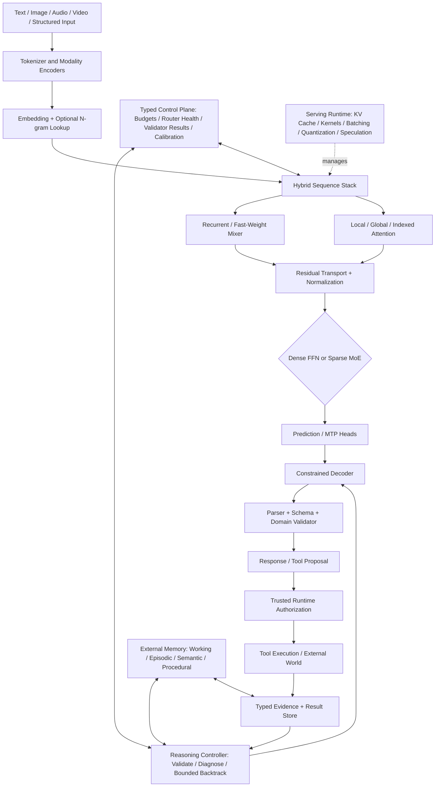

# The Synthesized SOTA LLM Architecture (v3 — evidence-grounded adaptive hybrid)
*Research synthesis and candidate architecture informed by publicly documented Transformer, state-space, recurrent/fast-weight, hybrid, sparse-expert, memory-augmented, adaptive-compute, diffusion and multimodal language-model research available through 17 November 2026, plus the supplied IDEAS20 compilation.*

**Document status:** Research specification; proposed design, not a trained or benchmark-validated model.

**Baseline:** `Pasted text(20261117-071440).txt` — *The Synthesized SOTA LLM Architecture (v2 — with upgrade paths).*  
**Supplementary ideas:** `ideas20_full_compilation.zip` — IDEAS20 compilation, Sentinel mappings and v2 duplicate.  
**Review date:** 17 November 2026.

**How to read this document:** every mechanism is tagged by evidence status. A mechanism may be mathematically established without being the best production choice, and a component used in one released model does not establish a universal optimum.

- **[PRODUCTION-VALIDATED]** — used in a publicly documented released model or production system; the claim is limited to the reported implementation and conditions.
- **[EMPIRICALLY VALIDATED]** — supported by published experiments; scale, dataset, compute and evaluation scope remain relevant.
- **[THEORETICALLY SUPPORTED]** — supported by mathematical analysis or an algorithmic property, without implying frontier-scale capability.
- **[PROVEN MECHANISM, NEW APPLICATION]** — an established mechanism applied to a new location or problem; the new application remains unvalidated.
- **[PROPOSED]** — a concrete, implementable design requiring experiments.
- **[EMERGING / PREPRINT]** — recent work or a preprint that is relevant but not yet mature evidence.
- **[REJECTED AS STATED]** — the supplied claim is technically incorrect, underspecified, or unsupported in its current form.
- **[CONDITIONAL]** — useful only when a workload, hardware profile or evaluation demonstrates a benefit.

---

## 0. Design Thesis

The objective is not to assemble the largest possible collection of fashionable mechanisms. It is to construct a **quality-constrained, hardware-aware, adaptive hybrid language model** whose sequence-processing paths, parameter capacity, memory policies and inference-time compute are selected by measured marginal value.

The design has three distinct strata:

1. **Neural model** — learned parameters and differentiable operations: representation, sequence mixing, residual transport, feed-forward capacity, learned memory, prediction and multimodal interfaces.
2. **Inference and serving runtime** — KV allocation, kernels, batching, quantization, speculative verification, prefill/decode scheduling and hardware placement.
3. **Agent and application control plane** — persistent external memory, symbolic constraints, search, tool execution, permission enforcement, provenance, budgets, replay and validators.

These strata communicate through explicit interfaces, but they are not interchangeable. MLA does not create an episodic database. A Rust state machine does not change the neural backbone. A grammar does not prove a value semantically correct. A runtime cache is not the model's learned recurrent state.

### 0.1 Target objective

The architecture is optimized for a declared deployment and training envelope, not for a single abstract score. One useful constrained formulation is:

\[
\min_{\theta,\,\pi,\,\rho}\; C(\theta,\pi,\rho;\mathcal{H},\mathcal{W})
\]

subject to

\[
Q_j(\theta,\pi,\rho;\mathcal{D}_j)\geq q_j,\qquad
R_k(\theta,\pi,\rho)\leq r_k,
\]

where:

- \(\theta\) denotes model parameters and learned architecture choices;
- \(\pi\) denotes inference/serving policies;
- \(\rho\) denotes application-level retrieval, verification and control policies;
- \(\mathcal{H}\) is the actual hardware topology and supported kernels;
- \(\mathcal{W}\) is the workload distribution;
- \(Q_j\) are task-quality measures such as language modeling, coding, mathematical reasoning, retrieval, instruction following and multimodal performance;
- \(R_k\) are bounded risk measures such as hallucination rate, invalid tool actions, calibration error, safety violations and tail latency;
- \(C\) includes training FLOPs, inference FLOPs, HBM capacity and bandwidth, network traffic, energy, wall-clock latency and monetary cost.

The weights and thresholds are workload-specific. Perplexity alone is insufficient: a lower validation loss can fail to improve downstream task performance, and an architecture that wins at batch size one can lose under production batching. [R26]

### 0.2 Core architectural hypothesis

**[PROPOSED]** Use a hybrid sequence backbone with two complementary paths:

- a recurrent/fast-weight path (Gated DeltaNet-family or another empirically selected SSM/linear-attention operator) that maintains a compact state and processes long streams efficiently;
- a content-addressable attention path (GQA, MLA or an indexed sparse/global attention variant) that preserves high-fidelity access to selected historical positions.

Combine these with selectively placed sparse feed-forward capacity, a stable residual transport mechanism, optional auxiliary prediction heads, and a runtime that separates model-local state from durable external memory.

This proposal is grounded in successful examples of hybrid designs—Jamba, Qwen3-Next, Qwen3.8-Flash-Next and Nemotron 3 Nano—but **does not claim that one published ratio or operator is universally optimal**. [R13, R25, R26, R28]

### 0.3 What this document does not claim

- It does not claim to enumerate every architecture ever proposed or every proprietary architecture whose details are undisclosed.
- It does not claim that the proposed combination has been trained or outperformed an existing model.
- It does not assign numeric speedups, training-cost multipliers or accuracy gains without a specified implementation and measurement.
- It does not treat agreement among language models as proof, attention weights as causal explanations, or token entropy as calibrated correctness confidence.

---

## 1. Scope and Architecture Taxonomy

The architecture landscape below is a representative taxonomy of publicly documented and technically relevant model families. It is designed to guide the synthesis and ablation plan, not to imply an impossible exhaustive inventory of all papers, private systems, model variants or implementations.

### 1.1 Transformer and attention-based models

- **[PRODUCTION-VALIDATED] Decoder-only Transformers** remain a robust general-purpose autoregressive baseline. Self-attention provides direct content-addressable interactions between positions, with per-layer compute and memory costs that depend on sequence length and implementation. [R1]
- **[PRODUCTION-VALIDATED] Encoder-only and encoder-decoder Transformers** remain relevant for representation learning, retrieval/reranking, classification, translation and sequence-to-sequence tasks. BERT is a canonical bidirectional encoder; T5 is a canonical text-to-text encoder-decoder. They are not interchangeable with decoder-only chat models; choose based on task and interface requirements. [R1, R60, R61]
- **[PRODUCTION-VALIDATED] Decoder-only autoregressive scaling** is represented by GPT-style models and remains the dominant general-purpose next-token prediction family. Its simplicity of generation does not make it optimal for every task or generation regime. [R1, R62]
- **[PRODUCTION-VALIDATED] MHA, MQA and GQA** trade parameter sharing in key/value heads against attention expressivity and KV-cache size. GQA is a practical compromise; quality and speed depend on head dimensions, kernel implementation and uptraining recipe. [R4]
- **[PRODUCTION-VALIDATED] MLA** uses a compressed latent representation for key/value state and changes the cache representation. It is a model architecture choice, not an external semantic-memory subsystem. [R5, R6]
- **[PRODUCTION-VALIDATED] Local, sliding-window, block-sparse and indexed sparse attention** reduce or constrain which positions are directly attended. These mechanisms can improve long-context cost, but retrieval quality depends on the selector, windowing, global-token policy and workload. [R26]
- **[PRODUCTION-VALIDATED] FlashAttention and FlashAttention-2** are IO-aware exact-attention algorithms/kernels, not a new asymptotic attention architecture. They reduce memory traffic and improve GPU utilization; dense exact attention still has quadratic pairwise interaction compute in sequence length. [R2, R3]
- **[EMPIRICALLY VALIDATED / HISTORICAL ALTERNATIVES]** Reformer (LSH attention), Longformer and BigBird (structured sparse/local/global attention), Linformer (low-rank attention projection), Performer (kernelized/linear attention) and FNet (Fourier-based token mixing) explore alternative ways to reduce sequence-mixing cost. They remain useful reference points, but each changes the approximation or connectivity pattern and must be compared against modern kernels and recurrent hybrids. [R47–R53]

### 1.2 Linear attention, recurrent models and state-space models

- **[EMPIRICALLY VALIDATED] S4/S5-family state-space models** connect sequence modeling to structured linear dynamical systems. These are foundational alternatives to direct pairwise attention. [R54, R55]
- **[EMPIRICALLY VALIDATED] Mamba** makes state updates input-selective and uses hardware-aware scan kernels; its recurrent state avoids a conventional per-token Transformer KV cache for the SSM path. [R7]
- **[EMPIRICALLY VALIDATED] Mamba-2 / State Space Duality** develops the connection between structured state-space models and attention-like computation, improving parallel training efficiency in the reported experiments. [R8]
- **[EMPIRICALLY VALIDATED] Mamba-3** is an ICLR 2026 paper that reports improvements over compared recurrent baselines at the evaluated 1.5B scale; its results should still be evaluated at matched parameter count, data, tokens and hardware rather than extrapolated to frontier scale. [R9]
- **[EMPIRICALLY VALIDATED] RetNet** offers parallel, recurrent and chunkwise recurrent formulations of retention. [R15]
- **[EMPIRICALLY VALIDATED] RWKV** and later variants use recurrent weighted-key/value mechanisms to target constant-memory-per-step decoding. [R17]
- **[EMPIRICALLY VALIDATED] Griffin/Hawk** combine gated recurrent units with local attention. [R14]
- **[EMPIRICALLY VALIDATED] xLSTM** revisits recurrent memory through modified LSTM cells and matrix-memory variants. [R16]
- **[EMPIRICALLY VALIDATED] Hyena** uses implicit long convolutions and gating as a subquadratic sequence-mixing alternative. [R18]
- **[EMPIRICALLY VALIDATED] DeltaNet and Gated DeltaNet** use fast-weight / delta-rule updates; Gated DeltaNet adds selective forgetting. [R10]
- **[EMPIRICALLY VALIDATED] Gated DeltaNet-2 (GDN-2)** decouples erase and write gates and reports advantages over the compared recurrent baselines at 1.3B parameters and 100B FineWeb-Edu tokens. This is strong evidence for a candidate operator, not proof of frontier-scale dominance. [R11]
- **[EMERGING / PREPRINT] Muir** proposes sensitivity-allocated gating and matched-filter readout and reports results from 166M to 1.34B parameters. As a very recent preprint, it is a high-priority candidate for replication, not a production-validated default. [R12]

### 1.3 Hybrid sequence architectures

- **[PRODUCTION-VALIDATED] Jamba** combines Transformer attention, Mamba blocks and MoE, and demonstrates that a hybrid can be deployed at substantial model scale. Its configuration is one design point, not a universal layer ratio. [R13]
- **[PRODUCTION-VALIDATED] Qwen3-Next** combines Gated DeltaNet, gated attention, MoE and multi-token prediction in a model-specific layer schedule. [R25]
- **[PRODUCTION-VALIDATED] Qwen3.8-Flash-Next** combines Gated DeltaNet with global attention during pretraining; its report describes one full-attention layer in every four, with those full-attention layers replaced by Qwen Sparse Attention during continued pretraining. It also introduces a four-branch Gated Residual design, N-gram embeddings and Muon-based optimization. This is a model- and training-stage-specific schedule, not proof that 3:1 is globally optimal. [R26, R27]
- **[PRODUCTION-VALIDATED] Nemotron 3 Nano** combines Mamba-2, GQA and MoE; the technical report specifies 31.6B total parameters, 3.2B active parameters (3.6B including embeddings), 128 routable experts and 6 activated experts per token. This is a concrete example of a hybrid architecture and sparse capacity working together. [R28]
- **[PRODUCTION-VALIDATED / RESEARCH-REPORTED] Kimi-family models** combine Kimi Delta Attention and attention-based components; Kimi K3 adds Attention Residuals and Stable LatentMoE in the published architecture description. Treat each report's claims in its own evaluation context. [R24, R29]

### 1.4 Sparse parameter architectures

- **[PRODUCTION-VALIDATED] Sparse Mixture-of-Experts** activates a subset of feed-forward experts for each token, increasing total parameter capacity without activating every parameter on every token. The progression includes GShard, Switch Transformer, GLaM, Mixtral and DeepSeekMoE/V3-style designs; router objective, expert granularity, top-k, capacity and placement differ across systems. [R6, R22, R63–R66]
- **[PRODUCTION-VALIDATED] Shared experts and fine-grained expert partitioning** can provide common capacity alongside routed specialization. [R22]
- **[PRODUCTION-VALIDATED] Auxiliary-loss-free load balancing** adjusts expert routing with utilization-dependent biases rather than relying solely on an auxiliary balance loss. DeepSeek-V3 reports this as part of its training and routing design. [R6]
- **[EMPIRICALLY VALIDATED] LatentMoE** changes the expert representation / computation to improve the efficiency–accuracy trade-off in its evaluated settings; its scaling and hardware implications must be matched to the target environment. [R23]

### 1.5 Adaptive depth and inference-time computation

- **[EMPIRICALLY VALIDATED] Mixture of Depths** routes a limited number of token positions through a layer, allocating layer compute selectively under a fixed capacity budget. [R20]
- **[EMPIRICALLY VALIDATED] LayerSkip** trains early-exit behavior and uses early layers for drafting with later layers verifying/correcting. Reported speedups apply to tested models and tasks. [R21]
- **[CONDITIONAL] Speculative decoding** uses a cheaper draft proposal and target-model verification. It can reduce serial decoding steps when draft acceptance is high and verification overhead is favorable; exact distribution-preserving verification is required if the target sampling distribution must be preserved. [R30]

### 1.6 Memory-augmented models and external memory

- **[EMPIRICALLY VALIDATED] Transformer-XL** carries segment-level recurrent hidden state across segments; **Compressive Transformer** compresses older activations; and **RETRO** augments generation with retrieval from a large external corpus. These are important precedents for separating short-term attention, compressed state and retrieval memory. [R56–R58]
- **[EMPIRICALLY VALIDATED] Titans** investigates a learned neural long-term memory that can be updated and queried alongside attention. This is distinct from a serving KV cache and from an application-level database. [R19]
- **[PRODUCTION-VALIDATED] Retrieval-augmented generation (RAG)** combines parametric model knowledge with retrieved external information. Its retrieval store, provenance and freshness policy are system-level components that require their own evaluation. [R59]
- **[EMPIRICALLY VALIDATED] KV-cache management methods** include attention-sink retention, heavy-hitter retention, observation-window-based selection and layer-wise budget allocation. H2O, StreamingLLM, SnapKV and PyramidKV demonstrate distinct research policies, each with different workloads and failure modes. [R31–R34]

### 1.7 Diffusion language models

- **[EMPIRICALLY VALIDATED] Masked diffusion language models**, exemplified by LLaDA, offer a non-autoregressive generation formulation in which a model iteratively predicts masked positions. This is an important alternative family, but its generation schedule, editing behavior, latency and tool-use properties should be compared with autoregressive models rather than assumed superior. [R35]
- **[EMERGING / PREPRINT] Newer diffusion variants, including iLLaDA, should be tracked as the evidence evolves; no diffusion design is made the default in this hybrid autoregressive proposal without direct task-level evidence. [R45]

### 1.8 Multimodal architectures

A general multimodal model usually combines one or more modality-specific encoders, projection/connector layers, a shared or partially shared sequence model, and modality-specific generation heads. Architectures differ in early, intermediate or late fusion; image/video/audio representations and temporal alignment are not solved by merely appending image tokens. [R36, R46]

**Design implication:** preserve modular modality interfaces. Do not force one tokenization or one attention schedule across all modalities before measuring cross-modal alignment, temporal resolution, throughput and quality.

### 1.9 Architecture-family comparison matrix

| Family | Primary strength | Main limitation / risk | Best reason to evaluate it |
|---|---|---|---|
| Dense decoder-only Transformer | Flexible content-addressable sequence modeling and strong baseline ecosystem | Dense attention cost and KV growth with context | Quality reference and broad general-purpose generation |
| Encoder-only / encoder-decoder | Bidirectional representation and explicit input/output separation | Not a drop-in autoregressive chat decoder | Retrieval, reranking, classification, translation and conditional generation |
| Sparse / local / indexed attention | Reduces direct attention work or bounds attended positions | Selector misses, locality assumptions and retrieval degradation | Long contexts with structured or indexable dependencies |
| Linear / kernelized attention | Lower asymptotic sequence cost in the chosen formulation | Approximation and/or reduced exact content-addressable retrieval | Long streams where measured accuracy survives the approximation |
| SSM / recurrent models | Compact recurrent state and streaming inference | Fixed/compressed state may interfere or forget exact historical details | Long-running streams and memory-constrained decode |
| Delta-rule / fast-weight models | Selective write, erase and update of compressed sequence state | State-update stability and exact multi-needle retrieval need testing | Candidate recurrent path for hybrid models |
| Hybrid recurrent + attention | Combines compressed streaming history with explicit retrieval path | More complex training, cache/state management and kernels | Workloads needing both long-stream efficiency and precise retrieval |
| Sparse MoE | High total capacity with limited active FFN compute | All-to-all traffic, routing imbalance and expert hot spots | Capacity growth when communication cost is controlled |
| Adaptive depth / early exit | Allocate compute by token or task | Confidence/exit errors and verifier overhead | Variable-complexity workloads with measurable early-exit utility |
| Diffusion language model | Parallel/masked refinement and non-autoregressive generation | Iteration schedule, latency, tool integration and decoding trade-offs | Editing, infilling or tasks where bidirectional iterative generation is advantageous |
| Neural / retrieval memory | Access to information beyond the immediate attention window | Write quality, interference, retrieval errors and memory governance | Long-horizon tasks requiring durable information |
| Multimodal encoder + connector + LLM | Modality-specific representation with shared reasoning/generation | Alignment, temporal grounding and connector bottlenecks | Vision, audio, video and structured sensor/action workloads |

The table is a decision aid, not an ordinal ranking. The design should select the least-complex family that meets the quality, reliability, latency and cost envelope. Hybridization is justified only when the workload needs the capabilities of more than one family and ablations show that the added complexity pays for itself.

---

## 2. Requirements Before Selecting a Configuration

The final architecture configuration cannot be responsibly fixed until the following are declared:

1. **Model scale:** parameter budget, active parameter budget, training-token budget and expected growth path.
2. **Deployment hardware:** accelerator type/count, HBM capacity/bandwidth, interconnect, CPU/RAM, storage and supported kernel stack.
3. **Serving workload:** context-length distribution, output-length distribution, batch size, concurrency, prefill/decode ratio, latency objectives and cache reuse rate.
4. **Capability targets:** multilinguality, coding, math, factual QA, multi-hop retrieval, tool-use, long-context retrieval, multimodal tasks and instruction following.
5. **Training regime:** pretraining corpus and licensing, continued pretraining, SFT, preference optimization, RL, distillation and safety evaluation.
6. **Deployment constraints:** open weights or API-only, license requirements, privacy, data residency, quantization and update cadence.

Until these are declared, the v3 design is a **configuration family and experimental hypothesis**, not a single frozen layer-by-layer blueprint.

---

## 3. Input and Representation Subsystem

### 3.1 Tokenization and base embeddings

**[PRODUCTION-VALIDATED]** Use a tokenizer appropriate to the target languages, code domains and multimodal serialization. Measure fertility, byte fallback rate, sequence expansion, rare-token behavior and cross-lingual fragmentation. Tokenizer changes after large-scale pretraining are expensive and can invalidate embedding alignment.

**[CONDITIONAL] N-gram embeddings.** Qwen3.8-Flash-Next reports an additional N-gram embedding table that augments model capacity at relatively low inference compute and can be offloaded/prefetched. [R26] This is a candidate when local token context is useful and host-memory bandwidth can sustain lookup. It is not a default: measure table footprint, host-device traffic, cache locality, collision behavior, data leakage risk and downstream accuracy against a no-N-gram baseline.

**[PROPOSED]** Keep the base token embedding, optional byte/character fallback and any N-gram table as distinct components with separately measured contribution. Do not use a semantic embedding table as a replacement for exact token identity.

### 3.2 Position and sequence metadata

**[PRODUCTION-VALIDATED]** Select positional encoding and extrapolation strategy with the target length distribution in mind. Rotary position embeddings and tested context-extension methods are established options, but extrapolation beyond training length must be evaluated for retrieval and generation quality, not just positional interpolation stability.

### 3.3 Multimodal ingress

**[PROPOSED]** Use modality-specific encoders and typed connectors for image, audio, video and structured spatial inputs. Preserve timestamps, frame/sample boundaries, resolution and modality provenance. A shared model can fuse these representations, but the connector must not erase temporal order or claim that a pooled embedding preserves all details.

---

## 4. Backbone: Adaptive Hybrid Recurrent / Attention Interleave

### 4.1 Proven core

A hybrid sequence mixer can combine:

- recurrent/SSM/fast-weight layers for compact streaming state and efficient long-sequence processing;
- local or chunked attention for nearby exact interactions;
- periodic global or indexed sparse attention for long-range content-addressable retrieval.

Mamba, Mamba-2, Gated DeltaNet, GDN-2, Jamba, Qwen3-Next, Qwen3.8-Flash-Next and Nemotron 3 Nano provide evidence for different parts of this design space. [R7–R13, R25–R28]

The v2 document's fixed 1:7 attention-to-Mamba ratio is **not** a universal optimum. Jamba's reported pattern, Nemotron's architecture and Qwen's 3:1 recurrent-to-attention-family pattern are different implementations with different scales, operators and training recipes. Compare ratios only under matched budgets and workloads.

### 4.2 [PROPOSED] Two-path hybrid block

Each stage contains:

1. a **recurrent state mixer** (GDN-2 as a strong candidate; Mamba-2/3, KDA or Muir as comparators);
2. a **content-addressable attention mixer** inserted at a selected cadence or selected block positions;
3. a feed-forward capacity module (dense or sparse MoE, depending on layer and budget);
4. a normalized residual transport path.

The recurrent state and the attention KV cache remain separate state objects. The recurrent path compresses sequence history through learned state updates; attention retains explicit position-indexed key/value representations (or an MLA latent representation) for the attention path.

### 4.3 [PROPOSED] Configurable layer schedule

Represent the layer schedule as a searchable configuration, not a hard-coded constant:

\[
S = (m_1,m_2,\ldots,m_L),\qquad m_i\in\{\text{recurrent},\text{local-attention},\text{global-attention}\}.
\]

Search over at least these pilot families:

- all-attention baseline;
- recurrent-only baseline;
- 1 recurrent : 1 attention;
- 3 recurrent : 1 attention;
- 7 recurrent : 1 attention;
- front-loaded and back-loaded global-attention schedules;
- a learned architecture-search schedule that is frozen before the final production run.

The 3:1 pattern is a practical initial candidate because it is close to a publicly documented Qwen3.8 configuration, but it is **not selected as final without ablation**. [R26]

### 4.4 [PROPOSED] Task- and layer-aware architecture selection

Do not implement the v2 supernet that computes both full attention and recurrent paths at every swappable position by default. It has an unverified 1.3–1.5× FLOP estimate and introduces path-state incompatibility, runtime dispatch, kernel and optimizer complications.

Instead:

- perform architecture search or controlled schedule sweeps during pilot training;
- select a fixed schedule for each model size / deployment profile;
- if conditional operator selection is later tested, gate at a sequence/chunk boundary with explicit state ownership and measure the full systems cost;
- require the conditional version to beat the best fixed schedule at equal quality and total hardware cost.

### 4.5 Attention variant selection

**[CONDITIONAL] GQA** is the lower-complexity baseline when KV-cache size is a constraint. **[CONDITIONAL] MLA** is a stronger candidate when the architecture can be trained and served with efficient latent-cache kernels. **[CONDITIONAL] indexed sparse attention** is useful when the context is long enough that the indexer cost is outweighed by fewer attention operations. MHA remains a valuable quality baseline. [R4–R6, R26]

Do not compare MLA, GQA and QSA only by theoretical memory bytes. Measure real memory traffic, kernel occupancy, indexer overhead, context retrieval recall, tail latency and batch throughput.

### 4.6 Recurrent operator selection

- **GDN-2:** primary research candidate because it decouples erase and write gating and has a public 1.3B-scale evaluation. [R11]
- **Muir:** high-priority exploratory candidate because it is recent and reports favorable small-scale results; replicate independently and test larger scale before adoption. [R12]
- **Mamba-2 / Mamba-3:** important comparators for SSM state capacity, scan efficiency and long-sequence stability. [R8, R9]
- **KDA / Gated DeltaNet:** additional comparators for forgetting and state-update behavior. [R10, R24]

No recurrent operator is declared the winner solely because it provides linear-time or constant-memory sequence processing. A compact recurrent state can lose exact retrieval information; test associative recall, multi-needle retrieval, long-range dependencies, code references and interleaved task streams.

### 4.7 [PROPOSED] Sequence-state health monitoring

Track recurrent-state norm, update magnitude, erase/write gate distributions, saturation, drift and retrieval failures. Add tests for state contamination across independent documents, task boundaries and batch/sequence reset. Any state reuse must be scoped to the correct conversation or document and have explicit reset semantics.

---

## 5. Residual Transport and Normalization

### 5.1 Proven mechanisms

Residual streams and normalization are fundamental to stable deep networks. Recent proposals such as Attention Residuals (AttnRes) and Gated Residual (GR) offer alternatives to simple uniform residual accumulation. Qwen3.8 reports a four-branch gated residual path; Kimi reports attention over preceding block outputs with blockwise variants. [R24, R26]

### 5.2 [PROPOSED] Keep residual candidates separable

Use a conventional pre-normalized residual Transformer/hybrid as the reference baseline. Compare, independently:

1. standard residual addition + RMSNorm/LayerNorm variant;
2. block-level Attention Residuals;
3. multi-branch Gated Residual;
4. a constrained hybrid only if the independent ablations justify combining them.

Do not stack AttnRes and four-branch GR automatically. Both alter information transport, activation storage, bandwidth and optimization; their interaction requires evidence.

### 5.3 Acceptance criteria

Measure training stability, gradient norms, activation memory, validation loss, downstream accuracy, long-context degradation, throughput and scaling behavior. Reject a residual design if its training-loss gains do not translate into reliable downstream gains or if the serving footprint erases its quality advantage.

---

## 6. Capacity: Sparse MoE with Hardware-Aware Routing

### 6.1 Proven core

DeepSeek-V2/V3 demonstrate MLA and fine-grained MoE; DeepSeek-V3 reports 671B total parameters and 37B activated per token, with auxiliary-loss-free load balancing and multi-token prediction. Nemotron 3 Nano reports 128 routable experts and 6 activated. [R5, R6, R28]

Sparse MoE increases total capacity while limiting active compute, but it introduces all-to-all communication, expert imbalance, routing instability, token dropping/capacity constraints and expert placement costs.

### 6.2 [PROPOSED] Layer-selective MoE

Use dense FFNs in selected layers and MoE in others. Determine placement empirically. Each MoE layer should expose:

- a learned router and deterministic top-k selection policy;
- optional shared expert capacity for cross-domain/common features;
- explicit expert capacity and overflow policy;
- utilization and token-drop metrics;
- routing entropy and expert specialization diagnostics;
- communication-aware expert placement.

Top-k, shared-expert count, expert granularity and placement are configuration variables. They must not be copied blindly from a model at another scale.

### 6.3 [PROVEN MECHANISM, NEW APPLICATION] Auxiliary-loss-free utilization correction

A DeepSeek-style bias update is a candidate for balancing load without relying exclusively on an auxiliary loss. It should be treated as a routing-control mechanism with a monitored update rate and stability bounds, not as a proof that oscillation cannot occur in every implementation. Compare against auxiliary-loss balancing and router regularization under the same topology. [R6]

### 6.4 [CONDITIONAL] Latent expert representations

LatentMoE is a candidate where hardware layout and lower communication overhead justify the representation change. Compare parameter count, active FLOPs, expert bandwidth, accuracy and kernel support against standard MoE. [R23]

### 6.5 [REJECTED AS STATED] Sequence-coherent router momentum

The v2 proposal to penalize expert switching between adjacent tokens is not adopted as a default. Tokens within one sentence or code file can require different expert functions; forced continuity can suppress valid specialization. A perplexity spike under a previously selected expert is also not a clean pre-routing signal unless the relevant expert computation has already occurred.

A limited experiment may add a context-conditioned prior or group-level routing statistic, but it must not impose continuity and must be evaluated against the ordinary token-level router.

### 6.6 [CONDITIONAL] Adaptive expert budgets

Complexity-adaptive top-k is a plausible research direction, but complexity estimates and dynamic dispatch may cost more than the saved expert compute. First establish that token-level or layer-level complexity estimates predict marginal expert utility. Then test a small number of permitted expert budgets with a hard compute ceiling.

---

## 7. Memory: Three Separate Memory Planes

The v2 document's most important conceptual correction is to separate three kinds of state.

### 7.1 Model-local recurrent state

**[PRODUCTION-VALIDATED / EMPIRICALLY VALIDATED]** SSM and linear-attention layers carry a compact recurrent state across tokens or chunks. This is learned model state with fixed or bounded representation size per sequence, depending on the operator. It is not a searchable database and should not be assumed to preserve every earlier detail.

### 7.2 Attention KV cache

**[PRODUCTION-VALIDATED]** The KV cache stores attention-specific key/value data (or compressed MLA latent representations) needed for autoregressive continuation. It is an inference-time runtime resource, usually scoped to a sequence and model layer. It is not persistent cross-session memory.

### 7.3 External agent memory

**[PROPOSED]** Keep durable memory outside the neural KV cache. A practical four-tier organization remains useful:

1. **Working memory** — current task state, recent conversation and active constraints.
2. **Episodic memory** — time-stamped events, observations, tool results and decisions.
3. **Semantic memory** — reconciled facts, entities, relations, policies and durable knowledge abstractions.
4. **Procedural memory** — tested workflows, executable procedures, tool recipes and validated strategies.

Each record should include provenance, owner/scope, timestamps, version, confidence semantics, expiration/retention policy, access policy and a supersession/contradiction relation. Retrieval must return the evidence and its age, not only a free-floating summary.

### 7.4 [CONDITIONAL] KV cache selection and eviction

H2O, StreamingLLM, SnapKV and PyramidKV show that useful KV-retention policies can combine recency, attention statistics, sink tokens, observation windows and layer-specific budgets. No single policy is universally correct. [R31–R34]

The v2 proposal's counterfactual KL ablation is an expensive, output- and query-dependent diagnostic. Its result is not a universal causal value for a KV entry. Raw attention-weight history is not causal influence.

**[PROPOSED] Multi-signal KV manager:**

- enforce a hard per-sequence and per-layer memory budget;
- preserve architecture-required sink/global tokens;
- estimate retention utility from several signals (recency, learned or measured attention patterns, retrieval tests, token/layer importance and workload profile);
- support layer-specific allocation rather than a uniform cache budget;
- keep an exact/full-cache mode for quality measurement;
- evaluate approximate policies against full-cache output and task performance;
- optionally train a proxy for sampled counterfactual output-KL changes, with calibration and held-out interventions, as one feature among others—not as ground-truth causal attribution.

### 7.5 [PROPOSED] External memory retrieval and consolidation

Use hybrid retrieval where appropriate: exact lexical search for identifiers and quoted strings; dense retrieval for semantic similarity; metadata/time filtering; graph traversal for explicit relations; reranking for query relevance. Consolidation should merge only supported facts, preserve conflicting evidence and record source lineage. Deletion and expiry must be implemented, not simulated by hiding a record from the prompt.

### 7.6 [PROVEN MECHANISM, NEW APPLICATION] CRDT-based shared memory

A CRDT can support convergent merging of distributed updates when its data type and operations satisfy the required algebraic properties. It does **not** make a memory fact true, current, authorized or conflict-free in the semantic sense. Preserve tombstones, source provenance, version vectors or equivalent causal metadata, authority, expiry and supersession rules. [R37]

### 7.7 [CONDITIONAL] Neural long-term memory

Titans-style learned memory may be evaluated as an additional trained model path. It must remain distinct from the external database and conventional KV cache. Evaluate catastrophic interference, write stability, forgetting, privacy and whether memory updates can be reliably reproduced. [R19]

---

## 8. Adaptive Computation and Inference-Time Scaling

### 8.1 [EMPIRICALLY VALIDATED] Mixture of Depths and early exits

Mixture of Depths allocates a token's path through a layer under a capacity budget. LayerSkip trains early-exit behavior and can use early layers for draft generation followed by verification with later layers. [R20, R21]

### 8.2 [PROPOSED] Budgeted depth controller

A learned controller may choose among a small set of depth budgets or verification paths based on task class and calibrated utility estimates. It must be trained/evaluated against a fixed-depth baseline with the same total resource envelope. Never assume that a cheap uncertainty score always predicts whether more layers improve the answer.

### 8.3 [PROPOSED] Task-level test-time compute router

At request entry, estimate task class and risk, then select among:

- direct generation for simple requests;
- one-pass generation plus deterministic validation for structured outputs;
- tool-assisted execution for verifiable computations;
- multi-candidate generation and ranking for tasks where diversity improves success;
- bounded search/backtracking for complex planning or coding;
- escalation or abstention when the evidence is insufficient.

The router should be trained or calibrated on held-out workload traces. Record expected utility, actual quality, and additional cost for each budget level.

### 8.4 [REJECTED AS STATED] Entropy as universal depth or stop signal

Token entropy measures uncertainty in a local predictive distribution, not answer correctness, epistemic uncertainty, progress or task completion. Low entropy can indicate a confidently wrong answer; high entropy can be appropriate for creative or branching tasks. Use entropy only as one calibrated feature, never as an automatic forced-commitment proof.

---

## 9. Reasoning: Bounded Search, Constraints and Verifiable Feedback

### 9.1 Proven mechanisms

- **[PROVEN MECHANISM]** Compile explicit constraints before generation when a parser, type checker, solver or domain extractor can do so reliably.
- **[EMPIRICALLY VALIDATED]** Reinforcement learning with verifiable rewards can improve reasoning on tasks where objective correctness checks exist. DeepSeek-R1 reports rule-based rewards for mathematics, coding and logical reasoning, while also discussing reward-model limitations for open-ended tasks. [R38]
- **[EMPIRICALLY VALIDATED]** Process reward models can evaluate intermediate steps, but model-based scoring is vulnerable to distribution shift and reward hacking. [R39]
- **[EMPIRICALLY VALIDATED]** Self-consistency can improve some reasoning tasks by aggregating sampled reasoning paths; agreement is a heuristic, not proof. [R40]
- **[EMPIRICALLY VALIDATED]** Tree-of-Thoughts and related search approaches explicitly retain branching and backtracking rather than forcing a one-way reasoning sequence. [R41]

### 9.2 [PROPOSED] Explicit task state graph

Use a controller with typed states and bounded transitions:

1. **Parse** — normalize the request and identify the expected output contract.
2. **Extract constraints** — collect hard constraints, assumptions, dependencies and unknowns.
3. **Build task model** — construct a dependency graph or structured state representation.
4. **Generate candidate** — produce one or more candidate plans/answers.
5. **Validate** — call an appropriate validator or independent evaluator.
6. **Diagnose** — classify failure as factual, logical, constraint, execution, formatting or insufficient-evidence.
7. **Revise / backtrack** — reopen only the relevant hypothesis or plan node, with bounded retries.
8. **Commit / abstain / escalate** — select a validated answer or clearly report uncertainty.

Transitions can revisit earlier logical states, but the controller must prevent unbounded loops. Use a maximum attempt count, token budget, tool budget, wall-clock deadline and a progress monitor. Record prior hypotheses, failures and state hashes to avoid repeating equivalent failed work.

### 9.3 [PROPOSED] Typed validator hierarchy

Choose the strongest available validator for the task:

| Validator | What it establishes | What it does not establish |
|---|---|---|
| Compiler / type checker | Syntactic and static type validity under the language/toolchain | Program meets all requirements or is secure |
| Test suite | Behavior on the covered tests | Correctness for untested inputs |
| SMT solver / proof checker | Validity under encoded assumptions and formalization | Correctness of assumptions or model of the real world |
| Database / API response | The specific returned state at the time of query | Global truth or future state |
| Independent measurement | Observed behavior under stated protocol | Generalization outside measured conditions |
| PRM / reward model / LLM critic | A learned plausibility or quality estimate | Formal truth; can be wrong or reward-hacked |
| Self-consistency | Agreement among sampled model paths | Independence or correctness of shared assumptions |
| Human/domain review | Contextual expert judgment | Infallibility or reproducibility without a record |

The controller should store validator identity, version, input hash, assumptions, result, timestamp and evidence. Multiple validators are not interchangeable just because they return a score.

### 9.4 [PROPOSED] Progress and cycle detection

Detect cycles from task-state and hypothesis equivalence, not textual similarity alone. Track:

- canonicalized plan/hypothesis identifiers;
- which constraints have been resolved;
- which tests have passed/failed;
- unresolved blockers;
- whether the candidate set or evidence set has changed;
- marginal quality improvement per additional token/tool call.

Terminate or change strategy when equivalent states recur without new evidence or measurable progress. This directly addresses reasoning loops while preserving legitimate backtracking.

### 9.5 [PROPOSED] Calibrated abstention

Abstain or request external review when validators disagree, evidence is missing, uncertainty is outside the calibrated range, or the expected value of further compute is low. Calibrate confidence on held-out examples and track Brier score, ECE, selective risk and coverage. Do not use self-consistency alone to trigger a high-confidence claim.

---

## 10. Output: Multi-Token Prediction and Constrained Decoding

### 10.1 Multi-Token Prediction

**[PRODUCTION-VALIDATED]** DeepSeek-V3 uses an MTP training objective and reports that the auxiliary future-token prediction objective benefits model performance; the trained prediction structure can also support speculative decoding. [R6]

MTP as a training objective, MTP prediction heads at inference, and speculative decoding are related but distinct:

1. an auxiliary training loss predicts future tokens to enrich supervision;
2. an auxiliary head may propose one or more future tokens;
3. a speculative decoding algorithm verifies proposals with the target model.

MTP does not guarantee 2× decoding speed. End-to-end gains depend on proposal accuracy, accepted draft length, verifier batching, memory, kernels, batch size and serving workload.

### 10.2 [PRODUCTION-VALIDATED] Exact speculative verification

When preserving the target model's sampling distribution is required, use a mathematically correct speculative sampling/verification procedure. Do not replace probability-based verification with semantic equivalence unless the system explicitly accepts a changed output distribution and has a separate correctness argument. [R30]

### 10.3 [PROPOSED] Grammar plus semantic validation

Use a two-phase output contract:

- **During decoding:** constrain tokens to a grammar or schema where practical (JSON, code AST fragments, tool protocol, SQL subset).
- **After decoding:** parse and validate types, references, domain invariants, authorization and executable behavior.

Grammar validity guarantees only that the output belongs to the accepted language. It does not prove that a value is factually correct, that a referenced object exists, or that an action is safe.

### 10.4 [REJECTED AS STATED] Semantic re-ranking with the KV causal-influence proxy

A cache-eviction importance proxy is not a general semantic decoder score. It predicts an approximation to a cache-retention diagnostic and should not be repurposed as a token probability or semantic validity measure. Use explicit constraint, schema and domain validators instead.

---

## 11. Multimodal Extension

### 11.1 [PROPOSED] Modular modality front ends

Provide dedicated encoders or tokenizers for image, audio, video and structured spatial inputs. Each front end emits typed representations with modality/time metadata. The central model may share a latent sequence space while retaining modality identifiers and boundary information.

### 11.2 Fusion choices

Compare:

- early fusion: modality representations enter the shared sequence backbone early;
- intermediate fusion: modality-specific encoders connect through learned projections or cross-attention;
- late fusion: separately encoded streams are combined close to output or task heads.

Choose by task: real-time audio, speech generation, video temporal reasoning, image grounding, document understanding and spatial action prediction have different alignment and latency requirements. [R36]

### 11.3 Evaluation requirements

Evaluate temporal alignment, fine-grained localization, OCR/document accuracy, audio transcription and generation quality, video event ordering, modality hallucination, cross-modal retrieval and robustness to missing/corrupt inputs. A text-only benchmark suite cannot validate multimodal capability.

---

## 12. Training and Post-Training Architecture

### 12.1 Pretraining

**[PROPOSED]** Start with a controlled decoder-only baseline and scale the hybrid candidates with fixed data mixtures and training budgets. Keep data pipeline, tokenizer, optimizer schedule and evaluation checkpoints consistent across architecture comparisons.

Training-data controls:

- document data sources, provenance, license and allowed use;
- deduplicate at document and near-document levels;
- remove evaluation contamination where possible;
- classify language, domain, code, quality and time range;
- preserve high-quality long-context examples and structured sequences;
- use curriculum only when its effect is measured, not because it sounds intuitively beneficial.

### 12.2 Scaling laws and compute allocation

Chinchilla-style compute-optimal scaling is a historically important empirical result, not a universal rule that fixes the best parameter/token ratio for every 2026 model, post-training regime or inference-heavy deployment. [R42]

Fit scaling curves for the target data quality, architecture, training stack and inference objective. Track both validation loss and downstream performance; determine whether an extra parameter, data token, longer context, expert, memory mechanism or RL sample gives the best marginal return.

### 12.3 Optimizers and precision

**[CONDITIONAL]** Compare AdamW and Muon-family optimizers with architecture-specific learning-rate schedules and parameter-group treatment. Qwen3.8 reports Muon refinements; that does not mean Muon is the best optimizer for every hybrid model. [R26, R43]

**[CONDITIONAL]** Evaluate BF16, FP8 and lower-precision options (including FP4/NVFP4 where supported) with measured numerical stability, outlier behavior, accumulation precision, communication savings, kernel maturity and quality. DeepSeek-V3 reports FP8 training; NVIDIA's later Nemotron family reports low-precision deployment/training choices. There is no universal precision floor. [R6, R28]

### 12.4 Supervised fine-tuning

Use instruction data that covers all target task classes, response contracts, tool schemas, refusals, uncertainty and recovery from tool failures. Track source distribution and avoid optimizing for stylistic compliance at the expense of correctness. Keep tool traces and external execution feedback separate from hallucinated “tool-use” demonstrations.

### 12.5 Preference optimization and reinforcement learning

Use preference optimization (e.g. DPO-style methods) when curated preference pairs are available. Use RL with verifiable rewards for tasks with reliable graders such as math, code tests and formal constraints. For open-ended tasks, reward models and LLM judges are useful ranking signals but need human evaluation, adversarial tests and reward-hacking monitoring. [R38, R44]

### 12.6 Process supervision

A process reward model can help rank intermediate steps or identify failure modes, but it must be evaluated against outcome correctness and adversarial optimization. Use independent held-out verifiers for high-stakes or executable actions. [R39]

### 12.7 Distillation

Distill larger or more deliberative teacher behavior into smaller deployment models only after measuring capability transfer, calibration and regressions. Preserve verifier traces and answer correctness; do not train the student to imitate unverified reasoning verbosity as a proxy for reasoning quality.

---

## 13. Inference and Serving Architecture

### 13.1 Kernel and memory execution

Use fused kernels and IO-aware attention implementations where supported. FlashAttention reduces high-bandwidth-memory traffic for exact attention; it does not remove the fundamental quadratic number of dense attention interactions. [R2, R3]

### 13.2 KV cache policy

Separate cache admission, allocation, retention, quantization, offload, prefix reuse and eviction. Measure each policy independently. Paged allocation and continuous batching can reduce fragmentation and improve utilization, but scheduling must respect the mix of prompt lengths, output lengths and prefill/decode workloads.

### 13.3 Speculative decoding

Compare:

- external small draft model;
- MTP head;
- LayerSkip / self-speculative decoding;
- multi-token or block proposals;
- no speculation baseline.

Measure acceptance rate, accepted tokens per verifier pass, end-to-end tokens/second, tail latency and memory. A speculative method that increases throughput at batch size one may degrade throughput at high concurrency.

### 13.4 Prefill/decode scheduling

**[CONDITIONAL]** Disaggregated prefill/decode can be beneficial when the hardware and request mix justify transferring KV state between dedicated pools. It adds network and scheduling costs; it is a serving architecture, not a neural-layer improvement.

### 13.5 Quantization and offload

Test weight-only, activation and KV quantization separately. Keep high-precision paths for numerically sensitive components when required. CPU offload/prefetch is useful only when data transfer can overlap with computation and does not create a bandwidth bottleneck.

### 13.6 Parallelism

Select tensor, pipeline, expert and context parallelism based on topology. Measure communication overlap, all-to-all traffic, inter-node bandwidth and failure recovery. The fastest single-node layout is not necessarily the best multi-node layout.

---

## 14. Cross-Cutting Control Plane: Typed Signals, Not One Uncertainty Tensor

### 14.1 Problem with the v2 shared uncertainty bus

The v2 proposal uses one 256-dimensional sequence tensor to combine expert-load violation, memory-proxy confidence and reasoning/validator agreement, then lets all subsystems read and write it. These quantities do not share a natural scale or meaning. They have different calibration, update rates, scope and provenance. Mixing them into one unconstrained vector creates attribution and training-stability questions and makes it unclear whether a number means model uncertainty, expert saturation or memory quality.

### 14.2 [PROPOSED] Typed control signals

Maintain typed records with explicit definitions:

- `task_budget`: remaining token, tool, time and memory budget;
- `router_health`: expert utilization, overflow, all-to-all load and routing entropy;
- `sequence_state_health`: recurrent-state norm, saturation and reset state;
- `memory_evidence`: source IDs, timestamps, provenance and retrieval score semantics;
- `validator_result`: validator type/version, assumptions, pass/fail/unknown and evidence;
- `answer_calibration`: calibrated probability/risk for a defined event, not a vague “confidence” scalar;
- `runtime_health`: queue depth, cache pressure, HBM, bandwidth and latency.

Each signal has a schema, producer, consumer, freshness, scope and safe default. Use a small learned joint-conditioning vector only as an optional model-training experiment with ablations; do not make it the single source of truth for the runtime.

### 14.3 [PROPOSED] Control policy

The application controller can use typed signals to decide whether to retrieve more evidence, allocate more tokens, call a validator, change decoding strategy, backtrack, stop, or abstain. Decisions and inputs must be logged for replay and audit. The controller must not let the model self-assign permissions or increase its own resource limits.

---

## 15. Agent and Application Architecture (Separate from the LLM)

The supplied IDEAS20 archive contains many strong ideas that belong outside the neural model. They remain valuable and are included here as an adjacent system design.

### 15.1 Typed tool protocols and capability security

**[PROPOSED]** Describe tool interfaces with machine-checked schemas and typed state transitions. Enforce capabilities at the host/runtime boundary. A prompt instruction is not an authorization boundary. WASM or process isolation is useful but does not by itself make a capability token unforgeable or prevent confused-deputy behavior; authorization must be checked by trusted host code.

### 15.2 Durable intent checkpoints

Persist task identity, goal, plan DAG, completed actions, external side effects, validator results, idempotency keys and unresolved blockers. A checkpoint should carry semantic intent and recovery policy, not only a program counter or a prose summary.

### 15.3 Deterministic replay and semantic execution diffs

Replay can be deterministic for recorded model responses, tool responses, time inputs and state transitions. It cannot guarantee that a live model provider or external service will reproduce the same output in a fresh run. Store input/output hashes, model/version identifiers, tool arguments, response snapshots and redaction/privacy metadata.

Compare execution DAGs to find the first divergent decision, then inspect downstream effects. This is a debugging and evaluation capability, not an internal neural-causality explanation.

### 15.4 Runtime budgets

Enforce token, tool-call, wall-clock, network and memory budgets in trusted runtime code. Define graceful degradation: reduce optional sampling, summarize, save checkpoint, request authorization, or stop. A model prompt saying “do not exceed budget” is not enforcement.

### 15.5 Symbolic planning and formal tools

Use parsers, type checkers, SMT solvers, symbolic execution, e-graphs, model checkers and Datalog where their formal assumptions match the task. The LLM may translate a natural-language objective into candidate formal artifacts, but independent validation must check those artifacts before they are treated as proof.

### 15.6 Causal telemetry

Instrument tool, retrieval, policy and execution events as a provenance DAG. OpenTelemetry spans can record observed data dependencies and action chronology. They do not automatically identify which prompt token caused an output token; that requires controlled interventions and a clearly defined causal estimand.

---

## 16. End-to-End Shape (v3)

The diagram shows logical interfaces. It does not imply that every tool action loops through every subsystem or that the external memory database is part of the differentiable neural model.

---

## 17. Experimental Program and Acceptance Gates

No architecture should be called optimized until it wins controlled experiments. This section defines the minimum program needed to convert the proposal into a validated model.

### 17.1 Stage 0 — freeze the experimental contract

Record:

- hardware inventory and firmware/driver/runtime versions;
- total accelerator-hours and energy ceiling;
- parameter and active-compute budgets;
- training-token budget and data mixture;
- context-length distribution;
- target task mix and benchmark versions;
- inference concurrency, batch size and latency targets;
- reproducible seeds, checkpoints and evaluation scripts.

### 17.2 Stage 1 — operator-level pilots

Train small matched pilots for:

- dense Transformer baseline;
- GQA Transformer;
- MLA Transformer;
- Mamba-2 / Mamba-3 candidate;
- GDN / GDN-2 candidate;
- Muir candidate (clearly tagged preprint replication);
- one hybrid recurrent + attention schedule.

Match total trainable parameters, optimizer tokens and compute as closely as possible. Report unavoidable differences rather than hiding them.

### 17.3 Stage 2 — hybrid schedule sweep

Evaluate all-attention, recurrent-only, 1:1, 3:1, 7:1, front-loaded global attention, back-loaded global attention and a searched fixed schedule. Compare local attention vs global attention vs indexed sparse attention. Do not extrapolate a short-context win to million-token retrieval.

### 17.4 Stage 3 — capacity ablations

Compare dense FFN, top-k MoE, shared-expert MoE, auxiliary-loss-free bias balancing, conventional balance losses and LatentMoE where implementation exists. Measure all-to-all communication and expert hot spots, not merely active parameter count.

### 17.5 Stage 4 — residual / embedding ablations

Compare ordinary residual, AttnRes and Gated Residual separately. Compare base embeddings with and without N-gram table/offload. Do not combine all new mechanisms before measuring their independent marginal contribution.

### 17.6 Stage 5 — compute and decoding ablations

Compare fixed depth, Mixture of Depths, LayerSkip, MTP, external-draft speculative decoding and no speculation. Measure target distribution fidelity where required, acceptance rate, throughput and tail latency.

### 17.7 Stage 6 — memory and reasoning-system ablations

Compare:

- full KV cache;
- standard cache budget policies;
- H2O / StreamingLLM / SnapKV / PyramidKV-style baselines;
- the proposed multi-signal manager;
- optional counterfactual proxy;
- no external memory vs retrieval-only vs four-tier external memory;
- one-pass reasoning vs bounded state graph vs search;
- formal validator vs PRM/LLM judge vs self-consistency.

### 17.8 Stage 7 — precision and deployment tests

Compare BF16, FP8 and any supported low-bit format with exact hardware/kernels. Test batch size 1 and production concurrency, cold/warm cache, short and long contexts, prefill-heavy and decode-heavy traffic, and failure/restart scenarios.

### 17.9 Evaluation matrix

| Area | Required measurements |
|---|---|
| Language modeling | Validation loss/perplexity by domain and language |
| General capability | MMLU-family or current equivalent, knowledge QA, instruction following |
| Coding | HumanEval/MBPP or maintained equivalents, repository tasks, compile/test pass rate |
| Math/reasoning | MATH/AIME-style tasks, proof/solver validation, multi-step robustness |
| Retrieval | Needle and multi-needle retrieval, RULER/LongBench-type tests, exact key-value recall, multi-hop retrieval |
| Long-context | Accuracy by length, position, number of distractors and context composition |
| Tool use | Correct tool choice, argument schema validity, authorization, action success and recovery |
| Calibration | Brier score, ECE, selective risk/coverage, abstention quality |
| Multimodal | modality-specific QA, temporal alignment, grounding, OCR/audio/video task accuracy |
| Safety and robustness | prompt injection, data exfiltration, policy bypass, malformed inputs, adversarial contexts |
| Inference | TTFT, TPOT, tokens/s, requests/s, p50/p95/p99, peak HBM, KV bytes/token |
| Training | accelerator hours, FLOPs, tokens/s, loss stability, communication overlap, energy |
| Cost | cost per accepted task and cost per quality threshold, not just cost per generated token |

### 17.10 Statistical acceptance

- Define primary metrics and minimum meaningful effect sizes before training.
- Use repeated seeds or confidence intervals where compute permits.
- Keep a held-out evaluation set and prevent benchmark leakage.
- Test for regressions on minority languages, rare syntax, long-tail domains and safety behaviors.
- Report model size, active parameters, data tokens, hardware, quantization, batch size, context and decoding configuration with every claimed result.
- Publish failed ablations and negative results.

### 17.11 Promotion rule

A proposal is promoted from **[PROPOSED]** only after a reproducible experiment shows a measurable benefit at matched quality/cost, survives the held-out evaluation and has an implementation path for the target hardware. A paper result or another vendor's production deployment is not sufficient to promote the *new combination*.

---

## 18. Suggested Initial Research Configuration (Not a Claimed Optimum)

For a first credible pilot, avoid implementing every optional mechanism at once.

1. Start with a pre-norm decoder-only baseline and preserve a dense Transformer checkpoint as the quality reference.
2. Replace selected sequence-mixing blocks with GDN-2 (and Mamba-2 as comparator); insert global attention blocks at candidate 1:1, 3:1 and 7:1 schedules.
3. Begin with GQA as the simpler attention cache baseline; evaluate MLA and indexed sparse attention in separate branches.
4. Keep standard residual transport for the first hybrid baseline; test AttnRes and Gated Residual as isolated ablations.
5. Use dense FFNs for the smallest pilot. Introduce MoE after the sequence operator and training pipeline are stable; then compare standard and latent expert layouts.
6. Add MTP as an auxiliary objective only after the base model has a reliable training/evaluation baseline.
7. Keep the reasoning controller, persistent external memory and validators outside the differentiable model initially.
8. Add the KV policy, speculative decoding, quantization and disaggregated serving after the model quality is stable.

This ordering reduces confounding. A gain or regression can be attributed to one architectural decision rather than to an inseparable bundle of changes.

---

## 19. Honest Limits and Open Research Questions

1. **No universal best backbone exists.** Attention, recurrent/SSM, linear/fast-weight, hybrid and diffusion models trade expressivity, memory, retrieval and hardware efficiency differently.
2. **Scale transfer is uncertain.** A method that wins at 166M–1.34B or 1.3B parameters may not preserve its relative advantage at tens or hundreds of billions of parameters.
3. **Long-context capability is multidimensional.** Context length in a model card does not imply perfect retrieval, reasoning or attention over every token at that length.
4. **Recurrent compression loses explicit positions.** It can improve state cost but can fail on exact multi-needle retrieval and interference; periodic attention is a candidate mitigation, not a guarantee.
5. **Sparse MoE shifts costs.** Active FLOPs may decrease while network traffic, expert memory, synchronization or batch fragmentation increase.
6. **Memory is not automatically reliable.** External retrieval can surface stale, conflicting, poisoned or unauthorized data; neural memory can interfere or forget.
7. **Self-consistency is not independent evidence.** Shared model priors and correlated failure modes can make a majority wrong.
8. **Validators are only as complete as their assumptions and coverage.** Passing tests does not prove full correctness; a formal proof proves a model under its formalized assumptions.
9. **Reward models can be gamed.** A model can optimize the proxy while degrading the intended behavior.
10. **Compute estimates are implementation-dependent.** Kernel maturity, hardware, topology, batch size, precision and context distribution can overturn theoretical cost comparisons.
11. **The combined v3 design is unvalidated.** Its value lies in its testable synthesis and research plan; it is not an empirical claim that the new whole system beats existing models.
12. **Public research is incomplete.** Proprietary model details, unreleased internal variants and papers released after the review cutoff are outside the scope of this version.

---

## 20. Disposition of the Original v2 Proposals

| v2 item | v3 disposition | Reason |
|---|---|---|
| Fixed 1:7 attention/Mamba pattern | **[REJECTED AS UNIVERSAL RULE]** | One model-specific schedule; compare multiple schedules. |
| Learned Layer-Type Gating supernet | **[DEFERRED / EXPERIMENTAL]** | Doubled-path cost and recurrent-state incompatibility not quantified; fixed schedule search first. |
| Auxiliary-loss-free MoE | **[RETAINED, QUALIFIED]** | Validated mechanism; does not eliminate every possible oscillation or stability issue. |
| Sequence-level router momentum | **[REJECTED AS DEFAULT]** | May suppress token-local specialization; perplexity signal is underspecified. |
| MLA | **[RETAINED, RE-SCOPED]** | Attention KV compression, not four-tier external memory. |
| Four-tier retrieval memory | **[RETAINED, SEPARATED]** | External agent/application memory, separate from neural KV and recurrent state. |
| Counterfactual KV influence proxy | **[DEFERRED / EXPERIMENTAL]** | Query/output-specific diagnostic; proxy requires calibration; attention history is not causality. |
| Monotonic reasoning state machine | **[REJECTED AS STRICTLY ONE-WAY]** | Reasoning needs bounded revision/backtracking. |
| Formal oracle validation | **[RETAINED, QUALIFIED]** | Use actual validators where available and declare their coverage. |
| Self-consistency weak oracle | **[RETAINED AS HEURISTIC]** | Agreement is not proof and samples may be correlated. |
| Entropy-gated forced commitment | **[REJECTED AS STATED]** | Entropy is not correctness, progress or completion. |
| MTP | **[RETAINED, QUALIFIED]** | Training objective and inference acceleration are distinct; no automatic 2× gain. |
| Grammar-constrained decoding | **[RETAINED, EXTENDED]** | Pair grammar with post-generation semantic/domain validation. |
| Shared 256-dim uncertainty bus | **[REPLACED]** | Use typed, calibrated, separately scoped control signals. |
| FP8 and compute-optimal scaling | **[RETAINED, QUALIFIED]** | Hardware- and regime-specific; no universal precision floor or scaling ratio. |
| 1.3–1.6× training cost estimate | **[REMOVED]** | Unsupported without actual compute accounting. |

---

## 21. Research References

The register below identifies primary papers, official technical reports or official project sources used to ground this synthesis. The labels describe the source type, not a blanket endorsement of every reported claim. Vendor-reported results remain vendor-reported; preprints remain preprints.

- **[R1]** Vaswani et al. (2017), *Attention Is All You Need*. arXiv: https://arxiv.org/abs/1706.03762
- **[R2]** Dao et al. (2022), *FlashAttention: Fast and Memory-Efficient Exact Attention with IO-Awareness*. NeurIPS 2022: https://proceedings.neurips.cc/paper_files/paper/2022/hash/67d57c32e20fd0a7a302cb81d36e40d5-Abstract-Conference.html
- **[R3]** Dao (2023/2024), *FlashAttention-2: Faster Attention with Better Parallelism and Work Partitioning*. ICLR 2024: https://openreview.net/forum?id=mZn2Xyh9Ec
- **[R4]** Ainslie et al. (2023), *GQA: Training Generalized Multi-Query Transformer Models from Multi-Head Checkpoints*. EMNLP 2023: https://aclanthology.org/2023.emnlp-main.298/
- **[R5]** DeepSeek-AI (2024), *DeepSeek-V2: A Strong, Economical, and Efficient Mixture-of-Experts Language Model*. arXiv: https://arxiv.org/abs/2405.04434
- **[R6]** DeepSeek-AI (2024), *DeepSeek-V3 Technical Report*. arXiv and official model repository: https://arxiv.org/abs/2412.19437 ; https://github.com/deepseek-ai/DeepSeek-V3
- **[R7]** Gu and Dao et al. (2023), *Mamba: Linear-Time Sequence Modeling with Selective State Spaces*. arXiv: https://arxiv.org/abs/2312.00752
- **[R8]** Dao and Gu (2024), *Transformers are SSMs: Generalized Models and Efficient Algorithms Through Structured State Space Duality* (Mamba-2). ICML/PMLR: https://proceedings.mlr.press/v235/dao24a.html
- **[R9]** Lahoti et al. (2026), *Mamba-3: Improved Sequence Modeling using State Space Principles*. ICLR 2026: https://proceedings.iclr.cc/paper_files/paper/2026/hash/8abd2043b71a074278d5f687947bff9c-Abstract-Conference.html
- **[R10]** Yang et al. (2024), *Gated Linear Attention Transformers with Hardware-Efficient Training* / Gated DeltaNet family. arXiv: https://arxiv.org/abs/2412.06464
- **[R11]** Hatamizadeh et al. (2026), *Gated DeltaNet-2: Decoupling Erase and Write in Linear Attention*. arXiv: https://arxiv.org/abs/2605.22791 ; official implementation: https://github.com/NVlabs/GatedDeltaNet-2
- **[R12]** Gangavarapu et al. (2026), *Muir: Linear Attention with Sensitivity-Allocated Gating and Matched-Filter Readout*. arXiv preprint, 5 Nov 2026: https://arxiv.org/abs/2611.08376
- **[R13]** Lieber et al. (2024), *Jamba: A Hybrid Transformer-Mamba Language Model*. arXiv: https://arxiv.org/abs/2403.19887
- **[R14]** De et al. (2024), *Griffin: Mixing Gated Linear Recurrences with Local Attention for Efficient Language Models*. arXiv: https://arxiv.org/abs/2402.19427
- **[R15]** Sun et al. (2023), *Retentive Network: A Successor to Transformer for Large Language Models*. arXiv: https://arxiv.org/abs/2307.08621
- **[R16]** Beck et al. (2024), *xLSTM: Extended Long Short-Term Memory*. arXiv: https://arxiv.org/abs/2405.04517
- **[R17]** Peng et al. (2025), *RWKV-7 “Goose” with Expressive Dynamic State Evolution*. arXiv: https://arxiv.org/abs/2503.14456
- **[R18]** Poli et al. (2023), *Hyena Hierarchy: Towards Larger Convolutions*. ICML/PMLR: https://proceedings.mlr.press/v202/poli23a.html
- **[R19]** Behrouz et al. (2025), *Titans: Learning to Memorize at Test Time*. arXiv: https://arxiv.org/abs/2501.00663
- **[R20]** Raposo et al. (2024), *Mixture-of-Depths: Dynamically allocating compute in transformer-based language models*. arXiv: https://arxiv.org/abs/2404.02258
- **[R21]** Elhoushi et al. (2024), *LayerSkip: Enabling Early Exit Inference and Self-Speculative Decoding*. ACL 2024: https://aclanthology.org/2024.acl-long.681/
- **[R22]** Dai et al. (2024), *DeepSeekMoE: Towards Ultimate Expert Specialization in Mixture-of-Experts Language Models*. arXiv: https://arxiv.org/abs/2401.06066
- **[R23]** *LatentMoE: Revisiting Efficiency–Accuracy Scaling in Mixture-of-Experts Architectures* (2026). arXiv: https://arxiv.org/abs/2601.18089
- **[R24]** Kimi Team (2026), *Attention Residuals*. arXiv: https://arxiv.org/abs/2603.15031
- **[R25]** Qwen Team (2025), *Qwen3-Next*. Official blog: https://qwen.ai/blog?id=qwen3-next
- **[R26]** Qwen Team (2026), *On the Design of Qwen3.8-Next Architecture: Evaluation, Efficiency, and Training Stability*. arXiv: https://arxiv.org/abs/2608.30320
- **[R27]** Qwen Team, official Qwen3.8-Flash-Next repository and architecture README: https://github.com/QwenLM/Qwen3.8-Flash-Next
- **[R28]** NVIDIA (2025), *Nemotron 3 Nano: Open, Efficient, and Self-Improving Language Models*. Official technical report: https://research.nvidia.com/labs/nemotron/files/NVIDIA-Nemotron-3-Nano-Technical-Report.pdf
- **[R29]** Moonshot AI (2026), *Kimi K3* and associated architecture report. arXiv: https://arxiv.org/abs/2607.24653
- **[R30]** Leviathan et al. (2023), *Fast Inference from Transformers via Speculative Decoding*. arXiv: https://arxiv.org/abs/2211.17192
- **[R31]** Zhang et al. (2023), *H2O: Heavy-Hitter Oracle for Efficient Generative Inference of Large Language Models*. arXiv: https://arxiv.org/abs/2306.14048
- **[R32]** Xiao et al. (2023), *Efficient Streaming Language Models with Attention Sinks*. arXiv: https://arxiv.org/abs/2309.17453
- **[R33]** Li et al. (2024), *SnapKV: LLM Knows What You are Looking for Before Generation*. arXiv: https://arxiv.org/abs/2404.14469
- **[R34]** Cai et al. (2024/2025), *PyramidKV: Dynamic KV Cache Compression based on Pyramidal Information Funneling*. arXiv: https://arxiv.org/abs/2406.02069
- **[R35]** Nie et al. (2025), *Large Language Diffusion Models (LLaDA)*. NeurIPS 2025: https://papers.nips.cc/paper_files/paper/2025/hash/48b383b24230e0e6e649d9c98dae4d8c-Abstract-Conference.html
- **[R36]** Han et al. (2025), *Multimodal Large Language Models: A Survey*. arXiv: https://arxiv.org/abs/2506.10016
- **[R37]** Shapiro et al. (2011), *Conflict-Free Replicated Data Types*. SSS 2011: https://hal.inria.fr/inria-00609399/document
- **[R38]** Guo et al. (2025), *DeepSeek-R1 incentivizes reasoning in LLMs through reinforcement learning*. Nature: https://www.nature.com/articles/s41586-025-09422-z
- **[R39]** Lightman et al. (2023), *Let's Verify Step by Step*. arXiv: https://arxiv.org/abs/2305.20050
- **[R40]** Wang et al. (2022/2023), *Self-Consistency Improves Chain of Thought Reasoning in Language Models*. arXiv: https://arxiv.org/abs/2203.11171
- **[R41]** Yao et al. (2023), *Tree of Thoughts: Deliberate Problem Solving with Large Language Models*. NeurIPS 2023: https://proceedings.neurips.cc/paper_files/paper/2023/hash/271db9922b8d1f4dd7aaef84ed5ac703-Abstract.html
- **[R42]** Hoffmann et al. (2022), *Training Compute-Optimal Large Language Models* (Chinchilla). arXiv: https://arxiv.org/abs/2203.15556
- **[R43]** *Muon is Scalable for LLM Training* (2025). arXiv: https://arxiv.org/abs/2502.16982
- **[R44]** Rafailov et al. (2023), *Direct Preference Optimization: Your Language Model is Secretly a Reward Model*. NeurIPS 2023: https://proceedings.neurips.cc/paper_files/paper/2023/hash/a85b405ed65c6477a4fe8302b5e06ce7-Abstract-Conference.html
- **[R45]** Nie et al. (2026), *Improved Large Language Diffusion Models (iLLaDA)*. arXiv preprint: https://arxiv.org/abs/2606.25331
- **[R46]** Connector-S (2025), *A Survey of Connectors in Multi-modal Large Language Models*. IJCAI 2025: https://www.ijcai.org/proceedings/2025/1202.pdf
- **[R47]** Kitaev et al. (2020), *Reformer: The Efficient Transformer*. arXiv: https://arxiv.org/abs/2001.04451
- **[R48]** Beltagy et al. (2020), *Longformer: The Long-Document Transformer*. arXiv: https://arxiv.org/abs/2004.05150
- **[R49]** Zaheer et al. (2020), *Big Bird: Transformers for Longer Sequences*. arXiv: https://arxiv.org/abs/2007.14062
- **[R50]** Wang et al. (2020), *Linformer: Self-Attention with Linear Complexity*. arXiv: https://arxiv.org/abs/2006.04768
- **[R51]** Choromanski et al. (2021), *Rethinking Attention with Performers*. arXiv: https://arxiv.org/abs/2009.14794
- **[R52]** Katharopoulos et al. (2020), *Transformers are RNNs: Fast Autoregressive Transformers with Linear Attention*. arXiv: https://arxiv.org/abs/2006.16236
- **[R53]** Lee-Thorp et al. (2021), *FNet: Mixing Tokens with Fourier Transforms*. arXiv: https://arxiv.org/abs/2105.03824
- **[R54]** Gu et al. (2022), *Efficiently Modeling Long Sequences with Structured State Spaces*. arXiv: https://arxiv.org/abs/2111.00396
- **[R55]** Smith et al. (2022), *Simplified State Space Layers for Sequence Modeling (S5)*. arXiv: https://arxiv.org/abs/2208.04933
- **[R56]** Dai et al. (2019), *Transformer-XL: Attentive Language Models Beyond a Fixed-Length Context*. arXiv: https://arxiv.org/abs/1901.02860
- **[R57]** Rae et al. (2020), *Compressive Transformers for Long-Range Sequence Modelling*. arXiv: https://arxiv.org/abs/1911.05507
- **[R58]** Borgeaud et al. (2022), *Improving Language Models by Retrieving from Trillions of Tokens (RETRO)*. arXiv: https://arxiv.org/abs/2112.04426
- **[R59]** Lewis et al. (2020), *Retrieval-Augmented Generation for Knowledge-Intensive NLP Tasks*. arXiv: https://arxiv.org/abs/2005.11401
- **[R60]** Devlin et al. (2018), *BERT: Pre-training of Deep Bidirectional Transformers for Language Understanding*. arXiv: https://arxiv.org/abs/1810.04805
- **[R61]** Raffel et al. (2019/2020), *Exploring the Limits of Transfer Learning with a Unified Text-to-Text Transformer (T5)*. arXiv: https://arxiv.org/abs/1910.10683
- **[R62]** Brown et al. (2020), *Language Models are Few-Shot Learners (GPT-3)*. arXiv: https://arxiv.org/abs/2005.14165
- **[R63]** Lepikhin et al. (2020/2021), *GShard: Scaling Giant Models with Conditional Computation and Automatic Sharding*. arXiv: https://arxiv.org/abs/2006.16668
- **[R64]** Fedus et al. (2021), *Switch Transformers: Scaling to Trillion Parameter Models with Simple and Efficient Sparsity*. arXiv: https://arxiv.org/abs/2101.03961
- **[R65]** Du et al. (2021), *GLaM: Efficient Scaling of Language Models with Mixture-of-Experts*. arXiv: https://arxiv.org/abs/2112.06905
- **[R66]** Jiang et al. (2024), *Mixtral of Experts*. arXiv: https://arxiv.org/abs/2401.04088
---

## 22. Final Status

**Architecture specification:** v3 research synthesis drafted.  
**v2 factual and conceptual corrections:** incorporated.  
**IDEAS20 archive:** reviewed and mapped into model, runtime and agent-system layers; detailed disposition is in the accompanying audit.  
**Training / benchmark validation:** not performed; requires an explicit model scale, data/licensing plan, hardware budget and experimental run.  
**Next technical milestone:** freeze the experiment contract, implement operator-level pilots and run the ablation program in Section 17.

The document is ready to serve as the research and experimental specification. The architecture itself remains a falsifiable proposal until the prescribed experiments establish which components improve the target workload.
